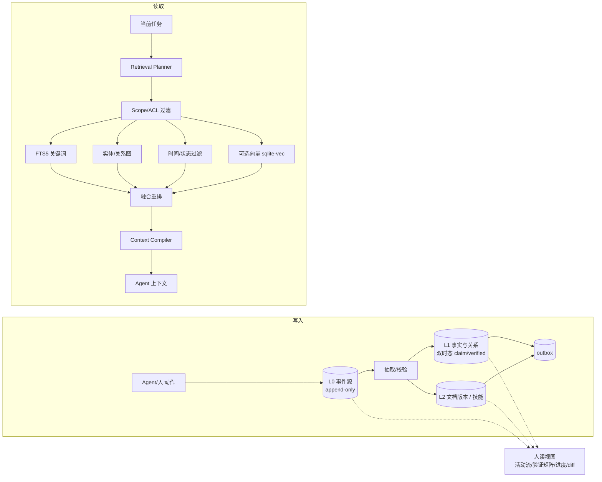

# DSH 项目工作台 · 项目记忆系统设计（万全之策 v1）

> 2026-11-11 · 配套文档：[项目工作台设计提案](project-workbench-design.zh.md)（§12.4/§12.7 的升级版）；
> 使用层（运行时行为）见 [memory-in-use-design.zh.md](memory-in-use-design.zh.md)。
> 依据：lumio 与 WorkBuddy/DSH 工作台的真实复盘材料（含 SQLite 记忆/任务板速查）+ 2026 年公开 Agent Memory
> 调研（Mem0、Zep/Graphiti、Letta、Hindsight、Cognee、LangMem、A-MEM、MemoryOS、MemOS、Memobase、Supermemory、
> Redis Agent Memory、云厂商 Memory 等）。
> 外部资料为公开信息，未独立复现；引用处已标注来源，最终以我们自己的任务评测为准。

---

## 0. 一页纸

**一句话**：项目记忆 = **事件为源、事实为图、文档为版本、简报为工作集**；SQLite 单写者 + CAS/租约 +
claim/verified + 双时态 + 混合检索 + 生成式人读视图。人永远不直接读数据库，读「生成视图」。

**四层 + 三个协议 + 两条铁律**：

| 层 | 存什么 | 性质 |
|---|---|---|
| **L0 事件源** | 发生过的动作：阶段流转、决策、领取/交接、证据、缺陷、门禁、违规、工具摘要 | append-only，项目事实唯一来源 |
| **L1 事实与关系** | 实体、属性、关系、状态；带 `observed_at / valid_from / valid_to`、置信度、来源 | 派生、双时态、可失效 |
| **L2 文档与技能** | 需求卡/ADR/契约/报告（不可变版本链）；SOP/技能/模板（程序性记忆） | 版本化、只增不改 |
| **L3 工作集与简报** | 当前阶段/周期/活跃项/待决策/风险/约束/多维状态矩阵；按任务召回的最小证据集 | 确定性派生 + Token 预算 |

**三个协议**：写入（propose → 校验 → commit + outbox）、读取（brief → recall → deep read）、蒸馏（回合/日/
周期/门禁/复盘）。

**两条铁律**：
1. **claim / verified 分离**：只有 verified 才能被 agent 当事实用；「什么没错」由状态直接回答。
2. **单写者 + CAS/租约**：agent 永远不能直接改事实；所有写入经领域服务，带 revision/epoch，过期写被拒绝。

**答案的要点（已按更正）**：lumio 的教训不是「流程文档没写好」，而是「**把流程状态放进手工 Markdown 和多个
工具的脑子里**」——它靠确定性工具链 + 单一交付入口止血；同期 WorkBuddy 第六轮把工作台记忆/任务板落到 SQLite，
用 `node:sqlite` 直接速查（scope 修正后命中率 27%→88%）。本设计把这条路线产品化：SQLite 账本 + 生成视图 +
claim/verified。

---

## 1. 从 lumio 学到的（真实证据）

### 1.1 lumio 的记忆与流程长什么样（证据）

> **更正**：上一版误读了项目——`lumio-gui`（AI 短剧生产系统，DEC-017 用 SQLite WAL 做业务事实层）是**另一个**
> 项目。真正的「流程管理失败」项目是 `C:\Users\oldap\Documents\lumio`（长期运营的 SaaS 创作工具，
> Next.js/FastAPI/PostgreSQL，main @ `b990243`，2026-11-10）。它**没有**用 SQLite 做项目记忆：记忆是
> **Markdown 四层 + 手工交接**。「SQLite 速查」只在 DSH 运行时（`session-query-sqlite`）与我们的新设计中
> 存在；另两个废弃项目（gui/agent）里的 SQLite 尝试不作结论依据，见 §1.3。

- `AGENTS.md`：权威顺序、修改前/中/后规则、协作回执、AI 收尾入口；明确规定「同一文件同一时间只能有一个写入者」、
  跨会话交接五要素、无证据的完成只能算「实现完成」。
- `docs/engineering/memory-and-handoff.md`：**四层记忆**（全局规则 / 项目决策 / 模块记忆 / 工作项记忆），全是
  Markdown；更新靠「当前交接」六字段模板；原话：「**格式通过不证明内容属实**」。
- `docs/memory/`：`project-context.md`（44 行高密度交接，含「最新交接 / 上一交接 / 上一交接…」链式堆叠）、
  `module-index.md`、`file-index.md`（**399 行人工维护的逐文件索引**）。
- `tools/engineering/`：`verify.mjs`、`ai-finish.mjs`、`coordinate.mjs`、`trunk-health.mjs`、`check-runs.mjs`、
  `merge-pr.mjs` —— 用确定性脚本给流程止血的产物。

### 1.2 「幺蛾子」清单（有证据）

| 现象 | 证据 | 本设计的机制 |
|---|---|---|
| 同一工作项反复收尾、重复 PR、平行分支 | `git log`：WI-20261109-003 → PR !4/!5/!6；WI-20261109-007 → !7/!8；同一提交反复 `ci(ai): finish` | 单一交付入口 + 单推进者；工作项状态机禁止重复收尾 |
| 静默降级（续跑沿用旧档位、跳过证据发布、隔离失效） | `DEC-20261109-005`、`WI-20261109-007` | fail-closed；档位/证据写入事件；恢复重验 |
| 多档 check-run 合并判定死锁 | `DEC-20261110-001`、`WI-20261110-001` | 判定归组 + 失败优先；门禁消费全部证据 |
| 主干分叉、陈旧记忆、失效 worktree | `DEC-20261109-001`、`WI-20261109-001`（trunk-hygiene） | 单一状态源；投影可重建；一致性审计 |
| 记忆 = 手工 Markdown 四层 + 399 行文件索引 | `docs/engineering/memory-and-handoff.md`、`docs/memory/file-index.md` | L0 事件 + 生成视图；不手工维护索引 |
| 「格式通过 ≠ 内容属实」（假绿） | 同源：checker/gate 只验形式；仪表盘空白页只验 HTTP 200 | 健康检查查真库 + 前端渲染探针 |
| 交接链无限堆叠 | `project-context.md` 的「最新/上一/上一…」结构 | 事件 + 当前投影；历史进审计归档 |
| 治理工具自身成为最大变更源 | 一天内新增 5 个工具；docs/tools 提交占 83% | 流程成本指标 + 单一入口；新工具必须替换旧工具 |
| 计数/ID/记忆不同步（COUNT_STALE / ID_DUPLICATE / 记忆重置） | `WI-20261109-001` 事实清单 | 计数/索引全部生成；唯一约束；对账门 |
| 驱动盘空白页只因少一个右括号，此前只验服务端 HTTP 200/grep | `WI-20261105-009`（仪表盘线） | 前端产物进门禁：语法/构建/真实渲染探针 |
| 分支保护对管理员无效，push/--force 均成功 | `DEC-20261104-001` | 远端只是探测器；真实闸门在本地 pre-push + 服务端事件 |

### 1.3 「SQLite 速查」到底在哪个版本

> 只看 `lumio`：它没有 SQLite 记忆；以下 WorkBuddy 六/七轮属另一条工作台改造线，仅作旁证，不作 lumio 结论。

> 结论：**lumio 本身没有 SQLite 速查版本**（截至 2026-11-10 的 main 仍是 Markdown 记忆）。
> 同一套工作台（WorkBuddy/DSH）的机制优化记录里有两个轮次，日期都是 2026-10-21：
>
> - **第六轮「机制优化」**（`luanyujia-workbench/09-改造参考/workbudy/08-后续轮次/02-机制优化-第六轮-20261021.md`）：
>   数据基准 `外壳\data\记忆库.db`（**SQLite，71 行**）与 `协作任务板.db`（SQLite，48 条）；用
>   `node -e "const{DatabaseSync}=require('node:sqlite'); ..."` 直接**速查**记忆 scope / 任务状态；发现
>   记忆 scope 大小写不一致导致注入命中率 27%（不过滤 88%）、`memory_write` 2475 次调用 0 次、任务板
>   48/48 全是 `imported:*`、ack≠accepted；提出记忆写入门/scope 归一、任务板 primary 判据。
> - **第七轮「逆向拆解」**（同目录 `03-逆向拆解-第七轮-20261021.md`）：对照 mem0 v2（scope 白名单 + 内容
>   hash + TTL + history 审计）、Temporal（lease/heartbeat/attempt）、Codex（审批闸）等，给出「抄哪段、
>   落到哪个文件、工时、硬判据」；指出 `attempt` 双计、`expire()` 重复计数等真实 bug。
>
> 所以「哪个版本」分两层：**WorkBuddy 工作台线**是第六轮（2026-10-21，SQLite 记忆库/任务板 + `node:sqlite` 速查），
> 第七轮同日续篇；**lumio 本线**则没有任何 SQLite 版本（见下）。
>
> **历史误读清理**：前两代 `lumio-gui`、`lumio-agent` 是已废弃尝试，其 SQLite 尝试不纳入本设计；
> `lumio` 本体没有任何 SQLite 记忆/速查版本。与本设计最相关的是 DSH 运行时自带的 `session-query-sqlite`
>（JSONL 会话 → 派生 FTS5 索引，`openAt: startup|first-search|never`，可整库重建、非权威）——我们直接复用，不另建。

### 1.4 从 lumio 继承的 10 条不变量（来源已校正）

1. 只有通过质量门并**冻结**的基线才能驱动下游（冻结版本 + VersionRef）。
2. 旧版本永远只读保留，返工产生新版本，不原地覆盖。
3. 执行成功 ≠ 质量通过；每个结果必须过对应质量门。
4. 迟到结果不能覆盖更新版本或已取消任务（fencing）。
5. 重试必须幂等，不能重复扣费/重复写入。
6. 每个 Agent 只能使用其 Profile 声明的工具与数据范围。
7. 渲染进程/客户端不能绕过领域服务直接改事实。
8. 同一运行只有一个推进者（我们的项目服务）。
9. **业务事实 + outbox 同一事务提交**，事件总线不能替代可靠事件记录。
10. 迁移必须保留稳定领域 ID、revision、content_hash、scope、事件序号，并提供导出校验/回滚/恢复演练。

> 来源：lumio `AGENTS.md`、`docs/engineering/`、DEC-20261109-001/003/005、DEC-20261110-001。
> 这 10 条会原样进入本设计的「不变量清单」（§11），并补上人读、防冗余、记忆评测三条。

### 1.5 从 lumio 复盘提炼的 10 条「机制判据」（配合 Git/CI 复盘）

| # | 他们的坑 | 插件做法 | 硬判据 |
|---|---|---|---|
| 1 | 门禁只写在文档、真实路径不执行（chmod 掩盖钩子失效） | 每阶段门禁三层：写下来 / 可机检 / 真实交付路径必跑 | 每个 gate 带 gateId + 命令 + 负向 fixture + 最近失败退出码 |
| 2 | 把「探测器」当「闸门」（远端分支保护对管理员无效） | 区分闸门与探测器；UI 不许把 CI 绿写成「已批准」 | 批准必须有人类事件；CI 只产生证据 |
| 3 | 两代收尾工具并存 → 同一主题重复收尾 8 次 / 8 个同标题提交 | 单一交付链、单一机制表述；开工前自检 | `start` 时检测同工作项已有开放 PR/分支则拒绝再开 |
| 4 | 编号/认领不原子（目录级 claim 锁死；DEC 撞号） | DB 唯一约束 + 事务分配；claim 支持 glob/子路径 | 重复 ID 写入必须失败；claim 过期不可写 |
| 5 | 状态只分「做/没做」，未回执/未知/未验证缺失（36 条通知仅 8 条真送达） | 显式建模未回执/未知/未验证；失败关闭 | 缺证据即报错；禁布尔 done |
| 6 | 收尾不对账（EV_MISSING / MEMORY_BEHIND / COUNT_STALE） | 收尾对账门：证据、记忆、计数、工作项状态、恢复路径 | 五类对账任一失败即拒绝收尾 |
| 7 | 记忆不分层、入口塞全文（44 行交接 vs 399 行索引） | 私有交接单文件带 revision 覆盖写；共享索引工具生成；常驻≤预算 | 入口文件超预算即告警；索引手工改即失败 |
| 8 | 计数/索引手抄（62/215 vs 261） | 所有计数由工具从权威源生成并对比 | 手写数字进文档 → checker 失败 |
| 9 | SQLite 一库混用（权威 + 检索） | **两库分离**：权威库 append-only 版本表+hash+CAS；检索库独立文件、可 drop 重建、可 `openAt:never` | 检索库删除后能从权威库重建并通过对照 |
| 10 | 迁移一步切（无镜像/回填/双读） | 镜像→幂等回填→双读逐字段对照→按读路径分阶段开关→R1–R6 门槛→legacy 默认可回滚；删除要 owner 裁决+期限 | 每阶段有对照报告；回滚演练通过才切 |

> 另：流程迁移必须带清扫（旧工具/旧文档/旧分支不能并存）——lumio 的 `--commit --push` → `--pr` 迁移就
> 是没清扫，直接导致 8 次重复收尾（见 [Git/CI 复盘](lumio-git-ci-postmortem.zh.md) §2 R2）。

---

## 2. 开源 Agent Memory 调研（2026 公开信息）

### 2.1 边界：记忆 ≠ 上下文 ≠ RAG ≠ Checkpoint

| 机制 | 保存什么 | 主动演进 | 是否完整记忆 |
|---|---|---:|---:|
| Context Window | 当前提示、最近消息、工具结果 | 否 | 否 |
| Compaction/Summary | 压缩后的历史 | 少量 | 否 |
| Session | 会话消息与基础状态 | 通常否 | 部分 |
| Checkpoint | 工作流节点、执行状态、游标 | 否 | 部分 |
| RAG | 文档/知识 | 通常只读 | 否 |
| **Agent Memory** | 事实、偏好、经历、决策、经验、技能 | **是** | **是** |
| Skill/Prompt | 可复用方法与规则 | 可演进 | 属于程序性记忆 |

### 2.2 主流系统速览与可借鉴点

| 系统 | 路线 | 核心机制 | 可借鉴 | 不足/风险 |
|---|---|---|---|---|
| **Mem0** | 通用 Memory API | 事实抽取 + 旧记忆对比 → `ADD/UPDATE/DELETE/NOOP`；向量（+可选图） | 写入时的冲突裁决算法；作用域隔离 | 图能力在付费层；自动抽取质量依赖模型；程序性记忆弱 |
| **Zep / Graphiti** | 时序知识图谱 | Episode → 实体/关系事实，带 `valid_at/invalid_at`；图+向量+全文+时间混合 | **双时态事实**、多跳、时间推理、可解释召回 | 图构建/实体消歧成本高 |
| **Letta / MemGPT** | Memory-Native Runtime | Core / Recall / Archival 分层；Agent 自编辑记忆块 | 分层与 Token 预算；Agent 主动整理（我们改成 propose/commit） | Runtime 重；自编辑需要治理，否则污染 |
| **Hindsight** | 经验反思 | `retain / recall / reflect`；语义+BM25+图+时间四路检索 + rerank | **多策略检索**、从轨迹提炼经验（Mental Model） | 反思可能错误归因，必须验证与标注 |
| **LangMem** | 框架扩展 | 语义/情景/程序性记忆；hot path + background | 程序性记忆与 prompt 改进 | 框架绑定强；无图/时间能力 |
| **Cognee** | 知识工程 | 文档/数据 → 图 + 向量 + 本体；`remember/recall/improve/forget` | 多源知识管线；本体与关系 | 对轻量项目偏重 |
| **A-MEM** | 研究 | Zettelkasten 式笔记网络：结构化属性 + 动态链接 + 记忆演化 | **记忆之间主动建链**、随新信息演化 | 尚未工程化 |
| **MemoryOS** | 研究 | 短期/中期/长期分层 + 遗忘曲线聚合 | 分层聚合、遗忘机制 | 偏对话画像 |
| **MemOS** | 研究 | 文本/激活/参数记忆统一生命周期 | 生命周期状态机（生成→激活→合并→归档→冻结） | 前沿，生产成熟度待验证 |
| **Memobase / Supermemory** | 用户画像/上下文基础设施 | Profile + 事件 + 主题；多源连接器 | 用户/项目画像分层；连接器思路 | 托管/闭源，本地优先不适用 |
| **Redis Agent Memory** | 基础设施 | Session Events + 长期事实 + 混合检索 | 实时写入、TTL、作用域过滤 | 上层治理（抽取/冲突/反思）仍需自建 |
| **文件型记忆**（CLAUDE.md / AGENTS.md） | 项目规则 | 本地可见、git 可审计 | 项目规则/约束的承载方式 | **不能当锁**；语义检索弱、时间/冲突能力差 |

### 2.3 该抄的设计（15 条）

1. **事件（episode）是源，事实是派生**（Graphiti/Generative Agents）：原始事件永不重写。
2. **双时态**：`observed_at`（系统何时看到）、`valid_from/valid_to`（世界何时成立）。
3. **写入时抽取 + 冲突裁决**：ADD/UPDATE/SUPERSEDE/INVALIDATE/MERGE/NOOP（Mem0）。
4. **作用域先行**：先 ACL/Scope 过滤，再检索（避免越权数据进入检索/日志/缓存）。
5. **多策略检索 + 重排**：关键词/BM25 + 向量 + 图 + 时间，融合重排（Hindsight）。
6. **分层上下文**：core/working、recall、archival，按 Token 预算注入（Letta）。
7. **记忆之间主动建链**：新记忆与既有记忆形成引用（A-MEM），支撑「为什么」。
8. **生命周期状态机**：candidate→active→superseded/expired→archived（MemOS/MemoryOS）。
9. **蒸馏与反思**：定期把经历压缩为经验；反思必须标「候选」，不能直接当事实。
10. **程序性记忆升级门禁**：经验→离线回放→影子评测→灰度→可回滚（Hindsight/LangMem 思路）。
11. **provider-neutral Memory Port**：业务只依赖接口，后端可换（本地 SQLite/Graphiti/Mem0）。
12. **权威数据与派生索引分离**：索引可删可重建，带构建版本与内容哈希。
13. **Context Compiler**：不是 Top-K 拼接，而是按任务类型/预算结构化编译。
14. **删除与遗忘传播**：删除要传播到全文/向量/图/缓存/备份，并给出证明。
15. **可解释记忆 UI**：来源、适用范围、有效性、召回历史、对任务的影响。

### 2.4 别抄的坑（10 条）

1. 把整段聊天/原始日志直接塞进向量库当记忆。
2. 只做向量检索（术语不一致时直接漏召回）。
3. 让 agent 直接改「核心记忆」（无 propose/commit、无审计）。
4. 自动反思直接当事实（错误归因会污染后续决策）。
5. 用单一「完成」状态掩盖需求/实现/验证/验收/发布的差距。
6. 把 Markdown/分支名/PR 描述当任务锁或实时状态源。
7. 多个工具各自维护实时状态。
8. 无作用域/权限过滤就做全库检索。
9. 只测 LoCoMo/LongMemEval 分数，不测「对真实任务有没有帮助」。
10. 忽略删除、审计、恢复、迁移——上线后再补代价极高。

> 公开 benchmark（LoCoMo、LongMemEval 等）只测**对话式长期记忆**，不测「任务是否变好」；不同厂商的分数来自
> 不同数据子集/Judge，不能当统一排行榜。我们以自有项目任务评测为主、benchmark 为参考。

---

### 2.5 开源实现的审计发现（第三方源码审计，2026-11）

> 来源：独立审计库 [agent-memory-atlas](https://github.com/neoneye/agent-memory-atlas) 对多个开源实现的逐行核对。
> 这些不是「理论风险」，是真实代码里的 bug；我们的设计要显式规避并写测试。

| 系统 | 审计发现 | 对我们的要求 |
|---|---|---|
| MemoryBank | 衰减公式 `exp(-t/5*S)` 被解析成 `((-t)/5)*S`，强度越高衰减越快；遗忘是 `pop` + 原地重写，且遍历所有用户；`memory_id=user_date_i` 用列表下标做身份 | 衰减/置信度函数写**单调性测试**；删除软删 + tombstone；ID 用确定性 hash，不用列表下标 |
| MemoryOS | 热度 `last_visit_time` 在算衰减前被更新，`R_recency≡1`；`N_visit` 与 `access_frequency` 两套计数；评测脚本与发布默认不一致 | 公式必须可单测；评测脚本与发布配置同源；热度/置信度不作为唯一生命周期依据 |
| A-MEM | memory evolution 静默改写旧 note，无版本历史 | 旧记忆只能 superseded，不静默改写；链接/演化作为独立可审计事件 |
| Mem0（base） | DELETE 是硬删，历史丢失 | 我们只提供软删（status=rejected）+ 审计 |
| Cognee | 写了 `contradicts` 边但检索器不读；`valid_to` 有 schema 无写入/读取方 | **冲突标记必须被检索与排序消费**，否则等于没做 |
| Graphiti 参考 server | 明确无鉴权、无 prompt 注入防护，不要暴露公网 | 记忆服务只在本机/受控进程内，鉴权在 DSH 会话层 |
| MemoryOS / MemoryBank | 长记忆压成一根 merged string / 无 per-fact 身份 | 每条记忆独立 ID、可纠正、可删除、可溯源 |

**提炼成 4 条强制测试（进入 CI）**：

1. 衰减/置信度函数单调性测试（强度↑保持率↑；时间↑保持率↓）。
2. 加载路径禁止破坏性变更（建索引不得删除/遗忘任何记忆）。
3. 冲突标记必须被检索消费（构造冲突 → 检索结果必须体现当前事实或争议）。
4. ID 稳定性测试（插入/删除中间项后，其他记忆 ID 不变）。

### 2.6 几个可直接抄的「实现级」细节

| 来源 | 细节 | 我们怎么用 |
|---|---|---|
| Mem0 | 写入循环：抽取候选 → 检索 top-10 相似旧记忆 → LLM 选择 `ADD/UPDATE/DELETE/NOOP` | 收缩为 `ADD/SUPERSEDE/NOOP`；DELETE 改软删；LLM 只做候选判定，commit 由服务执行 |
| Zep/Graphiti | 四个时间戳：`created_at`（我何时得知）、`valid_at`（事实何时为真）、`invalid_at`（何时不再为真）、`expired_at`（我何时得知失效） | 我们的 `observed_at/valid_from/valid_to/recorded_at` 补齐 `expired_at`（得知失效的时间） |
| Letta | 并发语义分级：append 安全、replace 单写者、rethink/整块覆写会丢更新；块常驻 2000~5000 字符、5~15 块 | 常驻四块（§3.5）+ 写租约；整块覆写只允许持有租约的写者 |
| Cognee | 源数据保全 + `add` / `cognify` 分离 + 按 pipeline run 回滚 + 检索前鉴权 | 事件源与投影分离；抽取失败可重跑；scope 过滤先于检索 |
| Memobase | 结构化 schema 画像（8 类 ~40 槽位）+ 事件时间线 + gist；缓冲到 1024 token 才 flush，每次固定 3 次 LLM 调用；读取路径不打 LLM | 记忆抽取走冷路径、批量、固定调用数；读取只走 SQL/FTS |
| LangMem | profile（只要最新状态）vs collection（不能丢信息）；相关性 = similarity + importance + strength | 决策/约束用 profile 式覆盖；事件/教训用 collection 式追加 |
| Supermemory | 版本链 + 三种关系 `updates/extends/derives`；`forgetAfter + forgetReason` | 关系类型进 `links`；过期要带理由 |
| sqlite-vec / FTS5 | sqlite-vec 仍是 pre-v1、以暴力 KNN 为主；FTS5 的 `trigram` 分词对代码标识符/路径/错误码极有用 | **FTS5 是第一公民**；向量只在万级内启用，且可重建 |

---

## 3. 我们的记忆架构（万全之策）

### 3.1 设计目标与非目标

| 目标 | 非目标 |
|---|---|
| Agent 少读、读对（Token 经济） | 不做通用 SaaS Memory 平台 |
| 人一眼看懂（做了什么/什么没错/进度） | 不做「无限上下文」 |
| 审计可追溯、可回放、可恢复 | 不把聊天原文当知识 |
| 防冗余/防冲突、本地优先 | 不依赖外部向量库/云服务（可选扩展） |
| 记忆质量可评测、可演进 | 不追求拟人化人格记忆 |

### 3.2 架构图



### 3.3 四层记忆详表

| 层 | 内容 | 存储 | 谁写 | 生命周期 | 怎么读 |
|---|---|---|---|---|---|
| **L0 事件** | 阶段流转、决策、领取/交接、证据、缺陷、门禁、违规、工具摘要、评审 | `memory_events`（append-only） | 项目服务（由工具/UI/门禁触发） | 永久（归档） | 时间线/按实体/按链 |
| **L1 事实与关系** | 实体、属性、关系、状态、契约、角色、依赖 | `entities`、`facts`、`links` | 抽取器 + 人审核 | 双时态；可 superseded/expired | FTS + 图 + 时间过滤 |
| **L2 文档与技能** | 需求卡、ADR、契约、报告、SOP、模板 | `docs` + `doc_versions` + 文件 | BA/架构/PM/人 | 不可变版本链 | 版本/状态/引用 |
| **L3 工作集** | brief：阶段/周期/活跃项/待决策/风险/约束/多维状态 | 确定性视图（不存副本） | 系统 | 每步重建 | 自动注入（≤2k） |

### 3.4 跨层辅助表

- `artifacts`：代码/测试输出/截图/交付物 → URI + hash，不进上下文。
- `lessons`：教训/反模式/根因，带触发标签。
- `procedures`：可执行 SOP/技能（版本化）；与 `.dsh/skills` 双向映射。
- `claims`：实体写租约（session_id、epoch、expires_at、version）。
- `outbox`：可靠事件（与事实同事务），供 UI/通知/外部集成消费。
- `checkpoints`：运行恢复点。
- `model_runs`：模型评测台账（谁适合干什么）。
- `audit_log`：只追加的审计事实（谁在何时做了什么，基于什么）。

---

### 3.5 叙事型记忆与四块常驻

除了结构化事实，项目里大量知识是「叙事型」的：决策理由、约束、约定、坑、状态。用一个统一的 `memories` 表承载
（字段：id 确定性 hash、kind、scope、text、status、confidence、source_kind、source_ref、valid_from/valid_to、
supersedes_id、hash），**没有 `source_ref` 的记忆不允许 `verified`**。

常驻上下文固定四个块，每块硬上限：

| 块 | 内容 | 建议预算 |
|---|---|---|
| `project_brief` | 项目是什么、技术栈、入口、关键路径 | ≤600 tokens |
| `decisions` | 近 N 条决策（日期 + 理由 + 影响） | ≤600 tokens |
| `constraints` | 不可违反的约定（架构/合规/接口） | ≤400 tokens |
| `active_work` | 当前周期/任务/阻塞/待决策 | ≤400 tokens |

超限时降级为指针列表（id + 一行摘要），由模型按需 `memory_recall` 展开。**常驻区永远是指针/摘要，不是全文**。

---

## 4. 写入协议（propose → validate → commit）

### 4.1 双路径

| 路径 | 何时 | 例子 |
|---|---|---|
| **同步（hot path）** | 用户明确要求记住、安全/权限规则、后续步骤立即需要、不可丢失的决策 | 「确认 A 方案」→ 决策事件 + fact |
| **后台（background）** | 画像/摘要/去重/冲突合并/图构建/经验提炼/低优先嵌入 | 回合结束后 PM 批量提交摘要 |

### 4.2 写入步骤

```text
1. observe   : 动作/文本/结果 → 写 L0 事件（原始、带来源、session、时间）
2. extract   : 抽取候选（事实/关系/决策/教训/文档/程序）
3. validate  : schema、scope/ACL、幂等键、content_hash 去重、证据检查
4. arbitrate  : 与既有事实比较 → ADD / UPDATE / SUPERSEDE / INVALIDATE / MERGE / NOOP
5. commit    : 单事务写 facts/docs + outbox（+ revision 递增）；返回 receipt
6. index     : FTS/关系/可选向量更新（派生，可重建）
```

### 4.3 硬规则

- **Agent 不能直接写事实**：只能 `memory_propose`；项目服务校验后 commit。人通过 UI/命令有等价入口。
- **CAS + 租约**：写实体必须持 `claims`（session + epoch，TTL）；epoch 不匹配（迟到请求）→ 拒绝；
  过期租约不能写；转交需显式 transfer 并记录。
- **幂等键**：每次 propose 带 `idempotency_key`；重复提交返回同一结果。
- **去重**：`content_hash`；同一 `logical_key` 只允许一个 canonical。
- **操作集收敛**：只允许 `ADD / SUPERSEDE / NOOP`；删除是 `status=rejected` 软删 + 审计；不提供物理 DELETE。
- **来源**：`source_ref`（path:line / commit sha / tool_call_id / url）为空时不允许 `verified`。
- **verified 必须有证据**：证据 = 事件/artifact/测试输出/命令输出（含环境与时间）。
- **多维状态**：实体不是单一 `done`，而是 `requirement/implementation/verification/acceptance/release` 五维。
- **写回执**：commit 返回 `{revision, eventIds, outboxIds, memoryIds}`，调用方记录。

---

## 5. 冲突与时效（本设计的核心算法）

### 5.1 双时态事实

```yaml
fact:
  id: fact_...
  subject: entity:svc-auth
  predicate: uses_database
  object: postgres
  observed_at: 2026-03-01T10:00:00Z   # 系统何时看到
  valid_from: 2025-01-01              # 世界中何时开始成立
  valid_to: 2026-02-28                # 世界中何时失效（null = 当前有效）
  recorded_at: 2026-03-01T10:00:00Z   # 系统何时记录
  confidence: 0.9
  status: verified                    # claimed/verified/disputed/superseded/expired
  source_event_ids: [ev_...]
  evidence_ids: [EV-...]
  revision: 3
```

- 新事实不是「覆盖」，而是**关闭旧区间 + 开启新区间**；历史永远可查。
- 查询默认只返回 `valid_to IS NULL AND status != 'superseded'` 的当前事实；「当时是什么」用时间旅行查询。

### 5.2 冲突判定与处理

```text
同 subject + predicate：
  ├─ 对象相同 → NOOP（或补充置信度）
  ├─ 对象不同且有效区间重叠 → 冲突
  │    ├─ 新事实有更强证据 → 提案 SUPERSEDE（关旧开新），生成审计事件
  │    └─ 证据不足/双方可信 → 进入 dispute queue → 决策卡给人裁决
  └─ 有效区间不重叠 → 正常的新旧事实
```

**四级冲突流水线（默认实现）**：

1. 确定性 ID/hash 命中 → `NOOP`；
2. 同 scope/kind 且来源均 `verified` → 新者 `SUPERSEDE` 旧者（保留双记录）；
3. `verified` 与 `claimed` 冲突 → verified 胜，claimed 标 `contradicted_by`；
4. 双 `verified` 真矛盾 → 挂 `needs_review`，进决策卡，**绝不自动二选一**。

- **不自动合并自由文本**：合并只发生在结构化事实；文档冲突走「合并决策卡」。
- **dispute queue** 在驾驶舱可见；未裁决的冲突阻止相关门禁（fail-closed）。
- **真相层级**：运行结果/测试 > 已验证证据 > 数据库事实 > agent 声明；冲突升级到人。

### 5.3 迟到、取消与恢复

- 每次写入校验目标实体的 `revision + epoch`；**迟到写一律拒绝**并返回原因。
- 取消/迭代后，旧任务结果标记 `orphaned`，不进当前事实。
- 恢复时从最后一个 checkpoint 继续，并**重新验证上游版本是否仍有效**；失效链路标 `stale` 并生成重验任务。

---

## 6. 读取协议与上下文编译

### 6.1 三层读取

| 层 | 内容 | 方式 | 预算 |
|---|---|---|---|
| **L0 brief** | 阶段/周期/活跃项/待决策/Top 风险/约束/约定/多维状态摘要 | preset prompt context 自动注入（确定性生成） | ≤2k tokens |
| **L1 任务相关** | 需求卡、相关 ADR/契约、相似历史工作项、相关教训、证据摘要 | `memory_recall(query, kinds, entity, budget)` | ≤4k |
| **L2 深读** | 全文、代码、git 历史、会话检索、artifact | 工具按需 | 单次 ≤8k |

### 6.2 Retrieval Planner

```text
1. Scope/ACL 过滤（必须先做；负向测试：A 查 B 必须报错）
2. FTS5 关键词（trigram 分词优先：代码标识符/路径/错误码/issue 号）
3. 实体/关系图扩展（一跳/两跳，带关系类型）
4. 时间/状态过滤（默认只当前有效；历史查询显式开启）
5. 可选向量召回（Phase 2：sqlite-vec，pre-v1，万级内可用）
6. RRF 融合 + 重排（关键词权重最高；再乘时效/可信度/重要性；除以 Token 成本）
7. Context Compiler（结构化 + 预算 + 来源/时间/状态标签 + 截断标记）

返回必须带 `source_ref` 与时间；提供 `explain` 说明召回原因。
```

每条注入内容附：`[类型][作用域][有效时间][来源][置信度][召回原因]`，并明确标注截断。

### 6.3 Context Compiler 预算参考

| 内容 | 占比 |
|---|---:|
| 系统规则/人设 | 20% |
| 当前任务/计划/状态 | 25% |
| 最近对话 | 20% |
| 高优先事实/约束 | 10% |
| 相关经历/教训 | 10% |
| 程序性经验 | 10% |
| 引用/安全余量 | 5% |

---

## 7. 蒸馏、程序性记忆升级与遗忘

### 7.1 蒸馏节奏

| 时点 | 动作 | 产物 |
|---|---|---|
| 回合结束 | PM 写 handoff + 事实提案 | 事件 + 候选事实 |
| 每日 | 活动流 → 日报 | `reports/daily/` |
| 每周期 | Cycle brief + lessons | `docs(kind=cycle-brief)` + `lessons` |
| 每门禁 | 基线快照 + checkpoint | 导出快照 + 审计锚点 |
| 复盘 | 根因/反模式 → lessons | 可触发后续任务召回 |

> 蒸馏用**确定性模板 + 廉价模型润色**；事实不许模型生成。

### 7.2 程序性记忆升级门禁

```text
经验（lesson/reflection candidate）
  → 证据验证（复现/反例）
  → 离线回放（历史任务集）
  → 影子评测（不影响主线，对比成功率）
  → 人类批准
  → 灰度启用（部分任务）
  → 持续监控负迁移
  → 回滚或提升为正式 procedure
```

### 7.3 遗忘与保留

| 对象 | 策略 |
|---|---|
| 工作集/缓存 | 每步重建，不做持久 |
| L1 事实 | 失效/替代保留历史；过期归档不物理删 |
| L2 文档 | 版本永久保留；superseded 只读 |
| artifacts | 按保留期清理（策略可配）；证据哈希保留 |
| L0 事件 | 永久审计（可归档冷存） |
| 密钥/敏感 | 写前扫描拦截；永不入库 |

---

## 8. 人读层：一键回答「AI 做了什么 / 什么没错 / 到哪了」

| 视图 | 内容 | 解决的问题 |
|---|---|---|
| **活动流 Timeline** | 谁（agent/人）→ 做了什么 → 状态（claimed/verified/disputed）→ 证据 → 时间 | AI 做了什么 |
| **验证矩阵** | 实体 × 需求/实现/验证/验收/发布 五维状态（来自 lumio 教训） | 什么没错、别被一个「完成」骗 |
| **进度** | Verified Done 计数、里程碑、周期、门禁 | 到哪了 |
| **记忆 diff** | 文档/事实两版本差异（谁改/为什么/证据） | 为什么变了 |
| **「为什么」链** | 需求↔决策↔工作项↔证据↔提交 | 凭什么这么做 |
| **决策收件箱** | 待裁决：冲突/范围/发布/不可逆动作 | 现在要我决定什么 |
| **记忆健康** | 召回命中、过期事实、重复率、注入 tokens、人工纠正 | 记忆本身靠不靠谱 |

**另导出 `MEMORY.md`**：按 kind 分节，每条带来源链接与状态；UI 支持逐条编辑/否决/钉住（参考 OpenMemory 的
「可看可删」形态，是信任的前提）。

**实现**：以上全部来自 SQLite 视图/查询，**由插件生成**；同时导出 Markdown/HTML：
`.dsh/project/**`（可 git、GitHub 可看）、`project_export --format site`（离线站点）、
`project_search`（FTS）。**人不需要读 SQL**；power user 可用 `sqlite3` 附带的查询示例。

---

## 9. SQLite 落地

### 9.1 位置与运行方式

- 库：`.dsh/memory/project.sqlite`（**不入 git**）；导出物入 git。
- `PRAGMA journal_mode=WAL; synchronous=NORMAL; foreign_keys=ON; busy_timeout=5000;`
- 单写者：Host 项目服务；读多写少；写事务短小，事实 + outbox 同事务。
- 驱动：Node 24 内置 `node:sqlite`（本机已验证）；避免 `better-sqlite3` 原生编译/ABI 问题。
- 备份：每日 `VACUUM INTO` 快照 + 门禁导出；恢复演练纳入发布检查。

### 9.2 Schema（核心表，合并 §12.4/§12.7 并扩展）

```sql
PRAGMA journal_mode = WAL;
PRAGMA foreign_keys = ON;
PRAGMA busy_timeout = 5000;

CREATE TABLE projects (
  id TEXT PRIMARY KEY, name TEXT NOT NULL,
  stage TEXT NOT NULL, cycle INTEGER NOT NULL DEFAULT 0,
  process_profile_json TEXT NOT NULL,
  revision INTEGER NOT NULL DEFAULT 1,
  created_at TEXT NOT NULL, updated_at TEXT NOT NULL
);

-- L0：原始事件（append-only，唯一事实来源）
CREATE TABLE memory_events (
  id TEXT PRIMARY KEY, project_id TEXT NOT NULL REFERENCES projects(id),
  kind TEXT NOT NULL,                -- stage/changed/decision/claim/handoff/evidence/defect/gate/violation/tool-summary
  entity TEXT, entity_id TEXT,
  actor_kind TEXT NOT NULL,          -- agent/human/system
  actor_id TEXT, session_id TEXT,
  payload_json TEXT NOT NULL,
  idempotency_key TEXT UNIQUE,
  at TEXT NOT NULL
);
CREATE INDEX idx_events_entity ON memory_events(entity, entity_id, at);

-- L1：实体 / 事实（双时态）/ 关系 / 争议
CREATE TABLE entities (
  id TEXT PRIMARY KEY, project_id TEXT NOT NULL, type TEXT NOT NULL,
  name TEXT NOT NULL, status_json TEXT NOT NULL,   -- 多维状态
  revision INTEGER NOT NULL DEFAULT 1, updated_at TEXT NOT NULL
);
CREATE TABLE facts (
  id TEXT PRIMARY KEY, project_id TEXT NOT NULL,
  subject TEXT NOT NULL, predicate TEXT NOT NULL, object TEXT NOT NULL,
  observed_at TEXT NOT NULL, valid_from TEXT, valid_to TEXT, expired_at TEXT,
  recorded_at TEXT NOT NULL, confidence REAL NOT NULL DEFAULT 0.5,
  status TEXT NOT NULL DEFAULT 'claimed',          -- claimed/verified/disputed/superseded/expired
  source_event_ids_json TEXT NOT NULL, evidence_ids_json TEXT NOT NULL DEFAULT '[]',
  supersedes_id TEXT, revision INTEGER NOT NULL DEFAULT 1
);
CREATE INDEX idx_facts_current ON facts(project_id, subject, predicate) WHERE valid_to IS NULL;

-- 叙事型记忆（决策/约束/约定/坑/状态），检索主入口
CREATE TABLE memories (
  id TEXT PRIMARY KEY,                    -- 确定性 hash
  project_id TEXT NOT NULL REFERENCES projects(id),
  kind TEXT NOT NULL,                     -- decision/constraint/convention/pitfall/status/fact
  scope TEXT NOT NULL,                    -- project/module/file/symbol
  text TEXT NOT NULL,
  status TEXT NOT NULL DEFAULT 'claimed', -- verified/claimed/derived/superseded/rejected/needs_review
  confidence REAL NOT NULL DEFAULT 0.5,
  source_kind TEXT NOT NULL,              -- git/ci/tool/user/agent/doc
  source_ref TEXT,                        -- path:line / commit sha / tool_call_id / url
  valid_from TEXT, valid_to TEXT,
  created_at TEXT NOT NULL,
  supersedes_id TEXT,
  content_hash TEXT NOT NULL,
  revision INTEGER NOT NULL DEFAULT 1,
  CHECK (status != 'verified' OR source_ref IS NOT NULL)
);
CREATE INDEX idx_memories_scope ON memories(project_id, scope, kind, status);
-- 派生索引：FTS5 external-content + 可选 sqlite-vec（vec0；pre-v1，万级内够用，可重建）
CREATE TABLE links (
  src TEXT NOT NULL, dst TEXT NOT NULL, rel TEXT NOT NULL CHECK (rel IN ('supports','contradicts','derived_from','verifies','references','supersedes','part_of')),
  created_at TEXT NOT NULL, PRIMARY KEY (src, dst, rel)
);
CREATE TABLE disputes (
  id TEXT PRIMARY KEY, project_id TEXT NOT NULL,
  fact_ids_json TEXT NOT NULL, reason TEXT NOT NULL,
  status TEXT NOT NULL DEFAULT 'open',             -- open/adjudicated/rejected
  decision_id TEXT, created_at TEXT NOT NULL, resolved_at TEXT
);

-- L2：文档与技能（不可变版本）
CREATE TABLE docs (
  id TEXT PRIMARY KEY, project_id TEXT NOT NULL, kind TEXT NOT NULL,
  logical_key TEXT NOT NULL, title TEXT NOT NULL, owner_role TEXT,
  status TEXT NOT NULL DEFAULT 'draft',            -- draft/review/approved/superseded
  current_version_id TEXT, canonical INTEGER NOT NULL DEFAULT 1,
  revision INTEGER NOT NULL DEFAULT 1, UNIQUE(project_id, kind, logical_key)
);
CREATE TABLE doc_versions (
  id TEXT PRIMARY KEY, doc_id TEXT NOT NULL REFERENCES docs(id),
  revision INTEGER NOT NULL, content_hash TEXT NOT NULL,
  media_type TEXT NOT NULL, content TEXT NOT NULL,
  author_kind TEXT NOT NULL, author_id TEXT, session_id TEXT, commit_sha TEXT, model TEXT,
  created_at TEXT NOT NULL, UNIQUE(doc_id, revision)
);
CREATE TABLE artifacts (
  id TEXT PRIMARY KEY, project_id TEXT NOT NULL, kind TEXT NOT NULL,
  uri TEXT NOT NULL, content_hash TEXT NOT NULL, bytes INTEGER NOT NULL, metadata_json TEXT
);
CREATE TABLE procedures (
  id TEXT PRIMARY KEY, project_id TEXT, name TEXT NOT NULL, version TEXT NOT NULL,
  skill_path TEXT, content_hash TEXT NOT NULL,
  status TEXT NOT NULL DEFAULT 'candidate',        -- candidate/shadow/active/rolled_back
  evidence_json TEXT, approved_by TEXT, created_at TEXT NOT NULL
);
CREATE TABLE lessons (
  id TEXT PRIMARY KEY, project_id TEXT NOT NULL,
  title TEXT NOT NULL, root_cause TEXT NOT NULL, anti_pattern TEXT NOT NULL,
  trigger_tags_json TEXT NOT NULL, status TEXT NOT NULL DEFAULT 'active', created_at TEXT NOT NULL
);
CREATE TABLE glossary (term TEXT PRIMARY KEY, project_id TEXT NOT NULL, definition TEXT NOT NULL, aliases_json TEXT);

-- 协作与可靠性
CREATE TABLE claims (
  entity_id TEXT PRIMARY KEY, project_id TEXT NOT NULL,
  session_id TEXT NOT NULL, epoch INTEGER NOT NULL,
  expires_at TEXT NOT NULL
);
CREATE TABLE outbox (
  id INTEGER PRIMARY KEY AUTOINCREMENT, project_id TEXT NOT NULL,
  topic TEXT NOT NULL, payload_json TEXT NOT NULL,
  created_at TEXT NOT NULL, delivered_at TEXT
);
CREATE TABLE checkpoints (
  id TEXT PRIMARY KEY, project_id TEXT NOT NULL, run_id TEXT NOT NULL,
  seq INTEGER NOT NULL, state_json TEXT NOT NULL, created_at TEXT NOT NULL
);
CREATE TABLE model_runs (
  id INTEGER PRIMARY KEY AUTOINCREMENT, at TEXT NOT NULL,
  project_id TEXT, work_item_id TEXT, task_type TEXT NOT NULL,
  provider TEXT NOT NULL, model TEXT NOT NULL, route_tier TEXT,
  outcome TEXT NOT NULL, rework_count INTEGER DEFAULT 0,
  tokens_in INTEGER, tokens_out INTEGER, cost_cny REAL, latency_ms INTEGER,
  failure_mode TEXT, human_rating INTEGER
);
CREATE TABLE audit_log (
  id INTEGER PRIMARY KEY AUTOINCREMENT, at TEXT NOT NULL,
  actor_kind TEXT NOT NULL, actor_id TEXT, session_id TEXT,
  action TEXT NOT NULL, entity TEXT, entity_id TEXT, detail_json TEXT NOT NULL
);

-- 检索（派生、可重建）
CREATE VIRTUAL TABLE memory_fts USING fts5(content, title, tokenize='unicode61');
-- Phase 2 可选：CREATE VIRTUAL TABLE memory_vec USING vec0(embedding float[768]);
```

### 9.3 工作集视图（确定性生成）

```sql
CREATE VIEW working_set AS
SELECT 'stage' AS key, stage AS value FROM projects
UNION ALL SELECT 'pending_decisions', CAST(COUNT(*) AS TEXT) FROM disputes WHERE status='open'
UNION ALL SELECT 'active_items', CAST(COUNT(*) AS TEXT) FROM entities WHERE type='work-item'
  AND status_json->>'implementation' IN ('in_progress','in_review');
```

### 9.4 性能与规模

- 索引：`(project_id, subject, predicate) WHERE valid_to IS NULL`、`(entity, entity_id, at)`、`doc_versions(content_hash)`。
- FTS5 分词：中文用 `unicode61` + 每字切分或外部分词（按实际需要）；标题/正文分列。
- 大文本入 `doc_versions`（压缩）；二进制只存 `artifacts` URI。
- 单项目预期：10^4~10^6 行、毫秒级 FTS、WAL 下并发读。
- 迁移：`schema_version` 表 + `PRAGMA user_version`；升级先备份 + `VACUUM INTO`。

### 9.5 两库分离：权威库 + 检索库（来自 DSH / lumio-agent 的实证）

> DSH `session-query-sqlite` 的结构值得照抄：**权威会话是 JSONL(+Zstd)，SQLite 只是派生 FTS5 索引**；索引可整库
> 重建，`openAt: never` 时完全不参与；README 明确不要把它指向权威库。lumio-agent 的 artifact registry（LB-039）
> 则证明：**整 unit JSON 重写 → per-record 版本表**是必要的（"a whole-unit JSON rewrite per append would make
> every write touch the complete history"）。

| 库 | 文件 | 内容 | 规则 |
|---|---|---|---|
| **权威库** | `.dsh/memory/project.sqlite` | 事件、事实、文档版本、claims/outbox/checkpoints、审计 | 单写者；WAL；**不做全文检索**（避免长事务/索引耦合） |
| **检索库** | `.dsh/memory/project-search.sqlite` | FTS5 索引 + 可选 sqlite-vec + 派生摘要 | 可随时删除重建；`openAt: never` 可关闭；构建带源 revision/content_hash |

- 重建命令 `project_reindex`：从权威库全量重建检索库，并输出对照报告（条数/哈希抽样）。
- 检索库损坏 → 删除重建，不影响权威数据；检索库缺失 → 功能降级为「无检索，只读 brief」。
- 会话检索直接复用 DSH `session-query-sqlite`（`ctx.sessionQuery`），不要自建第二套会话索引。

---

## 10. 与「事件源 + 图 + 版本」的一致性保证

1. **写路径**：只有项目服务能写；写事务 = 事实/文档版本 + outbox；索引异步派生可重建。
2. **读路径**：只读视图/查询；UI 只拿快照 + 增量事件；agent 只拿 compiler 输出。
3. **重建**：`memory_events` 是事实源；facts/docs 可由事件 + 抽取规则重建（保留构建版本与内容哈希）。
4. **删除传播**：删除/过期事件写 outbox，异步清 FTS/图/缓存；给出残留检测。
5. **灾备**：每日快照 + 门禁导出；恢复后重验上游（§5.3）。
6. **两库分离**：检索库可从权威库全量重建；删除/过期事件同时清理检索库并留残留报告。

---

## 11. 不变量清单（21 条「物理定律」）

1. 只有冻结基线能驱动下游；冻结后只读。
2. 旧版本只读保留；返工产生新版本，不原地覆盖。
3. 执行成功 ≠ 质量通过；结果必须过门禁。
4. 迟到结果不能覆盖更新版本或已取消任务（epoch）。
5. 重试幂等；不能重复扣费/重复写入。
6. Agent 只能用 Profile 声明的工具与数据范围。
7. 客户端不能绕过领域服务改事实。
8. 同一运行只有一个推进者。
9. 事实 + outbox 同事务提交。
10. 迁移保留稳定 ID / revision / content_hash / scope / 事件序号，且提供导出校验、回滚、恢复演练。
11. **claim / verified 分离**；verified 必须有证据。
12. **单写者 + CAS**；Markdown/聊天/分支/PR 只是快照，不是锁。
13. **双时态**；冲突进入 dispute queue，未裁决 fail-closed。
14. **作用域先行**（先 ACL 再检索）。
15. 记忆注入有 Token 预算；截断必须显式标注。
16. 文档/事实/程序均版本化；superseded 不物理删。
17. 程序性记忆升级必须过离线回放 + 影子评测 + 人批准 + 可回滚。
18. 删除传播到所有索引/缓存并有证明。
19. 人读视图由数据生成，不手工维护第二份状态。
20. 记忆质量用真实任务评测（而非只看 LoCoMo 分数）。
21. **权威库与检索库分离**：检索库可删、可重建、可 `openAt:never`；会话检索复用 DSH `session-query-sqlite`。

---

## 12. 评测（记忆好不好，用任务证明）

| 维度 | 指标 | 方法 |
|---|---|---|
| 写入质量 | 错误写入率、重复率、verified 正确率 | 抽样人工 + 回放 |
| 采用率 | 记忆写入率（memory_write/实际入库）、召回使用率、体检真库通过率 | 埋点 + 巡检 |
| 检索质量 | Recall@K、证据覆盖率、**过期事实命中率（stale-hit rate）** | 标注集 + 任务日志 |
| 冲突处理 | 矛盾检测率、当前事实选择准确率 | 注入冲突用例 |
| Token 经济 | 每步注入 tokens、有效占比、召回截断率 | 埋点 |
| 任务效果 | 一次验收通过率、返工率、决策等待、完成时长 | A/B（记忆开/关） |
| 恢复/审计 | 重启后状态正确率、事件可追溯率、导出可重建 | 故障演练 |
| 溯源 | **溯源覆盖率**（有 source_ref 的认知/事实比例） | 抽样 + 自动检查 |
| 拒答 | 无依据时拒答正确率 | 注入不可回答问题 |
| 性能 | p95 读/写延迟、容量拐点（10K/100K/1M 行） | 压测 |
| 安全 | 跨作用域泄露、密钥入库、删除传播 | 渗透用例 |

> 公开 benchmark（LoCoMo/LongMemEval）只作参考；**主指标是「记忆是否让真实项目任务更容易成功」**。

---

## 13. 分阶段实施

| 阶段 | 内容 | 验收 |
|---|---|---|
| **P1（MVP）** | L0 事件 + L2 文档版本 + claims/CAS + 工作集 brief + 活动流/验证矩阵/进度/决策收件箱 + 导出 Markdown + FTS | 一个真实项目「什么没错/到哪了/为什么」三问可答；重启恢复 100% |
| **P2** | L1 事实/双时态/冲突队列 + 关系图 + 混合检索 + Context Compiler + 程序性记忆 v1 | 冲突可裁决；过期事实不进入上下文；Token 成本下降 |
| **P3** | 向量检索（sqlite-vec）+ 反思/经验升级 + Provider Port（可接 Graphiti/Mem0 作后端）+ 跨项目经验库 | 经验升级可回滚；检索召回提升 |

---

## 14. 与 lumio / WorkBuddy / 开源方案的关系

- **从 lumio 直接复用**：确定性工具链（verify / ai-finish / coordinate / trunk-health）、单一交付入口、主干健康
  检查、证据规则、多维状态、fail-closed 修复思路。
- **对 lumio 的改进**：把「手工 Markdown 四层 + 399 行文件索引」换成「L0 事件 + 生成视图 + FTS 速查」；把
  「格式检查」换成「查真库的健康检查」；把「交接链堆叠」换成「当前投影 + 审计归档」；增加 claim/verified、
  双时态、dispute queue。
- **从 lumio 的 Git/CI 复盘直接复用**：单一交付链、原子 claim/ID、收尾对账门、流程成本度量、迁移带清扫；
  并参考 DSH `session-query-sqlite` 的两库分离（权威 JSONL + 派生 FTS5 索引）。
- **对开源方案的取舍**：不直接引入 Mem0/Zep/Hindsight 作为依赖（本地优先、可审计、离线、无外部服务）；
  借鉴其事实抽取/双时态/多策略检索/反思门禁思想；用 Memory Port 保留未来接入可选后端的空间。
- **不做的**：托管记忆云、自动反思直接生效、无限上下文、把聊天原文当知识、手工维护第二份索引。

---

## 15. 参考资料

- Mem0：https://arxiv.org/abs/2504.19413 · https://docs.mem0.ai/
- Zep / Graphiti：https://help.getzep.com/ · https://www.getzep.com/product/graphiti/
- Letta / MemGPT：https://arxiv.org/abs/2310.08560 · https://docs.letta.com/
- Hindsight：https://hindsight.vectorize.io/ · 对比文章：https://vectorize.io/articles/best-ai-agent-memory-systems
- Cognee：https://docs.cognee.ai/
- LangMem：https://langchain-ai.github.io/langmem/
- A-MEM：https://arxiv.org/abs/2502.12110
- MemoryOS：https://arxiv.org/abs/2506.06326
- MemOS：https://memos-docs.openmem.net/open_source/home/memos_intro/
- Memobase：https://github.com/memodb-io/memobase
- Supermemory：https://supermemory.ai/docs/overview/what-is-supermemory
- Redis Agent Memory：https://redis.io/docs/latest/develop/ai/context-engine/agent-memory/
- CoALA：https://arxiv.org/abs/2309.02427 · Generative Agents：https://arxiv.org/abs/2304.03442
- Reflexion：https://arxiv.org/abs/2303.11366 · ExpeL：https://arxiv.org/abs/2308.10144
- LoCoMo：https://arxiv.org/abs/2402.17753 · LongMemEval：https://arxiv.org/abs/2410.10813
- 第三方源码审计库（本次审计依据）：https://github.com/neoneye/agent-memory-atlas
- Graphiti 时序事实文档：https://help.getzep.com/v3/facts.md
- Memobase：https://github.com/memodb-io/memobase
- sqlite-vec（pre-v1）：https://github.com/asg017/sqlite-vec
- SQLite FTS5：https://www.sqlite.org/fts5.html
- 2026 全景调研（中文）：https://github.com/cdavid817/awesome-agent-tutorial（附录 M，信息基准 2026-08）
- lumio（只看第三代）：`lumio/AGENTS.md`、`lumio/docs/engineering/memory-and-handoff.md`、`lumio/docs/memory/*`、
  `lumio/docs/decisions/DEC-20261109-001/003/005`、`DEC-20261110-001`、`lumio/docs/work-items/WI-20261109-001/007/008`、
  `WI-20261110-001`
- 本次复盘：[lumio Git/CI 治理复盘](lumio-git-ci-postmortem.zh.md)（数据/根因/新结论）
- 两库分离参考：DSH `packages/session-query/session-query-sqlite/README.zh.md`
