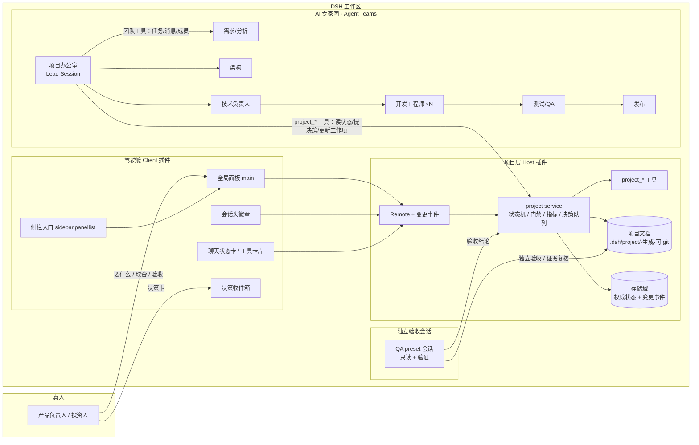
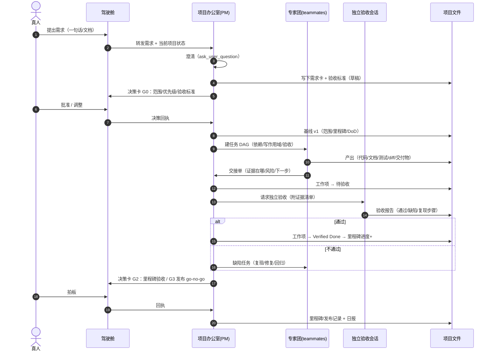
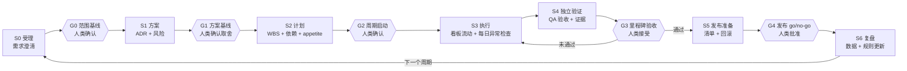
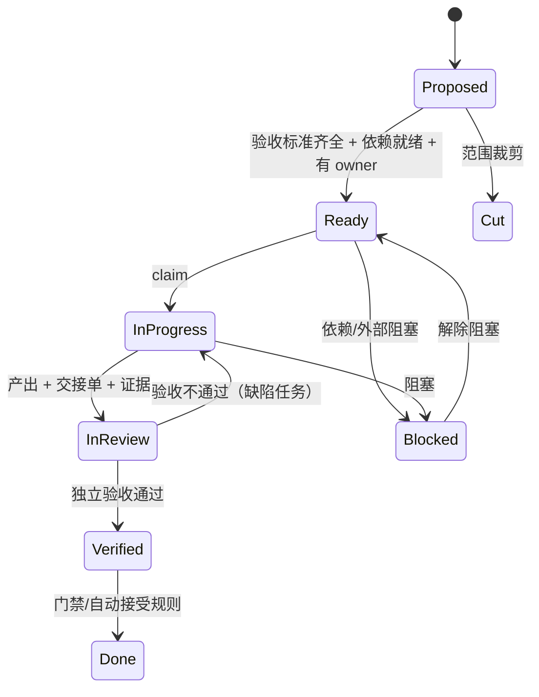
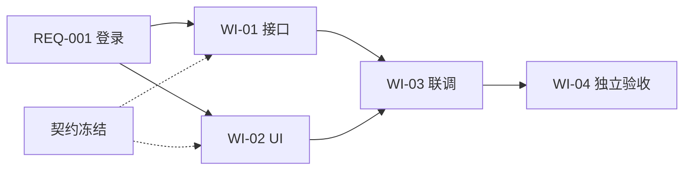
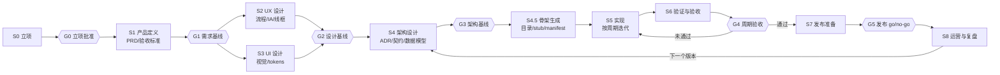

# DSH 软件项目工作台插件 · 设计提案

> 版本 v0.5 · 2026-11-11（v0.2 第 12 章：阶段硬控制/Git/成本/混合流程/SQLite；v0.3 §12.6 流程裁剪、§12.7 记忆架构、§12.8 模型评测台账；
> v0.4：记忆系统独立成文 [project-memory-design.zh.md](project-memory-design.zh.md)（lumio 复盘 + 开源调研 +
> 审计发现），§12.8.7 加入本机实测模型清单；v0.5 §12.2.0 加入 lumio Git/CI 复盘结论 + 10 条治理硬规则）
> 目标读者：插件作者（你）
> 依据：本机 DSH Desktop（运行版本约 `0.2.2-rc.1`）实测的 Service / Slot / Config 检查结果 + 本机 DSH 源码
> checkout `0.2.1-rc.2`（`C:\Users\oldap\Documents\deepseek-harness-a\deepseek-harness`）+ 软件工程与多智能体
> 文献调研（见第十一章附录）。**运行中的安装是 API 权威**；文中标注 `[实测]` 的条目来自本机检查，`[源码]`
> 来自 checkout，`[待验证]` 表示实现前需要再确认。

---

## 0. 一页纸

**产品的一句话**：把 DSH 工作区变成一个「AI 软件工作室」——真人只回答「我要什么」，AI 专家团负责「怎么做」，
一块驾驶舱回答「到哪了、卡在哪、现在需要我决定什么」。

**三个支柱**

1. **专家团（Role & Contract）**：产品/需求、架构、技术负责人、开发、测试、项目办公室，外加按需的评审团；
   每个角色有明确职责、产出契约、决策权和不可越界的地方。
2. **项目层（Project Layer）**：项目 / 需求 / 里程碑 / 工作项 / 依赖 / 决策 / 风险 / 证据的单一事实源。
   权威状态存 `ctx.storageDomain`（schema 校验 + CAS + 变更事件），人读文档生成到工作区 `.dsh/project/`
   （可 review、可 git），跨设备用 export/import 迁移。
3. **驾驶舱（Cockpit）**：常驻 Web 面板 + 会话内卡片，只回答五件事：健康度、里程碑、待决策、证据、风险。

**先给结论（关键设计选择）**

| 决策 | 选择 | 理由 |
|---|---|---|
| 生命周期 | **里程碑门禁（Stage-Gate）+ 固定周期迭代（Shape Up 式 2 周 cycle）+ 看板流动** 的混合模式 | 纯瀑布反馈太慢；纯 Scrum 对「人类注意力稀缺」不友好；AI 产能高，必须有基线防漂移 |
| 进度口径 | **唯一原子 = 已验证完成（Verified Done）**，% 完成/故事点只作辅助 | AI 产出快但「看起来完成」不可信，必须用证据判定 |
| 会话拓扑 | **1 个常驻项目办公室会话（Lead）+ 按需独立验收会话 + N 个弹性 teammate 子会话** | 尊重「一个工作区只开有限几个会话」；同时保留独立验证 |
| 专家团落地 | 执行团用原生 Agent Teams（软角色 + 硬契约）；验收用独立 preset 会话（硬隔离） | 原生 teammate 创建不支持按角色 preset，见 §2.7 |
| 人类接口 | 只处理三类决策：**要什么 / 取舍 / 验收**；决策以「决策卡」呈现，有推荐、后果、截止与默认 | 真人只解决「我要什么东西」的问题 |
| 可视化 | 7 个主视图（总览 / 路线图 / 看板 / 依赖图 / 燃起图 / 指标 / 决策收件箱）+ 报告即代码 | 先聚合、再异常、最后下钻证据；不做可拖拽甘特 |
| 插件边界 | 只做「项目层」：Host 服务 + Remote + 工具 + Client 驾驶舱 + preset/skills | 不重造 DSH 的会话、Agent、审批、团队能力 |

**MVP（第一个版本，2~3 周）**：项目文件模型 + 项目办公室 preset（含 SOP 技能）+ 4 个项目工具
+ 驾驶舱三视图（总览 / 看板 / 决策收件箱）+ 自动日报 + 独立验收流程。验收标准见 §10。

---

## 1. 目标、非目标与设计原则

### 1.1 目标

- 真人给出需求后，系统能自动完成：澄清 → 规格 → 方案 → 计划 → 实现 → 测试 → 验收 → 发布准备。
- 真人随时能在 30 秒内回答：「现在到哪了？卡在哪？需要我决定什么？」并且每个结论都能下钻到证据。
- 项目状态跨会话、跨重启、跨设备（git）可恢复；可审计「谁在什么时候基于什么证据改了什么」。
- 人类决策数量随项目推进**下降**，而不是被 agent 的提问淹没。

### 1.2 非目标

- 不做 IDE、不做 CI/CD 平台、不做代码托管；只做**编排与可视化层**。
- 不追求「无人值守自动发布」：不可逆动作永远有人类门禁。
- 不做完整甘特图/资源日历/工时管理（AI 团队没有「人天」，只有「验证成本」）。
- 不做个人 KPI 排行与「谁干得多」的度量。

### 1.3 设计原则

| 编号 | 原则 | 落地方式 |
|---|---|---|
| P1 | **真人是产品负责人，不是执行者** | 人类只回答要什么/取舍/验收；技术、排期、实现细节由 AI 团队决定并在决策卡中说明 |
| P2 | **唯一进度原子是「已验证完成」** | 工作项必须挂验收证据（测试输出/演示/交付物/diff）才能进入 Done |
| P3 | **会话是过程，项目文件是事实** | 项目状态存工作区文件；会话日志只做对话真相，不做项目数据库 |
| P4 | **人类注意力是最稀缺资源** | 决策批量、有推荐默认、有截止与超时策略、异常才升级 |
| P5 | **建造者不验收，不可逆动作必门禁** | 独立 QA 会话/角色；合并主干、发布、删数据必须人类确认 |
| P6 | **少会话、多智能体** | 会话 = 稳定上下文工位；agent/teammate = 弹性算力 |
| P7 | **复用 DSH 原生能力** | Agent Teams、plan mode、ask_user_question、present/deliverables、worktree、schedule 都用原生实现 |
| P8 | **全链路可追溯** | 需求 ID → 工作项 → 产出/提交 → 测试 → 验收 → 里程碑 → 发布，每一环可反查 |
| P9 | **异常驱动，不靠日报驱动** | 事件触发告警与升级；日报是归纳，不是信息源 |
| P10 | **一切可降级** | 没有 QA 会话、没有 CI、没有 GitHub 时，项目层仍可用（人工证据 + 本地测试） |

---

## 2. DSH 平台能力与硬约束（设计的地基）

> 本节是「插件必须贴着 DSH 真实能力做」的依据。标 `[实测]` 的来自本机运行中安装的检查结果；
> 标 `[源码]` 的来自 0.2.1-rc.2 checkout；标注 `[待验证]` 的要在实现前再确认。

### 2.1 会话 / Agent / 工作区模型

- **Session** 是持久会话日志（事件流是唯一真相）；**Agent** 是运行中的实例，一个 Session 可有多个生命周期。
  Session header 记录 `cwd`、`agentPreset`、`parentSession`、`delegationDepth` 等 `[源码]`。
- 一个 **Workspace = 一个目录**；一个工作区可以有很多 Session（侧栏/标签列出）。用户说的「一个工作区只开很
  有限的几个会话」是产品约束，不是引擎限制——本设计把它当**设计约束**来用（见 §5.6）。
- Client 侧可直接创建/导航会话：`ctx.uiWorkspace.startSession(workspaceId?, { agentPreset })` 新建；
  `ctx.uiWorkspace.openSession(target)` 打开会话或 addressed-subagent 子会话 `[实测]`。
- Host 侧有 `ctx.agents` / `ctx.agentLoop` / `ctx.workingDirectory`；跨会话查询有 session-query / session search 域
  `[源码]`。**项目层的状态不要依赖某一会话存活**。

### 2.2 Agent Teams（执行专家团的底座）

`[实测]` 本机 profile 已挂载实验性 Agent Teams：

| 事实 | 值 / 含义 |
|---|---|
| 团队归属 | 每个 **Lead Session** 一支团队，`TeamId = Root SessionId`；roster/任务板随会话持久化 |
| 成员上限 | 本机配置 `maxMembers: 8`（引擎默认 16）；任务板 `maxTasks: 256` |
| 成员创建 | `spawn_teammate` 只能由 Lead 调用；请求字段只有 `name / description / prompt / context(fresh|fork) / provider`——**没有 preset** |
| 成员形态 | teammate 是 Lead 的直接子会话（有独立日志），可被人类从 roster 导航进去；inactive 可冷恢复 |
| 消息 | 直接 inbox 消息 + 步骤边界 steering；投递成功 ≠ 已处理 |
| 任务板 | 全员可建任务；`pending / in_progress / completed / deleted`；`blockedBy` 必须无环；`writeScopes` 是**提示性路径前缀，不是锁**；所有更新是 revision CAS |
| Web 投影 | Lead Session 的 `agentTeam` 投影发布 roster + 任务板；现有团队 UI 就渲染它 |
| 工具集 | **同一套 9 个团队工具**发给每个成员，没有按角色裁剪 |

**设计推论**：
1. 执行团队内部是**软角色**：靠初始任务 prompt + 项目 SOP/技能 + 任务描述 + 产出契约分工，而不是工具集隔离。
2. 需要硬隔离时用**独立会话 + preset**（验收会话、只读评审会话），或用自定义 subagent provider（进阶）。
3. 项目任务板是**会话级**的，项目跨会话/跨重启必须落到项目文件（§8）。

### 2.3 人机协作原语（人类接口的现成积木）

| 原语 | 现有实现 | 在本设计中的用法 |
|---|---|---|
| 阻塞式问答 | `ask_user_question` 工具 + `userQuestions` 服务 `[实测]` | PM 需要澄清时直接提问；答案进入会话日志 |
| 计划批准 | plan mode：`/plan` 进入，`exit_plan_mode` 提计划供批准 `[源码]` | G0/G1 门禁的「计划/方案待批准」天然载体 |
| 敏感操作审批 | `ctx.approval` + 权限预设 | 危险命令、写仓库外、发布等 |
| 动作卡片 | `ctx.actionCards`：注册卡片 kind（title/brief/details/verbs/reconcile），会话投影 + `Remote act` 落决策 `[实测 0.2.2]` | **决策卡**的首选实现（按钮化、可审计、可 UI 操作） |
| 定时消息 | schedule 包/工具 `[源码]` | 每日/每周项目报告、风险扫描提醒 |
| 目标/待办 | goal / todo 服务与 UI `[源码]` | 单 agent 的任务清单，可作为项目工作项的执行子清单 |

### 2.4 输出、证据与并行

- **交付物**：`present` 工具声明最终文件；`workspace/changes` 记录每轮改动文件与 diff（`ctx.workspaceChanges`）
  `[源码]`。→ 天然是「已验证完成」的证据来源之一。
- **并行开发**：`ctx.worktrees` 服务可创建受管 git worktree `[实测]`；配合写作用域，多个开发 agent 各占一个 worktree，
  由 Tech Lead 合并。→ 解决「同一工作区并行写冲突」。
- **扇出编排**：`workflow` 引擎（脚本化 fan-out subagent）+ subagent 服务（`listChildren`/`listDescendants`/`sendMessage`）
  `[实测/源码]`。→ 适合「并行评审」「多专家会诊」「批量测试生成」这类**短任务**，不适合有状态的长团队。
- **任务隔离**：subagent 是父会话的直接子会话，有独立日志与上下文；团队 teammate 则是持久可续的子会话。

### 2.5 Web UI 扩展点（驾驶舱要落在哪）

`[实测]` 通过 Client Slot 检查确认，以下 slot 与页面能力可直接用：

| Slot / API | 用途 | 备注 |
|---|---|---|
| `main`（keyed，root 作用域） | **全局面板**：注册一个页面（像「插件」页那样），`ctx.layout.selectPanel(id)` 可跳转 | 驾驶舱主页面 |
| `sidebar.panellist`（list） | 侧栏入口（图标 + 标题） | 驾驶舱入口 |
| `conversation.session.header.actions` / `.utilities` | 会话标题旁的按钮/徽章 | 当前阶段、RAG 徽章、打开驾驶舱 |
| `conversation.chat.node`（keyed，`ChatNodeKind`） | 自定义 Chat 行 | 项目状态卡、门禁卡 |
| `tool.call.toolview`（keyed，按工具名） | 自定义工具调用卡片 | 项目工具结果可视化 |
| `conversation.composer.dock`、`conversation.input.dock` | 输入框上方/下方常驻条 | 「当前项目/阶段/待决策数」迷你条 |
| `ctx.sidebarRightTabs.register` + `sidebar.right.pane.tab`（keyed） | 会话右侧栏的 tab 页面 | 驾驶舱的「会话内形态」，不占整页 |
| `settings.section` | 设置页 | 项目、周期、决策策略配置 |

- 全局面板模式参考（权威样例）：`packages/client/ui-plugin-manager/src/client/index.ts`（另有整页 + 侧栏入口的
  `packages/client/ui-schedule/src/client/index.ts`）——
  `ctx.slots.inject('main', …ctx.slots.register({ name:'main', key: PANEL_ID, children: {...} }, Page))` +
  `ctx.slots.inject('sidebar.panellist', …ctx.slots.register({ id, label, order }, Icon))` `[源码]`。
- Client 取数有三条正经路：① **session projection 的 `wire.view`**（首选：Host 算好推送，无轮询）；② **Typert Remote**
  （需要 `./typert` / `./remote` / `./client/typert` 构建产物，见 §9.9）；③ Host 转发事件 + Client 一元读回。
  **不要轮询**、不要自己造 HTTP。`[源码]`
- UI 硬规则：只用主题 token（`--dsw-alias-*`）、文案走 locale、不放 iframe、不替换 app root、不 import
  `@deepseek-ai/dsh-client-*` 包（照宿主样式自己写控件）。

### 2.6 持久化选项

| 方式 | 优点 | 缺点 | 本设计用途 |
|---|---|---|---|
| `storageDomain`（schema 校验 KV；JSON/SQLite 后端）`[实测]` | 打开即 zod 校验、写入先持久后内存、`update` 天然 CAS、`domain/changed` 事件、版本化 | 只对 Host 可见（模型/浏览器看不到）、数据不在仓库、跨工作区要自己按 key 分区 | **权威状态**（项目/工作项/决策/风险/指标，主） |
| 工作区文件（`ctx.fs`，原子写） | git 友好、人可读可 review、可交付、agent 天然能改 | 无 schema/无原子 CAS/无订阅、可能被模型或外部进程绕过 | **生成的人类可读文档**（需求卡/ADR/报告/交接单，随 git） |
| Session projection | 实时、派生、自动广播到浏览器 | 只能由日志事件派生；卸载即消失；不是权威 | 会话内摘要（当前项目卡） |

> **关键取舍**：权威状态放 storage domain（一致性、校验、事件、升级迁移），工作区放**生成物**（可读、可 diff、
> 可进 git）。生成物由 Host 每次变更后重写（带「自动生成」标记），不作为权威回读；需要整包迁移时用一
> 个 export 命令把 domain 导出成 JSON 快照。这样既不牺牲可读性，也不把一致性押在「没人手改文件」上。
>
> **v0.2 修订**：项目记忆最终改用**插件自有的 SQLite 库**（`node:sqlite`，见 §12.4）——文档版本链、FTS 检索、
> 去重与冲突控制需要关系型/FTS 能力，KV 域的 JSON 形态不够；`storageDomain` 只保留给插件设置与 UI 缓存。

### 2.7 设计者必须知道的 12 条硬约束

1. **插件 Host 代码不是 Agent，但可以创建/驱动 Agent**：`spawnTeammate` / `sendMessage` / 任务板写操作要求
   `caller: Agent`，插件不能自己当 Lead；但 Host 侧可以用 `ctx.agents.create` / `ctx.sessions.create` /
   `ctx.subagents.startActivation` / `ctx.workflowEngine.start`（以某个 live Agent 为 parent）发起编排。
   插件负责状态与聚合，编排由 agent 驱动。
2. **teammate 无 per-role preset，但 subagent 可以**：Agent Teams 的 spawn 请求没有 preset/模型字段 → 执行团队角色靠
   prompt + SOP + 任务契约；需要硬隔离时用「独立会话 preset」或「带 `agentPreset` 的进程内 subagent activation」
   （`tool-subagent` 可配置 `agentPreset` / `allowedAgentPresets` 白名单）。
3. **writeScopes 是提示不是锁**：并行写必须配合 worktree/分支或串行化；任务板不会阻止冲突。
4. **团队上限 8（本机）/16（默认）、任务板 256**：大项目要按阶段/子项目拆团队，或把工作项保留在项目层、只把「当前
   周期」放进任务板。
5. **不能向会话追加自定义事件类型**：实时 `Session.append()` 不支持 `ignorable` 标记，自造 type 会导致会话无法重开。
   → 项目状态放文件/存储，不要放会话日志。
6. **UI 不能越界**：iframe、替换 app root、`document.body` 追加、import Harness Client 包、字面色样式都会破坏主题/
   locale 或直接崩 slot。
7. **安装即改 profile**：插件安装影响该 profile 的所有会话并需要授权；Desktop 的 `desktop` profile 只能由 Desktop
   自带 CLI（先初始化并退出应用）或会话内插件管理器管理。
8. **版本以运行中安装为准**：本机 0.2.2-rc.1 已提供 `actionCards`，而手边 checkout（0.2.1-rc.2）还没有；写代码前用
   `cordis_inspect_query` 核对 Service/Event/Slot，并用 `engines.dsh` 声明兼容范围。
9. **团队任务板是会话级**：roster/任务板写在 Lead Session 日志里（`team/member`、`team/task` 事件），跨会话、跨重启、
   跨 team 重建都会换一批；权威项目状态必须独立持久（推荐 storage domain，见 §8）。
10. **人类注意力要显式建模**：任何要向人提问的东西，都必须可批量、可默认、可超时、可追责（否则项目会停在「等人」。
11. **委派预算是硬上限**：subagent 每棵 activation 树默认最多 8 个活跃、委派深度默认 1；workflow 最多 1000 个子
    agent、单次 items ≤4096；goal/ralph ≤256 轮；team 8/16 成员、256 任务。自动团队流程要在 UI 上暴露剩余预算与
    阻塞原因。
12. **自定义 Remote 需要构建产物**：`@Remote` 方法依赖 Typert codegen（`./typert`、可选 `./remote`、`./client/typert`），
    没有 DSH 构建链的独立包要换通道（projection `wire.view` / 事件 + 读回 / webServer 路由），见 §9.9。

---

## 3. 总体架构

### 3.1 三层结构



### 3.2 组件职责

| 组件 | 形态 | 职责 | 明确不做 |
|---|---|---|---|
| **项目层 Host 插件** `dsh-project-workbench` | bundle 的 Host 入口 | 项目域模型、状态机、门禁、决策队列、指标计算、日报、文件持久化、Remote/事件、`project_*` 工具 | 不直接 spawn teammate、不替 agent 发消息、不写用户代码 |
| **驾驶舱 Client 插件** | bundle 的 `./client` | 全局面板、侧栏入口、会话头徽章、聊天卡、决策收件箱、项目设置页 | 不存事实状态（只缓存快照）、不解析会话日志 |
| **项目协议包** | presets + skills + templates | 项目办公室 preset（PM 人设 + 团队工具 + 项目工具 + SOP 技能）、QA preset、需求卡/ADR/验收/DoD/报告模板 | 不绑定具体技术栈 |
| **执行团队** | DSH Agent Teams | 在 Lead 会话里按任务 DAG 执行；写作用域分工；产出证据 | 不自我验收、不自我批准门禁 |
| **独立验收** | 独立会话 + QA preset | 只读验收：跑验收清单、复核证据、给结论与缺陷 | 不参与实现、不看实现者上下文 |

### 3.3 一次典型需求的生命周期（端到端）



### 3.4 为什么是「叠加一层」而不是「另做一个 App」

- DSH 已经把「会话、Agent、工具、审批、团队、交付物、worktree、定时任务」都做成了可组合的服务；
  **重造这些没有收益**，还会与宿主版本升级脱节。
- DSH 缺的恰好是**跨会话的长期项目状态**与**给真人的管理视图**：谁负责、到哪了、证据是什么、要我决定什么。
  这就是项目层的价值。
- 插件形态让这套能力可以随 DSH 升级、跟随用户 profile 安装，也符合我们上一份指南里的发布路径。

---

## 4. 专家团设计

### 4.1 两种专家团形态

| 形态 | 是什么 | 何时用 | DSH 落地 |
|---|---|---|---|
| **常设执行团**（Standing Team） | 一个 Lead（项目办公室）+ 一组持久的角色成员，按任务 DAG 持续交付 | 整个项目周期 | 一个 Lead Session + Agent Teams（teammates） |
| **按需评审团 / 专家会诊**（Council） | 针对一个问题，并行请 3~5 位独立专家出意见、交叉质询，PM 综合成决策卡 | 架构选型、重大缺陷根因、发布 go/no-go、范围取舍 | `workflow` 扇出 / 多个 fresh subagent，产出汇总到 PM 会话 |

**专家会诊协议**（把「专家团」从概念变成可复用流程）：

1. PM 写「会诊问题卡」：背景、已尝试、约束、必须回答的问题、期望产出格式。
2. 并行启动 3~5 个**独立**专家（不同视角：架构 / 实现 / 测试 / 安全 / 产品），每个是 fresh context，互不可见。
3. 第一轮：各自给「判断 + 依据 + 风险 + 反对意见」。
4. 第二轮（可选）：把彼此的匿名意见交叉发给专家，要求指出分歧点。
5. PM 综合：**共识 / 分歧 / 推荐选项 / 需要人类拍板的取舍**，做成一张决策卡。
6. 人类拍板后记 ADR；会诊记录落盘可审计。

> 会诊的价值不在「多个 agent 投票」，而在**强制暴露分歧与反例**；所以流程要求每位专家必须给出「我可能错在哪」。

### 4.2 角色表（常设执行团）

| 角色 | DSH 形态 | 核心职责 | 产出契约 | 决策权 | 明确禁止 |
|---|---|---|---|---|---|
| **项目办公室 / 交付经理**（PM/Scrum Master） | Lead Session（`project-office` preset） | 基线、进度、风险、决策排队、门禁组织、日报、团队协调 | 周报、决策卡、风险 Top-5、门禁材料 | 排期建议、任务分派、异常升级 | 不写产品代码、不验收、不替人类拍板 |
| **产品经理 / 需求分析师**（BA） | teammate（fresh） | 澄清需求、写需求卡与验收标准、划范围与非目标 | 需求卡、验收标准（Given/When/Then） | 需求解释权 | 不得改技术方案、不得承诺排期 |
| **架构师** | teammate | 方案选项、ADR、技术风险、接口契约草案 | ADR（≥2 选项）、架构图、风险清单 | 技术选型建议、可维护性否决 | 不得定排期、不得定产品范围 |
| **技术负责人**（Tech Lead） | teammate | WBS 分解、接口契约定稿、集成、代码评审、并行调度 | 任务 DAG、接口契约、评审单 | 可实现性否决、合并顺序 | 不得自我验收、不得跳门禁 |
| **开发工程师 ×N** | teammates（fresh） | 实现、单测、自测证据、交接单 | 代码/测试/交接单/证据链接 | 实现细节 | 不得改需求、不得改验收标准 |
| **测试 / QA** | **独立验收会话**（`project-qa` preset）+ 可兼任团内测试 | 测试策略、验收执行、缺陷分级、回归 | 验收报告、缺陷单、覆盖说明 | **验收通过/拒绝（凭证据）** | 不参与实现、不复用实现者上下文 |
| **发布 / 运维** | teammate 或按需角色 | 发布清单、回滚预案、CI/部署脚本 | 发布清单、回滚计划、发布记录 | 发布就绪判断 | 不得自行上线（不可逆动作必须人类门禁） |
| **评审专家**（安全/性能/UX/法务） | 按需 council | 专项评审 | 发现清单（blocker/major/minor） | 专项否决建议 | 不长期占团队编制 |

### 4.3 专家团怎么落到 DSH（可行性边界）

**执行团队的编制模板**（受 `maxMembers: 8` 约束，含 Lead）：

| 模板 | 成员 | 适用 |
|---|---|---|
| 精简（3） | PM(Lead) + 全栈工程师 + QA（QA 同时负责独立验收会话） | 小工具、单模块 |
| 标准（6） | PM(Lead) + BA + 架构 + 2×开发 + QA | 常规产品迭代 |
| 全量（8） | PM(Lead) + BA + 架构 + TL + 2×开发 + QA + 发布 | 多模块、需要发布 |
| 会诊（临时） | 用 subagent/workflow 扇出，不计入 roster | 架构选型、事故复盘、go-no-go |

**角色软隔离的四个抓手**（因为 teammate 不能绑定不同 preset/工具集，见 §2.7）：

1. **角色卡 prompt**：spawn 时把「你是谁/你负责什么/你不做什么/产出格式/完成标准」写进初始任务。
2. **项目 SOP 技能**：把需求卡、ADR、交接单、DoD、评审协议写成 skill（项目内 `.dsh/skills/` 或 bundle 自带），
   agent 按需加载，避免每次从头解释。
3. **任务契约**：每个工作项的描述里带验收标准、写作用域、证据要求；团队任务板保证依赖与所有权。
4. **门禁与验证**：软约束靠自觉，硬约束靠 **独立验收 + 人类门禁**；这两道是真正的防线。

**硬隔离的三条路（进阶）**：

- **独立验收会话**：用 QA preset 新建会话（只读项目 + 运行测试 + 证据复核），由人从驾驶舱一键打开；
  它不继承实现者的对话，天然独立。→ MVP 用这条。
- **按需专家 subagent + preset**：进程内 spawn 的 subagent 支持 `agentPreset` + `allowedAgentPresets` 白名单
  （`tool-subagent` 也可配置 `agentPreset`）→「专家会诊」的每位专家可以是不同 preset（安全/性能/UX），
  人设与工具集硬隔离，且不长期占团队编制。→ Phase 2 用这条。
- **自定义 subagent provider / 多会话 preset**：给长期工坊不同 preset 与工具集；代价是要维护 provider 与
  跨会话协调（DSH 团队不能跨会话发消息），复杂度高，Phase 3 再评估。

**团队重建**：teammate 是 Lead Session 的子会话；Lead 会话若重新开始（新会话/新团队），roster 会换一批。
→ 项目文件里的「角色表 + 当前负责人」是恢复依据，PM 新会话开场先读项目文件再重建团队。

### 4.4 协作协议（SOP）与契约工件

所有协议都是**文件模板 + skill**，agent 直接读写，人也能 review。

| 工件 | 必填内容 | 存在哪 | 谁写 |
|---|---|---|---|
| 需求卡 Requirement | ID、标题、背景/价值、用户场景、范围内、**非目标**、验收标准（GWT）、优先级、关联决策 | `.dsh/project/requirements/` | BA，PM 审核 |
| ADR | 背景、选项（≥2）、决定、后果、风险、状态（accepted/superseded） | `.dsh/project/adr/` | 架构师 |
| 接口契约 Contract | API/数据模型/错误码/兼容性/owner | `.dsh/project/contracts/` | Tech Lead |
| 工作项 WorkItem | 标题、所属需求、验收标准、依赖、写作用域、DoD、证据 | `.dsh/project/plan.json` | Tech Lead/PM |
| 交接单 Handoff | 完成了什么、证据在哪、未决问题、风险、下一步 | 工作项附件或 `.dsh/project/handoffs/` | 执行者 |
| 评审单 Review | 对象、发现（blocker/major/minor）、结论 | 工作项证据 | 评审者 |
| 决策卡 Decision | 问题、选项、推荐、后果、截止、默认、决策人、状态 | `.dsh/project/decisions/` | PM 提案，人类拍板 |
| 验收报告 Acceptance | 验收项、结果、证据链接、缺陷、结论 | `.dsh/project/evidence/` | 独立 QA |
| 日报/周报 Report | 完成/进行/阻塞、指标、风险、待决策、下周期计划 | `.dsh/project/reports/` | PM 生成 |

> **规则：没有契约工件的任务不能开始；没有证据的工作项不能完成。** 这两句话是整个系统的「物理定律」。

### 4.5 人类接口：真人只回答三类问题

| 类型 | 具体问题 | 呈现方式 | 超时策略（可配置） |
|---|---|---|---|
| **要什么** | 目标用户？解决什么问题？范围/非目标？优先级？ | 决策卡 / 澄清问题 | 默认「按推荐方案继续」，并在报告中标「假设」 |
| **取舍** | 速度 vs 质量？范围 vs 时间？自研 vs 采购？成本上限？ | 决策卡（含代价/后果） | 默认「保守选项 + 记录风险」 |
| **验收** | 接受 / 返工 / 放行？ | 门禁卡（附证据摘要） | **不自动通过**；超时则项目挂起并提醒 |

**决策卡规范**（PM 工具强制生成此结构）：

```
标题：<一句话问题>
背景：<为什么现在要决定，2~3 行>
选项：A <得到什么 / 代价 / 风险>
      B <得到什么 / 代价 / 风险>
推荐：A（理由）
影响：范围/时间/质量/成本
截止：<日期>    超时默认：A / 挂起
可逆性：可逆 / 不可逆（不可逆必须显式确认）
```

**人类注意力保护**：

- **决策预算**：默认每周最多 5 次打断（可配置）；其余问题进「决策收件箱」，每天固定 1~2 个窗口批量处理。
- **只升级异常**：触发升级规则（§6.3）才打断；常规进展写入日报。
- **产品语言**：决策卡不出现「用 Redis 还是 Postgres」这种只有技术含义的问题，要翻译成「要不要接受更高成本换取更快响应」，
  技术细节折叠在附注里。
- **不可逆动作清单**（必须人类确认）：合并主干 / 发布上线 / 删除数据或分支 / 改权限与密钥 / 付费与采购 / 对外沟通。

---

## 5. 流程设计：里程碑门禁 + 固定周期迭代 + 看板流动

### 5.1 为什么是混合模式

| 模式 | 对「AI 团队 + 稀缺人类」的适配 | 结论 |
|---|---|---|
| 瀑布 / V 模型 | 基线清楚、门禁明确，但反馈周期太长，AI 快产出的优势被浪费 | 借「基线 + 门禁」 |
| Scrum | 迭代与验收清楚，但仪式（站会/故事点/velocity）对人类是负担 | 借「短周期 + 演示验收」 |
| Kanban | 流动性好、WIP 限制、异常可见，但没有里程碑与基线 | 借「看板 + WIP + 周期时间」 |
| Shape Up | 固定周期、appetite 代替估算、到期必停（circuit breaker）、hill chart | **主参考**：最贴合「人类只定要什么」 |
| Stage-Gate | 阶段门禁 + 交付物齐套才放行，适合管理不可逆风险 | 外层骨架 |
| DevOps / 持续交付 | 小步快跑、可回滚、DORA 指标 | 发布阶段与指标参考 |

**结论：外层用 Stage-Gate 管基线与不可逆风险；内层用 Shape Up 式固定周期 + 看板流动管交付；每个门禁用证据说话。**

### 5.2 阶段与门禁

> **v0.2 细化**：本节是流程总览；更细的 **8 个阶段 + 6 道门禁 + 每阶段写路径硬控制**以 §12.1 为准，
> 门禁编号也以 §12.1 的 G0~G5 为准。



| 门禁 | 人类要回答的问题 | 通过条件（证据） | 失败处理 |
|---|---|---|---|
| **G0 范围基线** | 要做什么、不做什么、优先级、验收标准认不认？ | 需求卡 + 验收标准 + 非目标清单 | 打回澄清；范围争议记入决策日志 |
| **G1 方案基线** | 技术取舍认不认？风险能接受吗？ | ADR（≥2 选项）+ 风险清单 + 接口契约草案 | 会诊后重新提案 |
| **G2 周期启动** | 这个周期做这几件事，行吗？ | 工作项 DAG + appetite + 验证计划 | 裁剪范围后重报 |
| **G3 里程碑验收** | 这些「已完成」都验证过了吗？接受吗？ | 独立验收报告 + 每项工作项证据 | 缺陷任务回归；工作项退回 |
| **G4 发布 go/no-go** | 现在上线吗？回滚方案看过吗？ | 发布清单 + 回滚预案 + 回归结果 | 延期发布；发布窗口重排 |

> 小项目可把 G1/G2 合并、把 G4 降级为「发布确认」；但 **G0（范围）与 G3（验收）不能省**。

### 5.3 工作项状态机（与团队任务板映射）



| 项目层状态 | 团队任务板状态 | 说明 |
|---|---|---|
| Proposed / Ready / Cut | `pending`（未 claim） | 项目层保留 Cut（裁剪）语义，任务板删除即 tombstone |
| InProgress / Blocked | `in_progress`（+ 阻塞标记） | 阻塞信息写项目层，任务板只表达「有人在做」 |
| InReview / Verified / Done | `completed` | **注意**：任务板 completed ≠ 项目 Done，必须经过独立验收与门禁 |

> 同步策略：**项目层是 source of truth**；PM 工具的写操作负责同步任务板（建任务/认领/完成），
> 反向只做「读取 + 提醒」，避免双写。若团队重建导致任务板丢失，项目文件仍完整。

### 5.4 周期设计（借鉴 Shape Up）

- **周期**：默认 2 周（可配置 1~3 周）+ 2~3 天 cooldown（复盘、清理、下周期准备）。
- **appetite（胃口）**：需求定「最多花多少周期」而不是估「要多少人天」：小 = 0.5 cycle，中 = 1 cycle，大 = 2 cycle。
  **超预算不是延期，而是裁剪/降级/废弃**。
- **投注（betting）**：周期开始只接受「已成形（shaped）+ 已定 appetite」的需求；新需求进 parking lot 等下个周期。
- **circuit breaker**：周期到期未完成，强制停：已完成部分验收，未完成部分重新投注或砍掉。禁止无限续命。
- **hill chart**：每个工作项在「上坡（还在解未知）/ 下坡（执行中）」上标记位置；堵在上坡说明需要专家会诊或缩范围。
- **周期节奏**：Day 1 计划会（PM 输出周报）→ 每日异常检查（只处理例外）→ 周期末演示 + 验收 + 复盘。

### 5.5 变更控制

```
变更请求（人类或 PM 提出）
  → 影响分析（范围 / 周期 / 风险 / 成本 / 需要重做的验证）
  → 决策卡（选项：接受 / 延后 / 裁剪别处 / 拒绝）
  → 人类拍板
  → 基线版本 +1（记录来源请求与理由）
  → 更新计划、任务板、日报
```

触发「必须人类拍板」的阈值（默认，可配）：超出 appetite 20%、影响当前门禁、增加不可逆风险、跨里程碑依赖变化。

### 5.6 会话编排：一个工作区只开有限几个会话

**默认拓扑（推荐）**

| 会话 | 数量 | 角色 | 人类主要用途 |
|---|---|---|---|
| `[项目] 项目办公室` | 1（常驻） | Lead（PM preset）+ 专家团 teammates 子会话 | 提需求、看进展、答决策、看演示 |
| `[项目] 独立验收` | 0~1（按需） | QA preset（只读 + 验证） | 里程碑时打开，看验收结论 |
| teammate 子会话 | N（弹性，随团队） | 各专家 | 人类可直接进去追问/纠偏，通常只读 |

**可选：专用工坊会话**（前端 / 后端 / 数据 / 性能）——只在满足「上下文很大、需要人类频繁直接交互、跨多个周期」时创建。
代价：DSH 团队不能跨会话发消息，跨工坊协调要靠「项目文件 + 任务板 + 人类/PM 会话桥接」，成本明显更高。

**上下文卫生**

- 每个周期开始，PM 在项目文件里写一页 **Cycle Brief**（目标/范围/约束/上次教训），专家任务 prompt 里带摘要。
- 专家任务用 `fresh` context（不继承主会话），避免上下文污染；需要继承时才用 `fork`。
- 长会话靠 compaction 管理；重要结论**必须落到项目文件**，不能只存在对话里。
- 防反模式：❌ 每个角色一个会话（会话爆炸）❌ 所有事在一个会话（上下文污染）。

---

## 6. 进度把控：项目经理的控制回路

### 6.1 三基线（先有基线，才谈进度）

| 基线 | 内容 | 变更方式 |
|---|---|---|
| 范围基线 | 需求卡 + 验收标准 + WBS + 非目标 | 变更控制（§5.5） |
| 时间基线 | 里程碑 + 周期 + appetite | 变更控制；周期内冻结 |
| 质量基线 | DoD + 质量门 + 验收证据要求 | 只允许加严，放宽需人类批准 |

### 6.2 度量体系（唯一口径：Verified Done）

| 维度 | 指标 | 定义 | 建议目标/用途 |
|---|---|---|---|
| 交付 | **里程碑进度** | 已验收通过的工作项加权 / 基线总量 | 对外唯一进度数字 |
| 交付 | **验证吞吐** | 每周期 Verified 工作项数 | 产能趋势 |
| 交付 | **周期时间** | 工作项 InProgress → Verified 的中位时长 | 预测完成时间；Little's Law |
| 交付 | **WIP / 队列深度** | 进行中工作项、等待验收队列 | 发现验证瓶颈 |
| 质量 | **一次验收通过率** | 首次验收通过 / 送验总数 | 质量趋势 |
| 质量 | **返工率** | 因验收/评审失败重开的工作项比例 | 隐藏成本 |
| 质量 | **缺陷逃逸** | 验收后/发布后发现的缺陷数 | 验证有效性 |
| 预测 | **范围燃起** | 范围累计 vs Verified 累计 | 暴露范围蔓延 |
| 预测 | **appetite 偏差** | 实际花费周期 / 计划 appetite | 校准估算 |
| 人类 | **人类决策负载** | 每周期决策卡数量、等待时长、升级率 | 保护注意力 |
| 人类 | **自主完成率** | 无人工干预完成并验收的工作项占比 | 系统成熟度 |
| 成本 | **单项成本** | 每工作项 token/费用 + agent 时长 | 预算控制 |
| 风险 | **Top-5 风险** | 概率×影响排序，每周复查 | 风险前置 |

> 原则：**指标必须能从项目文件/会话事件自动生成**；需要人手动维护的指标一律不做。
> 指标用于团队体检与趋势，不用于个人排行。

### 6.3 控制回路（Plan–Do–Check–Act）与升级规则

| 环节 | PM 动作 | 触发 |
|---|---|---|
| Plan | 生成/更新 WBS、依赖、周期计划、验证计划 | G2 通过、周期开始 |
| Do | 分派任务、盯依赖、解阻塞、催决策 | 任务板事件 |
| Check | 汇总证据、计算指标、做日报/周报 | 每日/每周期/门禁前 |
| Act | 重排、裁剪、加人（spawn）、升级人类、改规则 | 异常触发 |

**升级规则（默认阈值，写入配置）**

| 异常 | 阈值 | 动作 |
|---|---|---|
| 工作项阻塞 | > 24h 无进展 | PM 自己解；> 48h 升级人类 |
| 决策等待 | > 48h（非不可逆） | 使用默认值继续，报告标注假设 |
| 决策等待 | > 24h（不可逆） | 提醒 + 项目挂起相关事项 |
| 范围变更 | 周期内新增 > 20% | 转下周期或触发变更控制 |
| 门禁失败 | 连续 2 次 | 专家会诊 + 人类介入 |
| 验证队列 | 等待验收 > 3 项 | 提醒开验收会话 / 增加验证资源 |
| 成本 | 单周期超预算 30% | 报告 + 人类决定是否继续 |
| 测试/CI | 连续红 > 1 天 | 暂停新任务，优先修复 |

### 6.4 风险、问题、决策、假设四本账

| 账本 | 字段 | 维护者 | 复查节奏 |
|---|---|---|---|
| 风险登记册 | ID、描述、概率、影响、触发条件、缓解、owner、状态、复查日 | PM | 每周 + 门禁前 |
| 问题日志 | ID、现象、影响、负责人、状态、解决方案 | PM | 每日 |
| 决策日志 | 决策卡 + 结果 + 理由 + 影响 + 关联 ADR | PM | 每次决策 |
| 假设日志 | 假设内容、依据、验证方式、如果错了怎么办 | PM/BA | 每周期 |

### 6.5 验收与质量门

**DoD（Definition of Done）模板**（工作项级）：

- [ ] 代码已提交/产出已落盘，且在写作用域内
- [ ] 单元测试/自动化测试通过（贴输出或 CI 链接）
- [ ] 关键路径有手工验证记录（贴命令/截图/演示）
- [ ] 接口/数据变更已更新契约文档
- [ ] 无未处理的 blocker 级评审发现
- [ ] 交接单完整（证据位置、风险、下一步）
- [ ] 独立验收通过（QA 会话/独立评审者）

**验收原则**：证据优先于自述；**建造者不验收**；验收结论必须可复现（命令/步骤/环境）。

### 6.6 针对 AI 团队特有失败模式的对策

| 失败模式 | 表现 | 本设计对策 |
|---|---|---|
| 需求幻觉 / 规格失真 | agent 把「以为的需求」当需求往下做 | 需求卡 + G0 人类基线 + 非目标清单 + 变更留痕 |
| 验证缺口 | 说「已完成」但没有可复现证据 | Verified Done 口径 + 独立验收 + 证据必填 |
| 自我评审偏袒 | 实现者自己评审自己，结论偏乐观 | 独立 QA 会话 + 评审者与实现者分离 + 对抗性评审 prompt |
| 测试被篡改/绕过 | 为了让测试变绿而改测试 | QA 复核测试改动；测试文件写作用域独立；diff 审查 |
| 协调开销超线性 | 团队越大越慢、消息风暴 | 编制模板 ≤8、任务 DAG + 写作用域、fresh context、少开会 |
| 上下文漂移 | 长会话后忘记约束/跑偏 | Cycle Brief、项目文件、周期重置、关键约束进 SOP |
| 评审失效 | 评审变成走过场 | 评审单强制发现分级、blocker 必须有处理结论 |
| 过度自信 | 不做风险评估、直接上 | 会诊协议 + 风险登记册 + 不可逆动作门禁 |
| 人类瓶颈 | 所有事等人拍板 | 决策预算、推荐默认、超时策略、批量收件箱 |

### 6.7 一个周期里 PM 的时间线（示例）

| 时间 | PM 动作 | 人类动作 |
|---|---|---|
| Cycle Day 1 上午 | 读项目文件 → 生成周期计划 → 分派任务 | 看周期计划卡（G2） |
| Day 1~10 | 盯依赖/阻塞/验证队列；每日异常检查；更新项目状态 | 决策收件箱（每天 1 窗口） |
| Day 5 | 中期检查：范围燃起、风险变化；必要时提议裁剪 | 只处理升级项 |
| Day 10 | 汇总证据 → 请求独立验收 → 生成周报 | — |
| Day 11 | 组织演示 + 验收结论 → 决策卡 G3 | 验收/拍板 |
| Day 12~14 | cooldown：复盘、清理、下周期 shaping、更新 SOP | 复盘参与（可选） |

---

## 7. 进度可视化方案

### 7.1 设计原则：「一屏、一会话、一仓库」

| 层级 | 载体 | 回答的问题 | 刷新方式 |
|---|---|---|---|
| 一屏 | 驾驶舱全局面板 | 「到哪了？卡在哪？要我决定什么？」 | Host Remote 事件推送 |
| 一会话 | 会话头徽章 + 聊天状态卡 + 工具卡片 | 「这个会话当前在做什么？结论是什么？」 | Session projection / 工具结果 |
| 一仓库 | `.dsh/project/reports/` 生成 Markdown + Mermaid | 「历史是什么？证据在哪？能给外部看吗？」 | 每周期/门禁自动生成，进 git |

信息层级固定为：**聚合 → 异常 → 证据**。人先看一屏，只有异常和待决策需要点开；任何数字都能下钻到证据。

### 7.2 推荐 7 个视图（核心，不贪多）

#### ① 驾驶舱总览（每天必看）

```text
┌─ 项目：Lumio 数据看板 ──────────────────────────────── [健康: 黄] ─┐
│ 阶段 S3 执行 · Cycle 3/6 · 下次门禁 G3（3 天后）· 待决策 2（1 不可逆）│
├───────────────────────────────────────────────────────────────────┤
│ 进度  ██████████░░░░░░░░░░░░  52%   （12 / 23 已验收）              │
│ 本周期  已完成 4 · 进行中 2 · 阻塞 1 · 待验收 2 · 已裁剪 1           │
│ 风险 Top-3  ① 第三方 API 配额（高） ② 支付回调幂等（中） ③ …         │
│ 验证队列  2 项等待独立验收（最久 1.5 天）→ [打开验收会话]            │
│ 最近活动  10 分钟前：QA 验收通过 WI-011、WI-012                     │
└───────────────────────────────────────────────────────────────────┘
```

一屏只放 5 类数字：**健康度、里程碑进度、待决策数、阻塞数、验证队列**。其余全部收进标签页。

#### ② 里程碑 / 周期路线图（人类唯一的「时间」视图）

```text
Cycle 1  ✔ 基础框架          G3 已验收
Cycle 2  ✔ 数据接入          G3 已验收
Cycle 3  ● 看板与筛选        G3 11-14（进行中，剩余 2 项）
Cycle 4  ◇ 权限与审计        G3 11-28
发布     ◇ v1.0             G4 12-05（go/no-go 待排）
```

不做可拖拽甘特。路线图是**沟通工具**，不是排期工具；精确日期以门禁与 appetite 表达。每个里程碑可点开看
「进入条件 / 通过条件 / 证据」。

#### ③ 看板（执行层，给人和 PM 看流动性）

```text
待办 Ready(7)     进行中 WIP≤2(2)    待评审(1)    待验收(2)     已验证(12)
┌───────────┐   ┌───────────┐    ┌────────┐   ┌────────┐   ┌────────┐
│ WI-014    │   │ WI-015    │    │ WI-016 │   │ WI-011 │   │ WI-001 │
│ 看板筛选  │   │ 导出 CSV  │    │ API 契约│   │ 登录   │   │ …      │
│ dev · 2d  │   │ dev · 1d  │    │ TL     │   │ QA     │   │        │
└───────────┘   └───────────┘    └────────┘   └────────┘   └────────┘
 ⛔ 阻塞：WI-017（等第三方账号）
```

- 列 = 工作项状态（§5.3），不是团队任务板状态；卡片可点开看验收标准与证据。
- **WIP 限制**：进行中 ≤ 团队规模；超限时 PM 必须先收尾再加新任务。
- 「待验收」单独成列并计入队列深度——这是 AI 团队最容易堵的地方。

#### ④ 依赖图 / 关键路径（给 PM 和 Tech Lead 看调度）



- 节点 = 工作项；边 = 依赖；红色 = 阻塞；粗线 = 关键路径。
- 用途：发现「并行机会」（可同时开工）和「关键路径」（决定周期长度）。
- 数据直接来自 `plan.json` 的 `dependsOn`，不需要手工画。

#### ⑤ 燃起图（范围 vs 已验证）

```text
工作项
 30 ┤                          ╭──── 范围基线（新增需求时跳升）
 25 ┤                     ╭────╯
 20 ┤               ╭─────╯
 15 ┤         ╭─────╯            ╭── 已验证（真实进度）
 10 ┤    ╭────╯           ╭──────╯
  5 ┤╭───╯         ╭──────╯
  0 └┴─────┴─────┴─────┴─────┴──→ 周期
```

- **只画「已验证」不画「进行中」**，否则会自欺。
- 范围线跳升 = 范围蔓延信号；两条线的差 = 未验证存量。
- 可选：累积流图（CFD）看各状态堆积，暴露验证瓶颈（验证队列变厚就是瓶颈）。

#### ⑥ 指标 / 团队体检（每周期更新）

| 卡片 | 展示 |
|---|---|
| 交付 | 验证吞吐（项/周期）、周期时间中位数、WIP、队列深度 |
| 质量 | 一次验收通过率、返工率、缺陷逃逸、测试通过率 |
| 预测 | appetite 偏差、里程碑偏差（天）、范围燃起 |
| 人类负载 | 决策数/周期、决策等待时长、升级率、自主完成率 |
| 成本 | 单项 token/费用、agent 失败率 |

接入 CI 后加 **DORA 五项**（部署频率、变更前置时间、变更失败率、故障恢复时间、部署返工率）作为趋势参考，
**不做个人考核**。

#### ⑦ 决策收件箱（人类最高频的交互面）

```text
┌ 决策 #D-012 ── 不可逆 ───────────────────────────── 截止 11-13 ┐
│ 问题：是否接受 3 天延期，换取支付对账进入本周期？                │
│                                                                │
│ A（推荐）延期 3 天   得到：对账按时上线   代价：演示顺延          │
│ B        不延期      得到：按时演示       代价：对账延后一周       │
│                                                                │
│ 推荐理由：对账是发布 G4 的阻塞项；演示可顺延不影响外部承诺。      │
│ 影响：范围 +1 项 · 时间 +3 天 · 风险：中                        │
│ [批准 A]   [选 B]   [追问]   [稍后]                             │
└────────────────────────────────────────────────────────────────┘
待处理 2 件 · 已决定 8 件（本周）· 平均等待 6h
```

- 每个卡片 = 一个决策；**不可逆**必须显式标记与二次确认。
- 支持批量：同类低风险决策可以「全部按推荐批准」。
- 与 `ask_user_question` / `actionCards` 打通：聊天里也能直接回答，回执同步到项目文件。

### 7.3 反模式（明确不做）

- ❌ 可拖拽的完整甘特图（维护成本高、AI 团队排期会天天变）。
- ❌ 个人产出排行/工时排名（会诱导刷指标、破坏协作）。
- ❌ 超过 7 个核心指标同时展示（一屏看不过来）。
- ❌ 需要手工维护的「第二份真相」（所有状态必须来自项目文件/会话事件）。
- ❌ 实时动画/3D/炫技图表（信息密度低，不符合工具定位）。

### 7.4 可视化方案对比（为什么选这些）

| 方案 | 擅长 | 短板 | 结论 |
|---|---|---|---|
| 甘特图 | 固定排期、资源计划、对外承诺 | 变更即失真；AI 团队节奏快，维护成本高 | 只做只读的里程碑路线图 |
| 看板 | 流动性、WIP、阻塞可视化 | 不表达时间与依赖 | 核心视图（执行层） |
| 燃尽图 | 周期内剩余量 | 易被「虚报完成」污染；不显示范围变化 | 用**燃起图**替代 |
| 燃起图 | 范围膨胀 + 真实完成 | 需要准确基线 | 核心视图 |
| 累积流图 CFD | 瓶颈识别（验证队列） | 对普通人不够直观 | 指标页可选 |
| EVM（挣值） | 与基线对比（SPI/CPI） | 口径重、依赖工时，AI 团队没有「人天」 | 仅保留 `appetite 偏差` 轻量版 |
| 依赖图 / DAG | 并行调度、关键路径、风险 | 节点多时拥挤 | 核心视图（可折叠/筛选） |
| RAG 仪表盘 | 管理层一眼看健康 | 粗粒度、易粉饰 | 总览页一部分 |
| 5 问状态报告 | 叙述性沟通、异步 | 手工、滞后 | 自动生成日报/周报（文本版） |

### 7.5 「报告即代码」：让进度进 git、进 GitHub

每个周期/门禁自动生成（并随项目文件提交）：

```
.dsh/project/reports/2026-W46.md
```

内容：本周完成/进行/阻塞、里程碑进度、指标快照、风险 Top-5、待决策、下周期计划，并内嵌 Mermaid
（路线图/依赖图），在 GitHub 上直接渲染。好处：

- 进度可 review、可 blame、可回溯（不需要额外服务）；
- 人类在手机上也能看；
- 出事时「当时的判断依据」有据可查。

### 7.6 可视化实现要点（DSH 落地）

- 数据源：Host Remote（快照 + `project/changed` 事件）；Client 只做缓存，不自己算业务规则。
- 刷新：事件驱动；页面不可见时暂停渲染；列表虚拟化。
- 图表：优先用原生 SVG/HTML + 主题 token，不引入重型图表库（避免包体积与主题不一致）；
  依赖图可用轻量 DAG 布局（Phase 2 再引入库）。
- 主题：只用 `--dsw-alias-*` token；深色/浅色都要验证；颜色语义统一（绿=正常，黄=注意，红=阻塞）。
- 无障碍：状态不能只靠颜色（加图标/文字）；键盘可操作。
- i18n：所有文案走 locale 字典；日期/数字按 locale 格式化。

---

## 8. 数据模型与持久化

### 8.1 实体

| 实体 | 关键字段 | 说明 |
|---|---|---|
| Project | id、name、stage、cycle、baselines、leadSessionId、acceptanceSessionId、schemaVersion | 项目根 |
| Requirement | id、title、背景/价值、scope、outOfScope、acceptance、priority、state | 需求卡 |
| Milestone | id、title、gate、targetCycle、status | 里程碑/发布点 |
| Gate | id、type（G0~G4）、status、evidence、decidedBy、decidedAt | 门禁 |
| WorkItem | id、requirementId、state、ownerRole、acceptance、dependsOn、writeScopes、appetite、evidence、teamTaskId、revision | 最小交付单元 |
| Decision | id、question、options、recommended、irreversible、deadline、status、answer、rationale | 决策卡 |
| Risk | id、description、probability、impact、trigger、mitigation、owner、status、reviewAt | 风险 |
| Evidence | id、kind（test/demo/artifact/diff/report）、uri、summary、producedBy、time | 验收证据 |
| ExpertRole | role、displayName、preset/session、currentOwner、responsibilities | 专家团角色表 |
| Report | period、metrics、highlights、risks、decisions | 生成物 |
| SessionLink | sessionId、role、type（lead/qa/workshop/teammate）、createdAt | 会话映射 |

### 8.2 两层存储：权威状态（domain）+ 生成文档（工作区）

**权威状态**放 `ctx.storageDomain`（按 workspace 分区；schema 校验、`update` CAS、`domain/changed`、版本化迁移）；
**生成文档**放工作区，供人阅读、review、进 git：

```text
.dsh/project/               # 除 templates/ 外均为「生成物」，顶部带「自动生成」标记
├── project.json            # 项目元数据只读快照（权威在 storage domain）
├── roles.json              # 专家团角色表与当前负责人
├── plan.json               # milestones + workItems + dependencies 的只读视图
├── requirements/REQ-0001.md  # 需求卡（人读；正文由 agent 写，Host 校验后生成）
├── adr/ADR-0003.md         # 架构决策记录（人读）
├── contracts/              # 接口契约
├── decisions/D-012.json    # 决策卡与回执（只读导出）
├── risks.json              # 风险/问题/假设（只读导出）
├── evidence/EV-0007.json   # 证据索引（uri 指向仓库文件/测试输出/交付物）
├── handoffs/               # 交接单
├── templates/              # 需求卡/ADR/交接单/DoD/报告模板（人可改，初始化时复制）
├── reports/2026-W46.md     # 生成的周报（含 Mermaid）
└── exports/                # project_export 的整包快照（迁移/备份/审计用）
```

**生成规则**：每次权威状态变更后，Host 重写受影响的文档；`reports/` 在周期/门禁时生成；`templates/` 与
`.dsh/skills/` 只在项目初始化时写入，之后归人维护。生成文件被手改时，下次生成会告警并覆盖（避免双份真相）。

**迁移/备份**：`project_export` 把 domain 导出成单文件 JSON 快照；`project_import` 校验 schema 版本后导入。
跨设备/跨 profile 迁移走 export/import，而不是让 agent 去改仓库里的 JSON。

> **备选（如果你坚持「项目状态全在 git」）**：把工作区文件当权威也可以，但你要自己做 schema 校验、原子写、CAS、
> 变更通知，并且接受「agent 或人直接改文件」的绕过风险。本设计推荐 domain 为权威 + 文件为生成物，兼顾一致性与
> 可读性；这也符合 DSH 自己的做法（workspace 注册表、schedule 都用 domain 持久化）。

### 8.3 示例：project.json / 工作项 / 决策卡

```json
{
  "schemaVersion": 1,
  "id": "prj-lumio-dashboard",
  "name": "Lumio 数据看板",
  "stage": "S3-execute",
  "cycle": { "index": 3, "total": 6, "start": "2026-11-02", "end": "2026-11-14" },
  "baselines": { "scopeVersion": 2, "qualityVersion": 1 },
  "leadSessionId": "sess_xxx",
  "acceptanceSessionId": null,
  "updatedAt": "2026-11-11T09:30:00+08:00"
}
```

```json
{
  "id": "WI-014",
  "requirementId": "REQ-0003",
  "title": "看板筛选",
  "state": "InReview",
  "ownerRole": "developer",
  "acceptance": ["按负责人筛选", "按状态筛选", "刷新后保持筛选"],
  "dependsOn": ["WI-012"],
  "writeScopes": ["src/board/**", "tests/board/**"],
  "appetiteCycles": 0.5,
  "evidence": ["EV-0031"],
  "teamTaskId": "task-7",
  "revision": 4
}
```

```json
{
  "id": "D-012",
  "status": "awaiting",
  "question": "是否接受 3 天延期，换取支付对账进入本周期？",
  "options": [
    { "id": "A", "label": "延期 3 天", "gain": "对账按时上线", "cost": "演示顺延" },
    { "id": "B", "label": "不延期", "gain": "按时演示", "cost": "对账延后一周" }
  ],
  "recommended": "A",
  "irreversible": true,
  "deadline": "2026-11-13T18:00:00+08:00",
  "defaultOnTimeout": "hang",
  "decidedBy": null,
  "decidedAt": null,
  "baselineImpact": "scope+1"
}
```

### 8.4 状态机

- **工作项**：见 §5.3（Proposed → Ready → InProgress → InReview → Verified → Done，另有 Blocked / Cut）。
- **决策**：`proposed → awaiting → decided → recorded`，可 `superseded`（被后续决策取代）；`hang`（超时挂起）。
- **门禁**：`pending → ready → approved / rejected`；`approved` 记录证据与批准人。
- **需求**：`draft → shaped → committed → delivered / cut`。
- **风险**：`open → mitigating → closed / materialized（已发生转问题）`。

### 8.5 并发、原子性与恢复

- **单写者**：权威状态只由 Host 的 `projectWorkbench` 服务写（agent 走 `project_*` 工具，人走 Remote/页面操作）。
  生成文档只是导出物，**从不回读为权威**；发现手改时告警并覆盖。
- **CAS**：storage domain 的 `update` 天然提供读改写原子性；另外每个实体带 `revision`，工具/Remote 调用带
  `expectedRevision`，过期写被拒绝并要求重读（和团队任务板同一套语义）。
- **事件广播**：domain 的 `domain/changed` 由 Host 服务转成 `project/changed`（含 revision 与变更摘要）推给
  驾驶舱；agent 侧通过工具返回值拿到最新状态。**不轮询。**
- **恢复**：进程重启/会话重开后，PM 第一件事是 `project_status`；权威在 domain，生成文档丢了也能重建；
  会话日志只是过程记录。
- **迁移**：domain `version` + `compatibleVersions`；升级插件时先 `project_export` 备份再迁；无法迁移时拒绝启动并给诊断，
  绝不部分加载。
- **备份**：每次门禁通过/周期切换导出一个快照到 `.dsh/project/exports/`（可配保留数），人也能直接读。

> 如果你想「项目状态全在仓库」，把上面「权威/生成」对调即可，但要接受 §8.2 末尾列出的代价；MVP 不建议。

### 8.6 与 DSH 原生能力的映射

| 项目层概念 | DSH 原生载体 | 同步方向 |
|---|---|---|
| 权威项目状态 | `ctx.storageDomain`（按 workspace 分区的 domain） | Host 服务唯一读写 |
| 人读文档 | 工作区 `.dsh/project/`（生成物，可 git） | Host 生成；人不回写权威 |
| WorkItem 执行 | 团队任务板 task（`createTask` / `claim` / `complete`） | 项目层 → 任务板（PM 工具写），任务板只读回显 |
| 验收证据 | `present` 交付物、`workspace/changes`、测试输出文件 | 引用（uri），不复制 |
| 决策 | `ask_user_question` / `actionCards` + 决策记录 | 双向：卡片落记录，回答写回 |
| 门禁（计划/方案） | plan mode 的 `exit_plan_mode` 批准 | 批准结果记录到 Gate |
| 定时报告 | `schedule` 创建周期提醒 | PM 会话收消息后生成报告 |
| 会话映射 | Session header（agentPreset、parentSession） | 项目记录 lead/qa session id |
| 角色与 SOP | preset + 项目内 skills（`.dsh/skills/`） | 安装时/项目初始化时写入 |

---

## 9. DSH 插件实现方案

### 9.1 插件包结构

```text
dsh-project-workbench/
├── package.json           # dsh.bundle.patch（数组：主 patch + preset patch）+ dsh.client + exports + files + engines.dsh
├── cordis.patch.yml       # 插入 Host 插件行（project-workbench）
├── presets.patch.yml      # 插入 preset 行：project-office / project-qa /（可选）project-reviewer
├── index.js               # Host 入口：project 域服务 + 工具 + Remote + 事件
├── client.js              # Client 入口：驾驶舱页面 + 侧栏入口 + 徽章 + 卡片
├── locale/en.json         # meta.title/description + UI 文案
├── locale/zh.json
├── icon.svg
├── skills/                # 项目 SOP 技能（初始化时复制进工作区 .dsh/skills/）
│   ├── project-workflow/SKILL.md
│   ├── requirement-card/SKILL.md
│   ├── adr/SKILL.md
│   ├── contract/SKILL.md
│   ├── handoff/SKILL.md
│   ├── review/SKILL.md
│   ├── acceptance/SKILL.md
│   ├── daily-report/SKILL.md
│   └── expert-council/SKILL.md
└── templates/             # 需求卡/ADR/交接单/DoD/报告模板（复制进 .dsh/project/templates/）
```

> `dsh.bundle.patch` 支持**有序文件列表**：`["cordis.patch.yml", "presets.patch.yml"]`，作为同一层按顺序应用
> （详见上一份指南 §2.2）。预设行本身可以用 `@deepseek-ai/dsh-agent-preset` 的 `config.plugins` 内联组合。
>
> 若走 §9.9 路线 B（自定义 Remote），`exports` 需增加 `./typert`（Host）、`./remote`（消费方）、
> `./client/typert`，并把生成产物放进 `files`；路线 A 不需要这些。

### 9.2 Host 侧 API 草案

**服务 `ctx.projectWorkbench`（Host，单一写入者）**

| 方法 | 作用 | 备注 |
|---|---|---|
| `snapshot()` / `subscribe()` | 读项目快照 + 订阅变更 | 快照含 revision |
| `initProject(input)` | 在工作区初始化 `.dsh/project/` 骨架（含 skills/templates） | 幂等 |
| `upsertRequirement(input)` | 创建/更新需求卡 | 状态机校验 |
| `proposePlan(input)` | 提交里程碑/WBS/依赖 | 生成工作项 ID |
| `transitionWorkItem(input)` | 工作项状态流转（CAS） | 校验验收标准/证据 |
| `raiseDecision(input)` / `resolveDecision(input)` | 决策卡 | 不可逆只能由人类通道 resolve |
| `requestGate(input)` / `approveGate(input)` | 门禁 | `approveGate` 仅 Client Remote（人类身份） |
| `attachEvidence(input)` | 证据索引 | 指向文件/交付物/diff |
| `addRisk/updateRisk` | 风险账本 | |
| `metrics(range)` / `generateReport(period)` | 指标与报告 | 写入 reports/*.md |
| `linkSession(role, sessionId)` | 会话映射 | lead / qa / workshop |
| `syncTeamTask(itemId)` | 与团队任务板同步（内部） | 失败可重试，幂等 |

**模型工具（`project_*`，注册到 `ctx.tools`）**

| 工具 | 入参要点 | 给谁用 | 注意 |
|---|---|---|---|
| `project_status` | `detail?: 'brief' \| 'full'` | PM、全体专家 | 只读、小体积；brief 用于每次任务开始注入 |
| `project_requirement` | action + 需求卡字段 | BA/PM | 必须带验收标准 |
| `project_plan` | action（propose/update/transition）+ 工作项 | Tech Lead/PM | 带 `expectedRevision` |
| `project_decision` | action（raise/list）+ 决策卡 | PM | **resolve 不放给 agent 工具**（人类通过 UI/问答回答） |
| `project_evidence` | kind/uri/summary/workItemId | 执行者/QA | 证据必须是可复现引用 |
| `project_gate` | action（request/list）+ 门禁材料 | PM | 只提交，不审批 |
| `project_report` | period | PM | 生成 + 返回摘要 |

**Remote（Client ↔ Host）**：`projectWorkbench` namespace：`snapshot`、`act(decisionId, verb, payload)`、
`approveGate(gateId, evidenceRefs)`、`updateSettings`；事件：`project/changed`（revision + 变更摘要）、
`project/decision-needed`、`project/gate-ready`。

**Config（写入 profile 的 patch 可调）**：`projectDir`、`cycleWeeks`、`decisionBudgetPerWeek`、
`irreversibleRequiresHuman`、`requireIndependentQa`、`reportCadence`、`thresholds`（§6.3 阈值）。

### 9.3 驾驶舱（Client）结构

- `PANEL_ID = 'project-workbench'`；`main` keyed slot 注册页面；`sidebar.panellist` 注册入口（图标 + 标题）。
- 页面标签：总览 / 看板 / 路线图 / 依赖 / 指标 / 决策收件箱 / 文档 / 设置。
- 跨会话数据：项目状态里记录 `leadSessionId` / `acceptanceSessionId`；Client 用 `ctx.sessions.retain(id)` 读会话
  投影（团队 roster/任务板复用原生 `agentTeam` 投影），**不重复造团队 UI**，只做跳转与汇总。决策/门禁按钮走
  first-party `actionCards.act` / `userQuestions.answer`（见 §9.9）。
- 会话内集成：`conversation.session.header.utilities` 放「项目徽章」（当前阶段 + RAG + 待决策数）；
  `tool.call.toolview` 为 `project_*` 工具渲染摘要卡片；`conversation.composer.dock` 放迷你状态条。
- 数据刷新：`ctx.remote.$on('project/changed', …)` + `connection/reset` 时重拉快照；页面不可见时不订阅重绘。
- 决策操作：卡片按钮 → `remote.projectWorkbench.act(...)`；不可逆二次确认；失败原因展示在卡片内。

### 9.4 preset 与技能

**Preset**（会话级，用户可在设置里选；bundle 安装后出现在列表）

| preset id | 展示名 | 组成（`config.plugins` 草案） | 用途 |
|---|---|---|---|
| `project-office` | 项目办公室 | persona（PM 人设 + 权限边界）+ 项目工具 + 团队工具 + 技能加载 | 常驻 Lead 会话 |
| `project-qa` | 独立验收 | persona（只读验收、不复用实现上下文）+ 项目工具（只读 + 证据/验收）+ 测试执行 | 按需验收会话 |
| `project-reviewer` | 独立评审（可选） | persona（对抗性评审）+ 只读工具 + 项目工具 | 重大变更/安全评审 |

> 注意：teammate 不能选 preset（§2.7），所以**执行团的角色差异靠角色卡 prompt + 项目技能 + 任务契约**；
> preset 只用于人类亲自打开/创建的会话（PM、QA、评审）。

**项目技能**：项目初始化时把 `skills/` 复制进 `<workspace>/.dsh/skills/`（DSH 会监视该目录，无需重启）。
技能覆盖：项目工作流、需求卡、ADR、接口契约、交接单、评审、验收、日报、专家会诊。技能是「可执行的 SOP」，
比把规则写进每个 prompt 更省 token、可迭代。

### 9.5 编排流程（实现时的关键点）

1. **PM 会话启动**：`project_status` → 读 `Cycle Brief` → 若团队不存在则按角色表 spawn；若 roster 丢失则先恢复
   （项目文件是依据）。
2. **任务派发**：`project_plan` 建工作项后，PM 用团队工具建对应 task（带 `blockedBy` / `writeScopes`），
   并把「角色卡 + 验收标准 + 证据要求」作为任务描述发出去。
3. **并行开发**：每个开发 lane 一个 worktree（`ctx.worktrees` 或工具），Tech Lead 维护合并顺序；写作用域重叠时
   任务板会给提示（但只是提示，需要 PM 主动避免）。
4. **专家会诊**：PM 用 `workflow` 或临时 subagent 扇出 3~5 个独立意见 → 汇总决策卡；会诊记录落盘。
5. **独立验收**：里程碑前，PM 请求人类打开 QA 会话（或人类自己点「开始验收」）；QA 用 `project_evidence`
   与只读代码/测试输出给结论，`project_gate` 提交 G3 材料。
6. **门禁**：PM 提交 → 驾驶舱亮卡 → 人类在 UI 批准（带人类身份）→ 项目记录 `approvedBy/approvedAt` →
   PM 下一轮拿到结果继续。
7. **报告**：PM 在周期末用 `project_report` 生成；可配 `schedule` 让 PM 每周固定收到提醒。

### 9.6 权限、安全与「AI 自动开发」的边界

- **不做的事**：不自动合并主干、不自动发布、不自动删数据/分支、不自动花钱——这些一律走人类门禁。
- **写作用域**：任务板 `writeScopes` + 分支/worktree + 合并前评审；插件在工具层校验「工作项证据必须在写作用域内」。
- **密钥**：项目文件与报告不落密钥；环境变量/凭据通过 DSH credentials 服务读取，不写盘。
- **审计**：每次状态变更记录 `actor`（agent/session 或 human）、`reason`、`evidence`、`revision`。
- **只读验收**：QA preset 尽量限制写工具（Phase 2 用 preset 内的工具限制行实现硬限制；MVP 靠人设 + 审计）。
- **项目文件审查**：初始化/打开时校验 schema，坏文件给诊断而不是静默修复。

### 9.7 兼容与升级

- `engines.dsh` 声明支持的版本；`ctx.get('actionCards')` 等**特性探测**，缺失时降级为 `ask_user_question`。
- 写代码前用 `cordis_inspect_query` 核对 Service / Event / Slot / Config（本机运行版才是权威）。
- 保持插件 API 面小：项目域服务 + 7 个工具 + 1 个 Remote namespace；升级时优先兼容旧字段（schemaVersion + 迁移）。

### 9.8 可观测性与自恢复

- 工具与 Remote 都是**幂等 + revision**；失败返回明确原因（如 `stale-revision`、`gate-needs-evidence`）。
- 驾驶舱对「项目文件损坏 / schema 不匹配 / 会话丢失」显示诊断卡片，不让用户猜。
- 重启恢复：Client 重连重拉快照；PM 会话重开先 `project_status`；QA 会话按需重建。

### 9.9 集成通道与构建方式（第三方 bundle 的关键现实）

一个残酷但重要的现实：`@Remote` 方法依赖 **Typert 构建期 codegen** 产出的 `./typert`、`./remote`、
`./client/typert` 文件（类型、JSDoc、Zod 投影都在构建期分析）。DSH 仓库自己的包由仓库构建生成；**独立第三方
bundle 如果没有这套构建链，就无法发布自己的 Remote namespace**。`[源码]`

三条可行路线：

| 路线 | 读（Host→Client） | 写（Client→Host） | 构建要求 | 适合 |
|---|---|---|---|---|
| **A. 独立 bundle（MVP 推荐）** | 插件注册 session projection 的 `wire.view`，Client 经 `projectionsBySession` 读；或 Host 转发事件 + 一元读回 | 复用 first-party Remote：`actionCards.act`（决策/门禁）、`userQuestions.answer`（问答）、`commands.execute`（会话内命令） | 纯 JS/TS 打包即可，**无需 Typert** | 快速验证、单页驾驶舱 |
| **B. 在 DSH 源码 checkout 内开发** | 自定义 Typert Remote | 自定义 Typert Remote | 仓库构建链（typert generator + 客户端构建），产物随 `lib/` 发布 | 完整类型安全、长期演进 |
| **C. 自定义 HTTP 路由** | `ctx.webServer.register(route)` 返回 JSON | POST 路由 | 无 Typert，但要自己处理鉴权/peer/连接 | 兜底，不做主线 |

**MVP 选 A**：驾驶舱只需要「读快照 + 写决策/门禁」两类通道，前者走 projection，后者走 first-party 的
`actionCards` / `userQuestions`；验证产品价值后迁到 B（换成完整 Remote）。

A 路线的两个实现细节：

- 驾驶舱是 root 作用域的 `main` 面板、不绑定会话；它读的是「项目绑定会话（lead session）」的 projection。
  `leadSessionId` 存在项目状态里，Client `ctx.sessions.retain(leadSessionId)` 后从 `projectionsBySession` 取快照；
  lead 会话未加载时显示「打开项目会话」入口。
- 决策/门禁的「人类身份」由 first-party Remote 保证（`actionCards.act` / `userQuestions.answer` 都带 agent 与
  peer 权限检查）；插件 Host 侧的 kind handler 只负责落库。**不要**用 agent 工具模拟人类批准。

---

## 10. MVP、路线图与需要你拍板的事

### 10.1 MVP（2~3 周）范围

| 包含 | 不包含（后续） |
|---|---|
| 项目状态模型（storage domain）+ 生成文档 + 初始化/迁移骨架 | 多项目组合/项目模板市场 |
| `project-office` preset + 9 个 SOP 技能 | 自定义 subagent provider 的角色硬隔离 |
| 6 个工具：status/requirement/plan/decision/evidence/report | workflow 编排的内置会诊面板 |
| 驾驶舱：总览 + 看板 + 决策收件箱 | 依赖图/燃起图/指标页 |
| 会话头徽章 + 工具卡片 | GitHub 集成（PR/CI/webhook） |
| 独立验收流程（QA preset 会话 + 门禁） | DORA 指标、发布自动化 |
| 自动日报（Markdown + Mermaid） | 多语言（先中英） |

**MVP 验收标准**（用它验收插件自己）：

1. 在一个真实小项目上：人类只说 1~2 段需求 → G0 通过 → 团队完成 ≥5 个工作项 → 独立验收 → 里程碑进度自动更新。
2. 人类每周被打断 ≤5 次，且每次都是决策卡（不是开放式提问）。
3. 每个 Verified 工作项都能点开到证据（测试输出/演示/diff）。
4. 关掉 DSH 重开/换会话后，项目状态与驾驶舱完全恢复。
5. 生成的周报可直接贴到 GitHub Issue。

### 10.2 路线图

| 阶段 | 内容 | 退出条件 |
|---|---|---|
| **Phase 1（MVP）** | 见 10.1 | 上述 5 条验收通过 |
| **Phase 2** | 依赖图/燃起图/指标页、风险账本、变更控制、会诊面板、QA 工具硬限制 | 真实项目连续 2 个周期使用；验证队列可被发现 |
| **Phase 3** | GitHub 集成（PR/评审/CI 回调 → 证据自动采集）、worktree 并行编排、DORA、多项目组合、schedule 自动周报 | 一个项目从需求到发布全流程跑通 |

### 10.3 成功指标（产品自身）

- 需求 → 首个里程碑的周期数（越低越好）；
- 人类决策数/周期与决策等待时长（越低越好）；
- Verified 吞吐与一次验收通过率（越高越好）；
- 返工率与缺陷逃逸（越低越好）；
- 项目恢复成功率（重启/换会话后状态正确率 100%）。

### 10.4 主要风险与缓解

| 风险 | 缓解 |
|---|---|
| 过度设计（第一个版本就想做全） | MVP 只做 3 视图 + 6 工具；功能按真实项目反馈排序 |
| DSH API 漂移（实验性包多） | `engines.dsh` + 特性探测 + 只依赖少量稳定服务；升级前跑回归 |
| 人类不信任「AI 说完成」 | Verified Done + 独立验收 + 证据可下钻；先在小项目建立信任 |
| 项目文件变成负担（要手填） | **一切自动生成**：agent 写文件、报告自动出；人类只决策 |
| 团队协调开销 | 编制模板 ≤8、fresh context、任务 DAG、并行用 worktree |
| 会话上下文污染 | Cycle Brief、周期重置、结论落文件、compaction |

### 10.5 需要你拍板的 7 个设计决策

| # | 问题 | 我的推荐 | 备选 |
|---|---|---|---|
| 1 | 一个工作区=一个项目，还是支持多项目？ | **MVP 单项目**（工作区即项目），Phase 3 再做组合视图 | 一开始就多项目（复杂度高） |
| 2 | 默认周期长度？ | **2 周 + 2~3 天 cooldown**（AI 速度快，比 Shape Up 的 6 周短） | 1 周（更敏捷但门禁太频繁）、4 周 |
| 3 | 会话拓扑？ | **1 个常驻 PM 会话 + 按需 QA 会话 + teammate 子会话** | 固定 3 个会话（PM/研发/验收） |
| 4 | 验收隔离程度？ | **独立 QA 会话（MVP）**，Phase 2 再加工具级只读限制 | 团内 QA（省会话但独立性弱） |
| 5 | 项目文件进 git 吗？ | **进**（`.dsh/project/`，可 review、可回溯） | 不入库（用 storage，跨设备差） |
| 6 | 决策超时策略？ | **非不可逆：默认推荐；不可逆：挂起并提醒** | 全部挂起（安全但拖进度） |
| 7 | 技术栈？ | **Host 用 TS + tsdown 构建；Client 用纯 JS bundle 格式**（兼顾可维护与免构建） | 全纯 JS（最快起步，后期维护吃力） |

---

## 11. 附录：调研笔记

> 说明：本附录是设计依据的浓缩版；数字来自公开研究/报告，口径与场景各异，用作**方向参考**而非硬指标。

### 附录 A：软件工程开发模式全景

| 模式 | 循环周期 | 角色/工件 | 适用场景 | 主要风险 |
|---|---|---|---|---|
| 瀑布 Waterfall | 一次性长周期 | 阶段评审、需求/设计/实现/测试文档 | 需求稳定、合规重文档 | 反馈慢、变更代价高 |
| 增量 Incremental | 多次增量 | 按功能切片交付 | 可拆分产品、早交付 | 集成风险 |
| 迭代 Iterative | 多轮细化 | 每轮原型/细化 | 需求逐步清晰 | 范围漂移 |
| 螺旋 Spiral（Boehm） | 风险驱动多圈 | 每圈风险分析+原型 | 高风险大型系统 | 成本高、管理复杂 |
| V 模型 | 阶段与验证配对 | 每层对应测试层 | 安全关键/硬件 | 僵硬 |
| RUP/UP | 4 阶段多迭代 | 用例驱动、架构中心 | 大型企业系统 | 重流程 |
| 原型/RAD | 快速原型 | 用户深度参与 | 需求不确定 | 原型被当产品 |
| Scrum | 1~4 周 Sprint | PO/SM/Dev、Backlog/增量 | 需求演进的产品 | 仪式负担、故事点估不准 |
| XP | 1~2 周迭代 | TDD/结对/CI/小步发布 | 高质量工程文化 | 纪律要求高 |
| Kanban | 连续流动 | WIP 限制、周期时间 | 维护/运维/持续交付 | 无里程碑与基线 |
| Lean | 连续 | 消除浪费、拉动 | 流程优化 | 需要文化 |
| Crystal / FDD / DSDM | 变体 | 人本/特性驱动/固定时间 | 特定组织 | 较少使用 |
| Shape Up | 6 周 cycle + 2 周 cooldown | appetite、betting、hill chart、circuit breaker | 小团队产品开发 | 需要成熟 shaping |
| Stage-Gate | 阶段+门禁 | 交付物齐套才放行 | 产品化/合规/硬件 | 门禁形式化 |
| DevOps / 持续交付 | 持续 | CI/CD、可回滚、DORA | 云原生 | 需要工程基建 |
| 持续发现 Continuous Discovery | 持续 | 每周用户研究/实验 | 产品探索 | 需要用户触达 |
| 混合 Hybrid | 外层预测+内层敏捷 | 基线+迭代 | **本项目推荐** | 需要明确边界 |

**本设计选择**：Stage-Gate（外层基线/门禁）+ Shape Up（固定周期/appetite/circuit breaker/hill chart）+ Kanban
（WIP/流动/周期时间）。理由：AI 团队产能高但需要基线防漂移；人类注意力稀缺需要「少而重」的门禁；
周期固定避免无限续命。

### 附录 B：项目经理的进度把控方法（标准做法 → AI 团队适配）

| 方法 | 标准做法 | 对 AI 团队的适配 |
|---|---|---|
| 三基线 | 范围/时间/成本/质量基线 | 保留范围/时间/质量；「成本」改为 token/费用预算 |
| WBS | 100% 规则、工作包 8~80h | 工作包按「一次可验证」切分，不按工时 |
| 估算 | 三点估算/PERT/规划扑克/故事点 | 用 appetite（周期预算）+ 大小档位（S/M/L） |
| 排期 | CPM/PERT、关键链、资源日历 | 用依赖 DAG + 关键路径 + 周期；不做资源日历 |
| 进度测量 | 0/100、50/50、EVM（PV/EV/AC、SPI/CPI 常见 0.95~1.10 经验区间） | 用 Verified Done 计数 + appetite 偏差 + 燃起图；EVM 只做里程碑级轻量版 |
| 跟踪节奏 | 每日站会/周报/里程碑评审 | 每日异常检查 + 自动日报 + 门禁评审（事件驱动） |
| 风险 | 风险登记册（概率×影响/触发/缓解/owner） | 保留，PM 每周输出 Top-5 + 需人类决策事项 |
| 变更 | CCB/变更请求/影响分析 | 决策卡 + 基线版本化；阈值触发人类 |
| 质量 | 质量门/DoD/评审/测试策略 | Verified Done + 独立验收 + 证据链 |
| 沟通 | 干系人沟通计划/RAG/5 问报告 | 驾驶舱 + 周报（自动生成）；RAG 只做聚合 |
| 升级 | 升级路径/时限 | 写死阈值（阻塞>48h、决策等待、门禁连续失败） |
| 度量框架 | EVM、平衡计分卡 | Little's Law（周期时间=WIP/吞吐）+ SPACE 五维 + DORA 五项（接入 CI 后） |

### 附录 C：进度可视化方案对比（长表版）

| 方案 | 回答的问题 | 数据来源 | 优点 | 缺点 | 本项目采用 |
|---|---|---|---|---|---|
| 甘特图 | 什么时候做什么 | 排期 | 时间直观 | 变更失真、维护贵 | 只读里程碑路线图 |
| 看板 | 现在有什么在流动 | 状态 | 流动/WIP/阻塞 | 不表达时间/依赖 | ✅ 核心 |
| 燃尽图 | 本周期还剩多少 | 剩余量 | 简单 | 可被虚报污染 | 用燃起图替代 |
| 燃起图 | 范围涨了没、真做了多少 | 基线+Verified | 暴露范围蔓延 | 需要基线 | ✅ 核心 |
| CFD | 瓶颈在哪 | 各状态累积 | 暴露验证瓶颈 | 不直观 | 指标页可选 |
| EVM | 相对基线偏了多少 | PV/EV/AC | 客观对比 | 口径重、依赖工时 | 轻量 appetite 偏差 |
| 依赖 DAG | 谁挡谁、关键路径 | 工作项依赖 | 调度/风险 | 节点多时拥挤 | ✅ 核心（可筛选） |
| 里程碑路线图 | 对外承诺到哪了 | 里程碑 | 沟通友好 | 粒度粗 | ✅ 核心 |
| RAG 仪表盘 | 健康度如何 | 多指标聚合 | 一眼看懂 | 易粉饰 | ✅ 总览一部分 |
| 5 问状态报告 | 发生了什么 | 叙述 | 异步沟通 | 手工/滞后 | 自动生成周报 |
| DORA 五项 | 交付能力趋势 | CI/CD 数据 | 行业基准 | 需要 CI 基建 | Phase 3 |
| SPACE 五维 | 开发者体验/生产力 | 多源 | 防单指标误导 | 落地成本高 | 指标设计参考 |

### 附录 D：AI 多智能体软件团队参考

| 框架/系统 | 角色与流程 | 可借鉴 |
|---|---|---|
| MetaGPT | 把 SOP 编码进角色：产品经理→架构师→项目经理→工程师→QA，产出 PRD/设计/API/代码 | **结构化产物即契约**；角色流水线 |
| ChatDev | 聊天链 + 阶段（设计/编码/测试/文档），沟通去幻觉 | 阶段化交付 + 交叉检查 |
| AgentVerse | 招募/决策/执行/评估四阶段 | 专家会诊的「招募-评估」模式 |
| CAMEL | 角色扮演 + inception prompting | 用 prompt 定义角色行为 |
| CrewAI | role/goal/backstory + Crews/Flows | 角色配置 + 流程编排分离 |
| AutoGen | 对话式多 agent（GroupChat/actor） | 消息驱动协作、可中断 |
| Devin / SWE-agent / OpenHands | 单 agent + 沙箱 + 工具接口（ACI） | 单 agent 也要强验证；工具体验决定成败 |

**多智能体失败模式（MAST 等研究归纳：3 大类 14 种）**：规格失真、跨 agent 错位、验证缺口；
典型表现：需求幻觉向下游传播、自我评审偏袒、协调开销超线性、上下文漂移、测试被绕过、评审走过场。
**对策**：契约工件 + 独立验证 + 人类门禁 + 任务 DAG + 写作用域 + 周期重置（本设计 §4~§6）。

**参考数字（不同研究口径不同，仅作方向）**：

- GitHub Copilot RCT：完成任务快 **55.8%**（Peng et al., 2023, arXiv:2302.06590）。
- METR 2025 RCT：资深开源开发者在自己熟悉的大型仓库里用早期 2025 AI 工具反而**慢 19%**，而他们自认为快了约 20%
  （任务复杂度与仓库成熟度影响很大）。
- TheAgentCompany：当时最强 agent 在真实软件公司任务上自主完成率约 **24%** —— 说明**人类门禁与独立验收**
  仍是必需，而不是可选项。
- DORA：2024/2025 报告在传统四指标外增加「部署返工率」为第五指标；同时发现 AI 采用率上升与吞吐/稳定性
  存在压力（相关性，非因果）。→ 指标用于团队体检，不做个人考核。
- SPACE 框架：把开发者生产力拆成 Satisfaction/Performance/Activity/Communication/Efficiency 五维，
  反对单一指标。→ 本设计的人类负载与团队体检指标参考此思路。
- Little's Law：`周期时间 = WIP / 吞吐率`。→ 看板的 WIP 限制不是摆设，直接决定交付速度。

### 附录 E：本机 DSH 证据与参考（实现时用）

**实测（本机运行版本约 0.2.2-rc.1）**

| 能力 | 事实 |
|---|---|
| 团队上限 | `maxMembers: 8`、`maxTasks: 256`、`maxMessageBytes: 65536`（profile patch） |
| 团队服务 | `ctx.agentTeams`：membership/listMembers/spawnTeammate/sendMessage/createTask/updateTask/waitForChange/interrupt |
| teammate 创建 | `SpawnTeammateRequest` 只有 name/description/prompt/context/provider（**无 preset**） |
| 任务板 | `TeamTaskSnapshot`：id/revision/subject/description/status/ownerId/blockedBy/writeScopes |
| 动作卡片 | `ctx.actionCards`：register/record/view + `@Remote act`（0.2.2 已有，0.2.1 checkout 未见） |
| 存储域 | `ctx.storageDomain.open(spec)`：schema 校验 KV（JSON/SQLite 后端） |
| 工作树 | `ctx.worktrees.create(agent, request)` |
| 会话创建 | Client `ctx.uiWorkspace.startSession(workspaceId?, { agentPreset })`、`openSession(target)` |
| 全局面板 | `main` keyed slot + `sidebar.panellist`；`ctx.layout.selectPanel(id)` |
| 会话槽位 | `conversation.session.header.actions/utilities`、`conversation.chat.node`、`tool.call.toolview`、`conversation.composer.dock` |
| 预设 | `ctx.agentPresets`：list/read/resolve/select/register；用户可在设置页选择；bundle 可插入 preset 行 |
| 技能根 | `<workspace>/.dsh/skills`（project-dsh，rank 100），目录监视、无需重启 |

**源码只读调研补充（0.2.1-rc.2，逐文件核对，只读未改任何文件）**

| 主题 | 事实 |
|---|---|
| 团队持久化 | roster 与任务板写在**Lead Session 日志**（`team/member`、`team/task` v2 整值快照）；四种 team 事件是 log-only、不进会话表面；读取用 `ctx.sessionProjections.stateOf(session,'agentTeam')` |
| teammate 生命周期 | spawn 经 `ctx.subagents.startActivation`；只有 Lead 能 spawn/interrupt；interrupt 保留 inbox、不释放任务 owner；插件 dispose 时 `drainChildren` |
| 任务板细节 | `claim` 需所有 blocker 完成且无 owner；`reassign` 仅 Lead；有未删除依赖者时 `delete` 返回 `TEAM_TASK_HAS_DEPENDENTS`；每 Lead 一条事务队列 + revision CAS |
| 委派预算 | subagent 每棵 activation 树 8 个活跃、深度默认 1；workflow ≤1000 子 agent、单次 items ≤4096；goal/ralph ≤256 轮 |
| 可复用投影 key | `title`、`todos`、`plan`、`goal`、`permissions`、`agentPreset`、`agentTeam`、`subagentCatalog`、`workingDirectory`、`sessionStats`、`tokenUsage`、`userQuestions`、`inbox`、`modelSelection`、`sessionListMetadata` 等 |
| 跨会话读取 | `ctx.sessionQuery`（需后端）、`ctx.sessionPersistence.open(id,'read')`、`ctx.sessionProjectionCache.cachedSnapshot` |
| 技能根 rank | `.dsh/skills`(100) > `.agents/skills`(200) > `customSkillDirs`(300) > `<dshHome>/skills`(400) > `<agentsHome>/skills`(500) > `bundledSkillDir`(600)；项目根 = 最近含 `.git` 的祖先，否则 cwd；watcher 深度 1 |
| 预设来源 | registry **不扫描目录**；preset 只能作为 bundle patch 的插入行安装；用户选择经会话 `agentPreset` / hero slot；进程内 spawn 的 subagent 支持 `agentPreset` + `allowedAgentPresets` |
| 页面结构 | `main` 是唯一整页（keyed，保留 `conversation`）；`sidebar.panellist` 的 id 必须等于 main key；右侧栏 tab 用 `ctx.sidebarRightTabs.register` + `sidebar.right.pane.tab` |
| 取数 | projection 的 `wire.view`（首选）／Typert Remote（需 `./typert`、`./remote`、`./client/typert` codegen 产物）／转发事件 + 一点读回；禁止轮询 `agent/status` |
| 存储语义 | storage domain 打开即逐条 zod 校验；写入先持久后内存；`update` 是 CAS；`domain/changed` 事件；损坏/版本不支持时**拒绝启动**而非部分加载；`invalidRecords:'backup-and-skip'` 只用于派生数据 |
| 沙箱/审批 | `SandboxMode` 只管控文件效果；审批 per-session `ask`/`never`，`unavailable` fail-closed；`writeScopes` 只是 advisory，Bash/formatter 可绕过 |
| 任务板 UI | 官方团队面板是**只读**（无编辑控件）→ 驾驶舱/项目层需要补管理工作项的界面 |
| 版本差 | 本机 0.2.2-rc.1 有 `actionCards`，0.2.1-rc.2 checkout 未见（写代码前必须 `cordis_inspect_query` 核对） |

**源码参考路径（checkout 0.2.1-rc.2）**

| 主题 | 路径 |
|---|---|
| Agent Teams 子系统（权威） | `docs/subsystems/agent-team.zh.md` |
| 团队组合包与 UI | `packages/experimental/agent-team-profile/`、`packages/experimental/agent-team/`、`client-ui-agent-team/` |
| 全局面板插件样例 | `packages/client/ui-plugin-manager/src/client/index.ts` |
| 布局/面板服务 | `packages/client/ui-layout/src/client/service.ts`、`README.zh.md` |
| 会话/工作区 UI | `packages/client/ui-workspace/src/client/navigation.ts` |
| plan mode | `packages/plan/`、`docs/subsystems/plan.zh.md` |
| 交付物/改动 | `packages/deliverables/`、`docs/subsystems/deliverables.zh.md` |
| workflow 扇出 | `packages/workflow/`、`docs/subsystems/workflow.zh.md` |
| 存储 | `packages/storage/`、`docs/subsystems/storage.zh.md` |
| 文件系统 | `packages/fs/`、`docs/subsystems/filesystem.zh.md` |
| 技能 | `packages/skill/skill-filesystem/README.zh.md` |
| 预设 | `packages/preset/agent-preset/`、`agent-preset-registry/`、`persona/` |
| 交互（提问/审批/计划） | `packages/interaction/` |
| 插件打包与发布 | 本工作区 `docs/dsh-plugin-guide.zh.md` |

### 附录 F：外部参考（建议阅读顺序）

- Shape Up（Basecamp）：https://basecamp.com/shapeup —— 固定周期、appetite、betting、hill chart、circuit breaker。
- DORA 指标指南：https://dora.dev/guides/dora-metrics-four-keys/ —— 四键 + 第五指标（部署返工率）。
- Scrum Guide：https://scrumguides.org/ —— Sprint/角色/工件。
- Kanban 指南（Atlassian）：https://www.atlassian.com/agile/kanban —— WIP 限制与流动指标。
- PMBOK / PMI：https://www.pmi.org/ —— 三基线、EVM、风险登记册、变更控制。
- Stage-Gate（Cooper）：https://www.stage-gate.com/ —— 阶段门禁。
- SPACE 框架：Forsgren et al., "The SPACE of Developer Productivity", ACM Queue, 2021.
- MetaGPT：https://arxiv.org/abs/2308.00352
- ChatDev：https://arxiv.org/abs/2307.07924
- AgentVerse：https://arxiv.org/abs/2308.10848
- CAMEL：https://arxiv.org/abs/2303.17760
- AutoGen：https://arxiv.org/abs/2308.08155
- SWE-agent：https://arxiv.org/abs/2405.15793
- OpenHands：https://arxiv.org/abs/2407.16741
- MAST（多智能体失败模式）：https://arxiv.org/abs/2503.13657
- TheAgentCompany：https://arxiv.org/abs/2412.14161
- Copilot RCT（55.8%）：https://arxiv.org/abs/2302.06590
- METR 2025 报告：https://metr.org/blog/2025-07-10-early-2025-ai-experienced-os-dev-study/
- DORA 2024/2025 报告：https://dora.dev/research/

---

## 12. v0.2 补充：阶段硬控制、Git/并行/成本、混合流程、SQLite 记忆

> 本章回答第二轮提出的四个问题，并修订前文相应部分（§12.5 有修订索引）。冲突处**以本章为准**。
> v0.3 增补：§12.6 流程裁剪（阶段不是固定）、§12.7 记忆架构、§12.8 模型评测台账。
> v0.4 增补：记忆完整方案独立成文（[project-memory-design.zh.md](project-memory-design.zh.md)），
> §12.8.7 给出本机实测模型清单与第一版路由表。

### 12.1 项目阶段：8 个阶段、6 道门禁、每阶段写路径硬控制（问题 1）

#### 12.1.1 阶段总表

> **注意**：下面的 8 阶段是**内置默认模板**，不是法律。实际项目在 G0 会先做**流程裁剪**并冻结一套属于该项目的阶段
> 集合（见 §12.6）；裁剪结果才是本项目的硬约束，guard / 门禁 / 驾驶舱都按裁剪结果执行。



| # | 阶段 | 目的 | 必须产出 | **允许写（硬）** | **禁止写（硬）** | 出口 |
|---|---|---|---|---|---|---|
| S0 | 立项 | 为什么做、成功标准、约束 | 项目章程、初步需求、成功指标 | `.dsh/project/**` | 代码、骨架、设计稿 | G0 立项批准 |
| S1 | 产品定义 | PRD、范围、验收标准 | PRD、需求卡、验收标准、非目标 | `docs/product/**`、`.dsh/project/**` | `src/**`、骨架、`docs/design/**` | G1 需求基线 |
| S2 | UX 设计 | 用户流程、信息架构、线框 | 流程图、IA、线框、状态图 | `docs/design/ux/**` | 代码、骨架、视觉稿实现 | G2 设计基线 |
| S3 | UI 设计 | 视觉规范、tokens、组件清单 | 视觉规范、`design/tokens/**`、组件清单、原型 | `docs/design/ui/**`、`design/tokens/**` | `src/**`、骨架、组件实现代码 | G2 |
| S4 | 架构设计 | 技术选型、契约、数据模型、模块边界 | ADR、接口契约、数据模型、**scaffold.plan** | `docs/architecture/**`、`contracts/**` | `src/**` 业务实现 | G3 架构基线 |
| S4.5 | **骨架生成** | 把架构落成可并行开工的目录/stub | `scaffold.manifest.json`、目录树、stub、模块 README | **仅 scaffold 工具**写 `src/**` 的空/声明性文件 | 业务逻辑、测试实现 |（G3 的一部分，产物检查） |
| S5 | 实现 | 代码、测试、集成 | 代码、单测、证据 | scaffold 声明的路径 + 已批准的扩展 | 改需求/契约（走变更控制） | G4 周期验收 |
| S6 | 验证与验收 | 独立验证、缺陷修复 | 验收报告、缺陷单、回归结果 | `tests/**`、受控修复补丁 | 新功能、范围变更 | G4 |
| S7 | 发布 | 发布清单、部署、回滚 | 发布清单、回滚预案、发布记录 | `release/**`、CI 配置 | `src/**` 业务代码（冻结） | G5 发布批准 |
| S8 | 运营与复盘 | 监控、热修、复盘 | 监控指标、复盘报告、规则更新 | `ops/**`、受控热修 | 未批准的大改 | — |

> 说明：S0~S4 是**全局瀑布**（每阶段一次）；S5~S8 是**循环区**（实现/验证按周期反复），但每个周期的
> 验收门禁与阶段写策略不变。

#### 12.1.2 门禁（人类拍板点）

| 门禁 | 时点 | 人类要回答 | 通过条件（证据） |
|---|---|---|---|
| **G0 立项** | S0 结束 | 做不做？目标/预算/成功标准认不认？ | 项目章程 + 成功指标 + 初步范围 |
| **G1 需求基线** | S1 结束 | 要做什么/不做什么/验收标准认不认？ | PRD + 需求卡 + 验收标准 + 非目标 |
| **G2 设计基线** | S2/S3 结束 | 体验方案认不认？视觉方向认不认？ | 用户流程 + IA + 线框 + 视觉规范/tokens |
| **G3 架构基线** | S4 结束 | 技术取舍/风险/契约认不认？ | ADR（≥2 选项）+ 契约 + 数据模型 + scaffold.plan |
| **G4 周期验收** | 每个周期结束（多次） | 这些「已完成」验证过了吗？接受吗？ | 独立验收报告 + 每个工作项证据 |
| **G5 发布** | S7 结束 | 现在上线吗？回滚方案看过吗？ | 发布清单 + 回滚预案 + 回归结果 |

回退路径（受控）：G4 未通过 → S5 缺陷任务；实现中发现契约不可行 → 变更控制回 S4；范围变更 → 回 S1。
**只能回退或走变更，不能跳阶。**

#### 12.1.3 硬控制怎么实现（不是靠 prompt）

**数据**：项目域保存当前 `stage` 与 `StagePolicy`：

```json
{
  "stage": "S2",
  "allowedPaths": ["docs/design/ux/**"],
  "forbiddenPaths": ["src/**", "design/tokens/**", "**/*.ts", "**/*.tsx", "**/*.js"],
  "allowedKinds": ["markdown", "image", "diagram"],
  "toolPolicy": { "bash": "deny", "write": "allow-paths", "edit": "allow-paths" },
  "requiredArtifacts": ["ux-flow", "ia", "wireframe"],
  "scaffoldMode": "locked"
}
```

**四层拦截（由弱到强）**：

1. **阶段级工具裁剪**：设计阶段直接去掉/禁用 `bash`、`write`、`edit`、`apply_patch` 等写工具（通过 preset
   组合或 `ctx.tools.restrict()`）；从源头减少绕过面。
2. **`ctx.tools.pre-execute` waterfall**（可 allow/deny/ask）：解析 `write`/`edit`/`apply_patch` 的目标路径与
   `bash` 命令，命中 forbiddenPaths 就 deny，并返回模型可读原因（`stage policy: S2 UX 阶段不允许写 src/**`）。
3. **`ctx.tools.guard()`（单调拒绝、顺序无关）**：作为兜底，把「阶段外产物一律拒绝」做成不可被其它策略
   放行的 guard（guard 只能 deny，不能 force-allow）。`[源码]`
4. **门禁审计（最后防线）**：每次门禁前跑 `git status --porcelain` + 文件分类 + scaffold manifest 比对，
   发现阶段外产物 → 门禁不通过 + 违规报告（谁、什么路径、什么时候）。这样即使有人/agent 通过 bash、
   formatter、生成器绕过了工具层，门禁仍会拦下。

**两个实现注意点（已核对源码）**：

- `fs/write-intent` / `fs/edit-intent` 是**单槽决策 waterfall**，已被 DSH 的 observation policy 占用，第三方
  插件**不能可靠叠加**；所以硬控制放在工具层 + 门禁审计，而不是 fs 策略层。
- **Bash 是残余风险**：命令分类（`>`、`tee`、`sed -i`、`git checkout`、formatter、codegen）只能启发式拦截。
  策略是：设计阶段禁 bash；实现阶段允许 bash 但用 guard + 门禁审计兜底；**不要声称「绝对不可能」**，而是在
  违规报告里如实呈现。

**违规处理**：拒绝 + 记录 `stage-violation` 事件 + 驾驶舱告警；人类可发**限时豁免**（`stage_override`，
范围/时长/理由必填，落审计），豁免到期自动恢复。

#### 12.1.4 骨架生成协议（回答「架构好了应该新建目录和文件骨架」）

1. **S4 内**：架构师产出 `scaffold.plan.json`——目录树、文件清单、每个文件的职责、接口 stub（只签名）、
   允许扩展点、owner、是否可新增。
2. **G3 通过后**：PM 调用 `project_scaffold`（Host 工具）一次性生成：
   - 目录 + 空文件/声明性 stub（只有 `// TODO` 与类型签名）；
   - 每个模块 README（职责/边界/依赖/owner）；
   - `.scaffold.manifest.json`（路径 + 内容 hash + 生成时间 + 架构基线版本）。
3. **S5 实现阶段**：写工具只允许落在 scaffold manifest 内的路径；**新增文件**必须走 `project_scaffold_extend`
   （Tech Lead/架构师批准，记录决策与理由）——防止「实现阶段偷偷改架构」。
4. **stub 不允许带实现**：骨架检查规则（空函数体、`throw new NotImplemented`、无 import 业务模块）作为
   门禁/CI 检查；违反 = 骨架阶段越权。
5. **UI/UX 阶段禁止写 `src/**` 与骨架**：设计产物只能是文档/图/tokens；到 S4.5 才生成骨架，S5 才写实现。

#### 12.1.5 验收用例（直接用你的例子）

| 用例 | 期望行为 |
|---|---|
| S1 产品定义阶段让 agent 写 `src/login.ts` | 工具层拒绝，返回「stage policy: S1 禁止写 src/**」；记录违规；门禁审计不通过（若绕过） |
| S3 UI 阶段让 agent 把设计写成组件代码 `src/button.tsx` | 拒绝；设计产物只能进 `docs/design/ui/**` 与 `design/tokens/**` |
| G3 通过后 | `project_scaffold` 自动生成目录/stub/manifest；驾驶舱显示骨架清单 |
| S5 想新增 scaffold 外文件 | 拒绝并提示走 `project_scaffold_extend`；批准后写入并更新 manifest |
| 通过 bash formatter 偷写文件 | 门禁审计发现阶段外变更 → 门禁不通过 + 违规报告 |

### 12.2 Git 管理、并行效率与模型成本（问题 2）

#### 12.2.0 实证：lumio 的 Git/CI 为什么乱（结论先于方案）

> 来源：[lumio Git/CI 治理复盘](lumio-git-ci-postmortem.zh.md)。`lumio` 111 commits（2026-10-29~11-10），
> 产品已到 PRD 阶段，但：23 个 `ci(ai): finish`、同一工作项被收尾 8/8/5/4 次、9 个 PR 集中在两天、
> 同标题 PR 4 分钟内连发 3 个、7 条残留交付分支（1 条有未合入提交）、docs/tools 提交占 83% 而产品目录仅
> 8 次提交、40 决策/51 工作项/53 证据服务 8 个产品提交。

**根因**：流程被实现成「脚本 + 文档 + 人肉约定」，不是状态机；交付链切换（`--commit --push` → `--pr`）
没清扫；认领/交付没有并发硬约束；远端不可信（分支保护对管理员无效、CI 只跑 gate 档）而本地闸门可绕过；
每出一次事故就加一个工具 → 工具本身成为最大变更源。

**因此本设计的 Git/CI 必须是（10 条硬规则）**：

| # | 规则 | 实现 |
|---|---|---|
| 1 | 项目服务持有 `WorkItem→Claim→Branch→Delivery→PR→CheckRun→Evidence` 唯一状态 | Host `repo`/`deliver` 服务；外键关联；写入即事件 |
| 2 | 唯一交付入口 `deliver`，手工 `git commit/push` 被钩子 + 服务双重拒绝 | 不是文档约定，是 API 校验 |
| 3 | 开工前自检：同工作项已有开放分支/PR/未合入提交 → 拒绝再开 | `start` / `trunk health` 硬阻断 |
| 4 | 一个工作项至多一个交付分支、一个开放 PR；合并后自动清扫 | 重复收尾幂等复用 + 告警 |
| 5 | 多会话共享主树时拒绝收尾，强制 worktree 隔离 | 与 lumio `WORKTREE_NOT_ISOLATED` 同义 |
| 6 | 收尾对账门：证据/记忆/计数/状态/恢复路径/旧协议引用 | 任一失败拒绝收尾 |
| 7 | 计数、索引、仪表盘、记忆摘要全部由权威源生成 | 手写数字进文档即失败 |
| 8 | CI 能力分级：远端/check-run 只是证据；人类批准是唯一批准来源 | 预演/降级结论不得作合并证据 |
| 9 | 流程迁移带清扫（旧工具/旧文档/旧分支/旧编号）+ 回滚门槛 | 不允许两代机制并存 |
| 10 | 度量流程成本：治理提交占比、重复收尾、滞留分支、未验收积压、假绿 | 驾驶舱「流程健康」卡片 + 阈值告警 |

> 这 10 条进入 §12.2.1 的分支模型与 §12.6 的阶段门禁实现；驾驶舱另加「流程健康」视图（§7）。

#### 12.2.1 Git 模型：受保护主干 + 工作项分支 + worktree 并行

| 分支 | 用途 | 生命周期 |
|---|---|---|
| `main` | 受保护基线：始终通过验证；只接受「Verified + review 通过」的合并 | 永久 |
| `phase/<stage>-<n>` | 阶段文档/设计产物的短分支（PRD/UX/UI/ADR），快速合入 | 数天 |
| `wi/<work-item-id>` | 工作项实现分支 | 一个工作项 |
| `lane/<role>-<cycle>` | 并行 lane 集成分支（可选） | 一个周期 |
| `release/<version>` | 发布冻结分支 | 一个发布 |
| `hotfix/<id>` | 线上热修（从 tag 拉） | 小时级 |

- **worktree 并行**：每个并行开发 lane 用 DSH `ctx.worktrees` 创建独立 worktree（`.worktrees/<lane>`），
  共享同一仓库、互不踩文件；Tech Lead 按依赖 DAG 顺序合并。`[实测]`
- **合并队列**：`main` 只接受「工作项 Verified + 评审通过 + CI 绿」；PM/TL 排队，冲突 rebase 后重新验证。
- **文档/代码分离提交**：阶段文档走 `phase/` 分支快速合并（review 粒度小）；代码走 `wi/`；不混提。
- **提交信息即追溯链**（trailer 形式，`git log --grep` 可查）：

  ```text
  feat(board): 看板筛选

  Project: prj-lumio-dashboard
  Stage: S5
  Cycle: 3
  WorkItem: WI-014
  Evidence: EV-0031
  Agent: dev-2
  Preset: project-dev
  Model: deepseek-chat
  ```

- **生成文档**（`.dsh/project/**`）入库但标注「自动生成」；DB 文件（`.dsh/memory/*.sqlite`）**不入库**，
  用导出 + 备份；`.gitattributes` 对生成物设定冲突即人工介入（不使用自动合并）。
- **回滚**：发布 tag 永远可回退；`release/` 分支 + 部署清单 + 回滚预案是 G5 的必交材料。

#### 12.2.2 并行窗口：PRD 之后哪些能同步？

| 触发 | 可立即并行启动 | 必须等待 |
|---|---|---|
| **G1 需求基线通过** | ① UX 流程与 IA ② 技术方案/ADR 草案 ③ 验收测试清单（GWT） ④ 风险清单 | UI 视觉（等 UX 的 IA/关键流程冻结）；实现（等 G3 + 骨架） |
| **UX 关键流程冻结** | UI 视觉设计 ∥ 技术方案细化 ∥ 测试策略 | 实现（等 G3） |
| **G3 架构基线通过 + 骨架生成** | 各模块开发 lane 并行 ∥ 测试自动化 ∥ 文档/部署脚本 | 验收（逐工作项滚动进行） |
| **单个工作项 Verified** | 立即进入独立验收（滚动验收，不等周期末） | — |

**并行三原则**：

1. **契约先行（contract-first）**：先把接口/数据契约冻结到最小可用集，让设计、实现、测试三路并行；契约变更走
   变更控制（影响分析 + 决策卡）。
2. **滚动验证**：工作项完成即送验，不等全部完成，缩短「完成→可发布」的延迟。
3. **依赖 DAG 调度**：PM 按 `plan.json` 的依赖关系排并行窗口，关键路径优先。

**时间效率的来源**（按收益排序）：并行窗口 > 滚动验证 > worktree 隔离 > 决策批处理 > 模型路由
（强模型用在设计/评审减少返工，弱模型用在可验证执行）> CI/测试缓存。

#### 12.2.3 模型路由与成本（回答「不同任务用不同模型」）

**DSH 原生机制（先讲清楚能怎么路由）**：

| 机制 | 粒度 | 用法 |
|---|---|---|
| **角色化 subagent 工具** | 每个工具实例 | `tool-subagent` 实例绑定 `provider` + `agentOptions{provider,model,reasoningEffort}` + `agentPreset` + `maxDepth`；一个工具 = 一个角色 = 一个模型档位 |
| **`workflow` 的 `agent()` 覆盖** | 每次子 agent 调用 | 脚本里 `agent(prompt, { provider, model, reasoning_effort, schema })`，适合会诊/批量审查/批量文档 |
| **会话级模型选择** | 每个会话 | 新会话/UI 选择；`modelSelection` 投影 + `model/selection` 事件 |
| **委派模型策略** | 每个会话的委派工具 | `modelSelectionSettings` + 授权路由列表 → 工具出现可选 `provider/model/reasoning_effort` + `list_subagent_models` |
| **部署默认** | 新 agent | `agent-default-model` 配置（`currentSelection` / `saveSelection`） |

> 注意：**常驻 Agent Teams teammate 的模型由 profile/provider 固定**（spawn 请求没有 per-call model），
> 所以**常驻团要小**（PM/TL/QA Lead），大量执行走「角色化 subagent 工具」按任务路由模型。

**档位化路由表（不硬编码厂商名，按能力档位配置）**：

| 档位 | 典型任务 | 你提到的例子 | 为什么 |
|---|---|---|---|
| **R 强推理** | 产品定义、架构选型、ADR、评审、专家会诊、事故根因 | GPT / Claude | 错误代价最高，值得贵 |
| **C 编码** | 实现、重构、测试生成、脚手架扩展 | DeepSeek / Qwen-Max | 有独立验证兜底，性价比高 |
| **S 廉价** | 留痕汇总、日报、索引、格式化、文档搬运 | hy4 | 只做机械/可校验工作 |
| **L 长上下文** | 大仓库审查、跨模块影响分析 | 长上下文模型 | 贵，按需触发 |

**成本控制策略**：

- **预算**：每阶段/每周期 token/费用预算；超支 → PM 决策卡（降档 / 缩范围 / 加预算）。
- **升级而非全局用贵**：默认 C 档实现 + 独立验证；同一工作项**连续 2 次验收失败** → 升级 R 档重规划/重写，
  记录升级原因与成本。
- **降档有条件**：S 档只能做不改变事实的工作；**审计事实必须来自 git / SQLite / 测试输出**，不能由廉价模型
  生成（否则「留痕」不可信）。
- **去重与缓存**：相同任务复用模板/缓存；文档按 content hash 去重（见 §12.4）。
- **按工作项计成本**：token/费用随工作项记录，驾驶舱可见；贵模型调用要能解释「为什么值得」。

### 12.3 全局瀑布 + 局部动态策略（问题 3）

**双层流程模型**：

- **L1 全局层（硬，不可跳）**：S0→S8 + 门禁 + 阶段写策略。人类在 G0/G1/G2/G3/G5 拍板，G4 每周期拍板。
- **L2 局部层（PM 自选）**：在某个阶段内部（尤其 S5 实现、S2/S3 设计探索），PM 为**每个工作项/周期**选择执行策略。

**PM 可选策略**：

| 策略 | 适用 | 典型用法 |
|---|---|---|
| 顺序子瀑布 | 高不确定 / 高变更成本 | 设计→评审→实现，逐段验证 |
| 短迭代 | 需求中等清晰、可增量交付 | 1~2 周 cycle，周期末演示+验收 |
| 看板流动 | 维护、缺陷、重复性任务 | WIP 限制、按优先级拉取 |
| 并行 lane | 模块边界清晰、契约已冻结 | 多 worktree 并行、按 DAG 合并 |
| Spike/原型 | 技术未知、需求不清楚 | 限时（如 1~2 天），产物进 `spikes/`，**明确丢弃** |
| 专家会诊 | 重大决策/根因/发布 go-no-go | 3~5 位独立专家 + 交叉质询 + 决策卡 |

**PM 选择规则（写成规则表，可配置）**：

| 信号 | 判断 | 策略 |
|---|---|---|
| 需求澄清度低 + 错误代价高 | 先降不确定 | spike + 会诊 + R 档模型 |
| 接口将变更 | 先冻结契约 | 顺序子瀑布 + 变更控制 |
| 任务可拆分、依赖清晰 | 最大化并行 | 并行 lane + 契约先行 |
| 重复性任务（缺陷、维护） | 追求流动 | 看板流 + C/S 档 |
| 周期压力大 | 缩范围不降验证 | circuit breaker + 裁剪 |
| 连续验证失败 | 升级判断力 | 会诊 + R 档 + 人类介入 |

**护栏（局部策略不能破坏全局）**：

1. 不得绕过 L1 阶段写策略与门禁顺序；
2. 不得跳过 required artifacts；
3. 不得自我验收/自我批准门禁；
4. 不得降低验证标准；
5. **策略选择必须记录**：写 `process-decision`（策略、理由、预期效果、度量），驾驶舱可见、可审计；
6. 策略可中途切换，但切换同样要记录并重排计划。

> 这样既满足「全局大约还是瀑布」，又允许 PM 在局部按情况用迭代/看板/并行/会诊，而不是死板地全瀑布。

### 12.4 项目记忆：SQLite + 防冗余/防冲突 + 人的可读层（问题 4）

#### 12.4.1 为什么 SQLite

- 事务 + 约束 + 唯一索引：从根上防重复/冲突；
- 版本表：文档只增不改，天然可审计、可回滚；
- FTS5：全文检索（人和 agent 都能查）；
- 单文件、并发读、WAL：适合「一个工作区一个项目库」；
- 比「让 agent 改 Markdown 文件」更抗冲突；比 KV domain 更适合关系/检索需求。

**位置**：`.dsh/memory/project.sqlite`（**不入 git**）；人读视图导出到 `.dsh/project/**`（入 git）。
实现用 **Node 24 内置 `node:sqlite`**（已在本机验证可用，免原生编译）；若换成 `better-sqlite3` 需构建授权。

#### 12.4.2 Schema 草案（SQLite）

```sql
PRAGMA journal_mode = WAL;
PRAGMA foreign_keys = ON;
PRAGMA busy_timeout = 5000;

CREATE TABLE projects (
  id            TEXT PRIMARY KEY,
  name          TEXT NOT NULL,
  stage         TEXT NOT NULL,
  cycle         INTEGER NOT NULL DEFAULT 0,
  baseline_json TEXT NOT NULL,
  revision      INTEGER NOT NULL DEFAULT 1,
  created_at    TEXT NOT NULL,
  updated_at    TEXT NOT NULL
);

-- 逻辑文档：一个逻辑 key 只有一条（防重复身份）
CREATE TABLE docs (
  id                 TEXT PRIMARY KEY,              -- doc:REQ-0001
  project_id         TEXT NOT NULL REFERENCES projects(id),
  kind               TEXT NOT NULL,                 -- requirement/prd/adr/contract/design/report/handoff
  logical_key        TEXT NOT NULL,                 -- REQ-0001 / ADR-0003
  title              TEXT NOT NULL,
  owner_role         TEXT,
  status             TEXT NOT NULL DEFAULT 'draft', -- draft/review/approved/superseded
  current_version_id TEXT,                          -- 指向 doc_versions
  canonical          INTEGER NOT NULL DEFAULT 1,    -- 0 = 重复/被替代
  revision           INTEGER NOT NULL DEFAULT 1,
  UNIQUE (project_id, kind, logical_key)
);

-- 不可变版本链：永不原地改，只追加
CREATE TABLE doc_versions (
  id           TEXT PRIMARY KEY,
  doc_id       TEXT NOT NULL REFERENCES docs(id),
  revision     INTEGER NOT NULL,
  content_hash TEXT NOT NULL,                       -- sha256，去重键
  media_type   TEXT NOT NULL,                       -- text/markdown / application/json
  content      TEXT NOT NULL,                       -- 小文档内联
  author_kind  TEXT NOT NULL,                       -- agent/human/import
  author_id    TEXT,
  session_id   TEXT,
  commit_sha   TEXT,
  model        TEXT,
  created_at   TEXT NOT NULL,
  UNIQUE (doc_id, revision)
);

-- 大文件/证据/交付物：DB 只存引用
CREATE TABLE artifacts (
  id            TEXT PRIMARY KEY,
  project_id    TEXT NOT NULL REFERENCES projects(id),
  kind          TEXT NOT NULL,                      -- test-output/demo/diff/screenshot
  uri           TEXT NOT NULL,
  content_hash  TEXT NOT NULL,
  bytes         INTEGER NOT NULL,
  metadata_json TEXT
);

-- 工作项/决策/证据/关系：字段沿用 §8.1，这里只强调约束
CREATE TABLE work_items (
  id           TEXT PRIMARY KEY,
  project_id   TEXT NOT NULL REFERENCES projects(id),
  requirement_id TEXT,
  state        TEXT NOT NULL,
  owner_role   TEXT,
  acceptance_json TEXT NOT NULL,
  depends_on_json TEXT NOT NULL,
  write_scopes_json TEXT NOT NULL,
  scaffold_path TEXT,
  evidence_ids_json TEXT,
  revision     INTEGER NOT NULL DEFAULT 1
);

CREATE TABLE decisions (
  id           TEXT PRIMARY KEY,
  project_id   TEXT NOT NULL REFERENCES projects(id),
  status       TEXT NOT NULL,                        -- proposed/awaiting/decided/superseded/hang
  question     TEXT NOT NULL,
  options_json TEXT NOT NULL,
  recommended  TEXT,
  irreversible INTEGER NOT NULL DEFAULT 0,
  deadline     TEXT,
  decided_by   TEXT,
  decided_at   TEXT,
  rationale    TEXT
);

CREATE TABLE links (                                 -- 文档↔工作项↔证据↔提交 多对多
  src TEXT NOT NULL, dst TEXT NOT NULL, rel TEXT NOT NULL,
  PRIMARY KEY (src, dst, rel)
);

CREATE TABLE doc_locks (                             -- 写租约，防并发改同一文档
  doc_id     TEXT PRIMARY KEY REFERENCES docs(id),
  session_id TEXT NOT NULL,
  expires_at TEXT NOT NULL
);

-- 追加式审计：事实不交给模型生成
CREATE TABLE audit_log (
  id          INTEGER PRIMARY KEY AUTOINCREMENT,
  at          TEXT NOT NULL,
  actor_kind  TEXT NOT NULL,                         -- agent/human/system
  actor_id    TEXT,
  session_id  TEXT,
  action      TEXT NOT NULL,
  entity      TEXT NOT NULL,
  entity_id   TEXT NOT NULL,
  detail_json TEXT NOT NULL,
  revision    INTEGER
);

CREATE VIRTUAL TABLE docs_fts USING fts5(title, content, tokenize = 'unicode61');

CREATE INDEX idx_docs_project_kind ON docs(project_id, kind, status);
CREATE INDEX idx_versions_hash     ON doc_versions(content_hash);
CREATE INDEX idx_work_items_state  ON work_items(project_id, state);
CREATE INDEX idx_audit_entity      ON audit_log(entity, entity_id);
```

#### 12.4.3 防冗余、防冲突规则

| 问题 | 机制 |
|---|---|
| **重复文档** | `content_hash` 去重；`UNIQUE(project_id, kind, logical_key)` 保证一个逻辑文档只有一条身份；`canonical=0` 标记重复/被替代；模糊重复（同标题/同内容片段）生成「重复候选」报告 |
| **并发写** | 单写者（项目服务）+ `doc_locks` 租约（TTL，过期自动释放）+ 写前 CAS（`expected_revision`） |
| **冲突写** | 版本不可变；冲突时**不自动合并正文**，生成「合并决策卡」（保留哪版/如何合并/谁负责） |
| **乱改历史** | 只能追加新版本，不能更新/删除旧版本；审计日志追加式 |
| **状态漂移** | `docs.status` 状态机（draft→review→approved→superseded），门禁只认 `approved` |
| **同一需求多份 PRD** | 逻辑 key 唯一 + 引用关系（`links`）+ 驾驶舱「重复/多版本」视图 |
| **DB 与导出不一致** | 导出物带 manifest（DB revision + 内容 hash + 导出时间）；门禁先导出再比对；手改导出物会在下次导出被覆盖并告警 |

#### 12.4.4 人怎么读（核心回答）

**人不直接读数据库；数据库是插件/agent 的记忆，人读「生成的只读视图」。** 五条通道：

1. **驾驶舱「文档」标签**（主要通道）：列表、按 kind/status 过滤、FTS 全文搜索、版本对比（diff）、审批状态、
   引用关系图；不需要懂 SQL。
2. **自动导出 Markdown**：变更后（防抖）导出到 `.dsh/project/**`，顶部带「自动生成 / 版本 / hash / 来源」，
   可进 git、GitHub 直接看、可 review。
3. **可选 HTML 静态站点**：`project_export --format site` 生成离线可读站点（含搜索），适合发给不装 DSH 的人。
4. **CLI / 工具**：`project_export`、`project_search`（FTS）、`project_diff`；power user 可直接 `sqlite3`
   打开 `.dsh/memory/project.sqlite`（会附赠常用查询示例）。
5. **聊天内卡片**：工作项/决策/验收卡直接显示文档摘要 + 版本 + 证据链接。

**git 里只放导出物**：代码 + 人读文档进 git；SQLite 是本地记忆（备份用每日快照或 `VACUUM INTO` 备份）。
DB 损坏时：从导出物 + 会话日志 + git 重建（export 是「可回放的投影」）。

#### 12.4.5 冗余治理流程

```
agent 写文档（project_doc）
  → content_hash 去重：已存在同内容 → 直接引用，不新增
  → 同 logical_key 已存在：新增版本（不覆盖），状态回到 review
  → 相似度检测：发现近似重复 → 生成「重复候选」报告
  → PM 在驾驶舱处理：合并 / 归档 / 保留并说明
  → 门禁检查：无未处理的 blocker 级重复
```

### 12.5 对前文的修订索引

| 前文位置 | 修订 |
|---|---|
| §2.6 持久化 | 项目记忆改用插件自有 **SQLite**（§12.4）；`storageDomain` 仅用于插件设置/UI 缓存 |
| §5.2 阶段与门禁 | 以 **§12.1** 的 8 阶段 + 6 门禁为准（G0~G5） |
| §5.3 工作项状态机 | 不变；但新增「阶段写约束」（工作项只能在 S5 进入 InProgress） |
| §5.4 周期设计 | 保留；S5~S8 按周期循环，S0~S4 一次性 |
| §5.5 变更控制 | 增加阶段回退路径（G4→S5、契约变更→S4、范围变更→S1） |
| §5.6 会话编排 | 不变；常驻团缩小（PM/TL/QA Lead），执行走角色化 subagent 工具 |
| §6 进度把控 | 指标数据源改为 SQLite + git；`process-decision` 纳入审计 |
| §7 可视化 | 新增「文档」标签（FTS/版本对比/重复候选）；总览增加「当前阶段 + 阶段写约束」卡片 |
| §8 数据模型与持久化 | 以 **§12.4 Schema** 取代 §8.2/8.3 的示例；导出物规则见 §12.4.4 |
| §9.2 Host API | 新增工具：`project_stage`、`project_scaffold`、`project_scaffold_extend`、`project_doc`、`project_search`、`project_export`、`project_process`；新增阶段 guard 组件 |
| §9.5 编排流程 | 增加 S4.5 骨架生成步骤与阶段 guard；并行窗口按 §12.2.2 |
| §10.1 MVP | 增加：阶段硬控制（S1~S3 禁写代码）+ 骨架生成 + SQLite 文档记忆 + Git trailer |
| **§12.6** | 阶段不是固定的：新增**流程裁剪（process_profile）**，立项时定、G0 冻结、变更受控 |
| **§12.7** | 项目记忆升级为**七类记忆架构**（claim/verified、蒸馏、人读层、token 预算） |
| **§12.8** | 模型路由不写死排名：**评测台账 + 动态路由**，用实践数据决定谁干什么 |

---

### 12.6 流程裁剪：阶段不是固定的，立项时定、冻结后照办

#### 12.6.1 原则

- 插件内置的是**阶段模板库**，不是唯一流程。项目到手后，PM/BA 先做一次**流程裁剪（tailoring）**，产出一份
  属于该项目的 `process_profile`：阶段集合、门禁、每阶段必交产物、写策略、并行 lane、入口阶段、需要的角色。
- **G0 立项门禁同时批准流程基线**：人批准后 `process_profile_version=1` **冻结**；此后 guard、门禁、驾驶舱、
  报告全部按它执行。
- 改流程走 `process_change`：影响分析 + 决策卡 + 人类批准 → `version+1`，历史版本保留可审计。**不允许执行中
  随手改阶段。**
- 阶段/门禁/策略是**数据**（JSON），不是代码；新增项目类型只是加模板。

#### 12.6.2 项目类型 → 默认模板

| 类型 | 判定信号 | 默认阶段流水线 | 关键差异 |
|---|---|---|---|
| **新产品 greenfield** | 无存量代码、要上线 | 立项→产品→UX→UI→架构→骨架→实现（周期）→验证→发布→复盘 | 全阶段；设计阶段必须做 |
| **存量增强 brownfield** | 已有代码/线上系统，加功能 | **接管审计(S-1)**→立项→产品→架构变更→实现→验证→发布 | 先建现状基线；UX/UI 按需可选 |
| **维护 maintenance** | 缺陷、小改动、值班 | 接管→分诊→修复→验证→发布（看板流） | 无固定周期；强调回归 |
| **重构/迁移 refactor** | 技术债、换框架/换库 | 接管→目标定义→目标架构+strangler 计划→增量迁移（周期）→回归→发布 | 新旧并行、可回滚 |
| **预研 spike** | 技术未知、需求未定 | 问题定义→spike→报告 | 产物可丢弃、不进主干、不发布 |
| **事故 hotfix** | 线上故障 | 分诊→缓解（受控热修）→根因→修复→复盘 | 时间优先；事后补验证 |
| **纯设计 design-only** | 只交付设计/规范 | 立项→产品→UX→UI→交付 | 无实现/发布阶段 |
| **自定义 custom** | 以上都不合适 | 从模板复制后增删阶段/门禁 | 人类批准后冻结 |

**中途接入**：项目可以从任意阶段进入（例如只接维护、只做发布）。`entry_stage` 记录在 profile；进入前必须有
「现状基线」证据（存量项目尤其如此：代码地图、依赖、测试基线、部署方式、已知风险）。这就是 **S-1 接管审计**
阶段——避免 agent 在没摸清现状时开始改代码。

#### 12.6.3 裁剪输入与输出

**裁剪 5 问**（PM 问人类，答案进项目记忆）：

1. 这是新产品、存量增强、维护、重构/迁移、预研、事故还是纯设计？
2. 有没有存量代码/测试/线上环境？质量如何？
3. 交付物是什么：上线系统、设计交付、原型、还是维护服务？
4. 合规/风险等级（是否有不可逆动作、数据敏感、对外承诺）？
5. 时间与预算约束（周期、模型成本上限）？

**输出 `process_profile`（示例）**：

```json
{
  "profileVersion": 1,
  "archetype": "brownfield-enhancement",
  "entryStage": "S-1",
  "stages": [
    { "id": "S-1", "name": "接管审计",
      "required": ["code-map", "test-baseline", "deploy-baseline", "risk-list"],
      "policy": { "allowedPaths": ["docs/audit/**"], "forbiddenPaths": ["src/**"] } },
    { "id": "S0", "name": "立项",
      "required": ["charter", "success-metrics"],
      "policy": { "allowedPaths": [".dsh/project/**"], "forbiddenPaths": ["src/**", "docs/design/**"] } },
    { "id": "S1", "name": "产品定义",
      "required": ["prd", "acceptance"],
      "policy": { "allowedPaths": ["docs/product/**"], "forbiddenPaths": ["src/**"] } },
    { "id": "S4", "name": "架构变更",
      "required": ["adr", "contract-delta", "scaffold-plan"],
      "policy": { "allowedPaths": ["docs/architecture/**", "contracts/**"], "forbiddenPaths": ["src/**"] } },
    { "id": "S5", "name": "实现（周期）",
      "policy": { "allowedPaths": ["src/**", "tests/**"], "scaffoldMode": "manifest+extend-approval" } },
    { "id": "S6", "name": "验证",
      "policy": { "allowedPaths": ["tests/**"], "forbiddenPaths": ["src/**"] } },
    { "id": "S7", "name": "发布",
      "policy": { "allowedPaths": ["release/**"], "forbiddenPaths": ["src/**"] } }
  ],
  "gates": [
    { "id": "G0", "approves": ["process-profile", "charter"], "by": "human" },
    { "id": "G1", "approves": ["prd", "acceptance"], "by": "human" },
    { "id": "G3", "approves": ["adr", "contract-delta"], "by": "human" },
    { "id": "G4", "approves": ["acceptance-report"], "by": "human" },
    { "id": "G5", "approves": ["release-plan"], "by": "human" }
  ],
  "parallelLanes": ["backend", "frontend", "data"],
  "roles": ["pm", "ba", "architect", "tech-lead", "dev", "qa", "release"]
}
```

**冻结与生效**：G0 批准 → 写 `process_profile` → guard/门禁/驾驶舱从此刻起只认这份 profile；驾驶舱显示
「当前阶段 + 本阶段允许/禁止写什么 + 下一门禁」。

#### 12.6.4 通用执行引擎（不写死 8 阶段）

- **Guard**：读当前 stage 的 `policy`，做路径/类型/工具检查（§12.1.3）。
- **门禁**：读 `gates` 配置，检查 `required` 产物是否存在且状态 `approved`。
- **驾驶舱**：按 profile 渲染阶段进度/门禁/写约束。
- **报告**：按 profile 的阶段与产物生成。
- **模板库**随插件发布；PM 可提议自定义阶段，人类批准后进入 profile 并冻结。

#### 12.6.5 验收用例

| 用例 | 期望 |
|---|---|
| 拿一个存量项目立项 | 裁剪出「接管审计→立项→产品→架构变更→实现→验证→发布」并冻结；S-1 必须先交现状基线 |
| 产品阶段想写 `src/foo.ts` | guard 拒绝；门禁审计不通过 |
| 执行到 S5 想加一个 `UX 评审` 阶段 | 走 `process_change` 决策卡；批准后 profile v2 生效并重排门禁 |
| 项目只做维护 | 裁剪成看板流（无固定周期），但验证门禁与写策略仍生效 |

### 12.7 项目记忆架构：怎么记最好

> 这是对 §12.4（SQLite 作为权威存储）的上层设计：**存什么、怎么写、怎么读、怎么蒸馏、怎么让人看懂**。
>
> **v0.4**：完整版（含 lumio 复盘、开源方案调研与源码审计发现、可执行 SQLite schema）已独立成文：
> [project-memory-design.zh.md](project-memory-design.zh.md)。
> **v0.5（使用层）**：真实使用中的注入/压缩/交接/纠错/降级与 DSH 运行时映射见
> [memory-in-use-design.zh.md](memory-in-use-design.zh.md)。

#### 12.7.1 记忆要同时满足四个用户

| 用户 | 需要 | 记忆设计对应 |
|---|---|---|
| **Agent** | 少读、读对：当前要做什么、约束是什么、相关历史与教训 | 工作记忆自动注入 + `project_recall` 按需检索 |
| **真人** | 一眼看懂：AI 做了什么、什么没错、进度到哪 | 活动流 + 验证徽章 + 进度 + 记忆 diff |
| **审计/复盘** | 可追溯：谁在何时基于什么证据做了什么决定 | 情景记忆（append-only）+ 关系图 + 审计日志 |
| **恢复/迁移** | 会话没了/换机器也能续 | SQLite 权威 + 导出 + 快照 + 可回放 |

#### 12.7.2 七类记忆（分工明确，别混在一起）

| 类型 | 记什么 | 存储 | 谁写 | 生命周期 | 怎么读 |
|---|---|---|---|---|---|
| **工作记忆 Working set** | 当前阶段/周期、活跃工作项、待决策、Top 风险、约束、约定 | 由 DB 视图**确定性生成** | 系统（不手工） | 每次请求重建 | 自动注入（≤2k tokens） |
| **情景记忆 Episodic** | 发生过的动作：状态变更、决策、交接、门禁、证据、违规 | `audit_log` + `memory_events`（append-only） | 项目服务 | 永久（归档） | 时间线/按实体查 |
| **语义记忆 Semantic** | 项目事实：需求、ADR、契约、术语表、约束、非目标、外部接口 | `docs` + `doc_versions` + `glossary` | BA/架构师/PM | 版本化，可 superseded | FTS + 链接 |
| **程序记忆 Procedural** | 怎么做：SOP、技能、模板、清单、评审协议、阶段 playbook | skill 文件 + `docs(kind=procedure)` | 人/PM | 版本化 | 技能加载/检索 |
| **参考记忆 Reference** | 代码、测试输出、截图、日志、交付物 | 文件 + `artifacts`（URI+hash） | 执行者/QA | 按保留期 | 按需读取（不进上下文） |
| **经验记忆 Lessons** | 踩过的坑、根因、反模式、"以后别这样" | `lessons` 表 | PM/QA（复盘） | 长期 | 相似任务召回 |
| **关系记忆 Graph** | 需求↔工作项↔决策↔证据↔提交↔文档 的引用 | `links` | 项目服务 | 永久 | 反查"为什么" |

> 关键区分：**文档是语义记忆的载体，事件是情景记忆的载体，关系是"为什么"的载体**。三者缺一不可。

#### 12.7.3 五条铁律

1. **claim vs verified**：每条记忆/断言都带 `status`（`claimed` / `verified` / `disputed` / `superseded`）、
   `evidence_ids`、`verified_by`。**只有 verified 才能被 agent 当事实用**；"什么没错"由这个状态直接回答。
2. **真相层级**：代码 + 测试 + 运行结果 > 已验证证据 > 数据库记录 > agent 声明。冲突时上层覆盖下层，
   并生成差异报告（不是悄悄改）。
3. **一次写入、多处派生**：原始事件只写一次；工作记忆、日报、周报、导出文档都是**确定性派生**（可用廉价模型
   润色文字，但事实不许由模型生成）。
4. **索引优先、按需读取**：agent 默认只拿工作记忆；要细节走 `project_recall`（FTS + 关系 + 过滤 + token 预算），
   返回带出处的片段，而不是整篇灌入。
5. **蒸馏不是删除**：原始事件保留（审计），蒸馏产物是"可读记忆"；过期用 `superseded/archived` 标记，
   到期后归档不物理删。

#### 12.7.4 写入协议（agent 怎么记）

```text
project_remember({
  kind: 'fact' | 'decision' | 'lesson' | 'handoff' | 'risk' | 'glossary' | 'note',
  scope: 'project' | 'requirement' | 'work-item',
  entityId?: 'WI-014',
  content: '<提炼后的事实，不复述聊天原文>',
  status: 'claimed' | 'verified',        // 只有挂了证据才允许 verified
  evidence: ['EV-0031'],                 // 事实必须有出处
  ownerRole: 'architect'
})
```

规则：

- **去重**：content hash 已存在 → 直接引用，不新增；
- **归属**：必须挂到实体（需求/工作项/决策/文档）上，禁止"孤立记忆"；
- **证据**：`status='verified'` 必须带 evidence；没有证据只能 `claimed`；
- **批量**：PM 在回合结束统一提交摘要，避免每步一次写放大；
- **禁止**：把整段聊天当事实写、把模型猜测写成 verified、写没有来源的"结论"。

#### 12.7.5 读取协议与 token 预算

| 层 | 内容 | 注入方式 | 预算 |
|---|---|---|---|
| **L0 工作记忆** | 阶段/周期/活跃项/待决策/Top 风险/约束/约定 | preset 的 prompt context 自动注入（确定性） | ≤2k tokens |
| **L1 任务相关** | 需求卡、相关 ADR/契约、相似历史工作项、相关教训、证据 | `project_recall(entity, kinds, budget)` | ≤4k tokens |
| **L2 按需深读** | 全文、代码、git 历史、会话检索 | 工具按需读取 | 单次 ≤8k，可多次 |

`project_recall` 返回：片段 + 出处（文档/版本/事件/证据）+ 状态徽章 + 相关度；**明确标注截断**，让 agent 知道
自己没看全。

#### 12.7.6 蒸馏节奏

| 时点 | 动作 | 产物 |
|---|---|---|
| 每个回合结束 | PM 写 handoff/summary | 情景摘要 + 工作记忆更新 |
| 每日 | 活动流 → 日报 | `reports/daily/`（人读） |
| 每周期 | Cycle brief + lessons | `docs(kind=cycle-brief)` + `lessons` |
| 每个门禁 | 基线快照 + 记忆 checkpoint | 导出快照 + 审计锚点 |
| 复盘 | 根因/反模式 → lessons | 可被后续项目任务召回 |

#### 12.7.7 人的可读层（回答「人怎么一下看懂」）

1. **活动流 Timeline**：按时间/实体显示 `谁（agent/人）→ 做了什么 → 状态（claimed/verified/disputed）→ 证据`；
   这就是「AI 做了什么」。
2. **验证徽章**：每条交付/断言都带状态与验证者；筛选「未验证/有争议」立即回答「什么没错」。
3. **进度**：Verified Done 计数 + 里程碑/周期 + 门禁状态。
4. **记忆 diff**：文档/事实两个版本的差异（谁改、为什么、证据）。
5. **「为什么」链**：从代码/工作项反查 需求→决策（ADR）→ 证据→验证者。
6. **不读 SQL**：以上全部在驾驶舱/聊天卡里；另外自动导出 Markdown/HTML + `project_export`/`project_search`。

#### 12.7.8 Schema 增补（在 §12.4 之上）

```sql
-- 统一记忆条目：事实/决策/教训/交接/风险/术语
CREATE TABLE memory_items (
  id           TEXT PRIMARY KEY,
  project_id   TEXT NOT NULL REFERENCES projects(id),
  kind         TEXT NOT NULL,              -- fact/decision/lesson/handoff/risk/glossary/note
  scope        TEXT NOT NULL,              -- project/requirement/work-item
  entity_id    TEXT,
  content      TEXT NOT NULL,
  status       TEXT NOT NULL DEFAULT 'claimed',  -- claimed/verified/disputed/superseded
  evidence_ids_json TEXT NOT NULL DEFAULT '[]',
  verified_by  TEXT,
  verified_at  TEXT,
  author_kind  TEXT NOT NULL,
  author_id    TEXT,
  session_id   TEXT,
  content_hash TEXT NOT NULL,
  revision     INTEGER NOT NULL DEFAULT 1,
  created_at   TEXT NOT NULL,
  updated_at   TEXT NOT NULL,
  UNIQUE (project_id, kind, scope, entity_id, content_hash)
);
CREATE INDEX idx_memory_status ON memory_items(project_id, status, kind);

CREATE TABLE memory_links (
  src TEXT NOT NULL, dst TEXT NOT NULL, rel TEXT NOT NULL,
  created_at TEXT NOT NULL,
  PRIMARY KEY (src, dst, rel)
);

CREATE TABLE lessons (
  id TEXT PRIMARY KEY,
  project_id TEXT NOT NULL REFERENCES projects(id),
  title TEXT NOT NULL, root_cause TEXT NOT NULL,
  anti_pattern TEXT NOT NULL, trigger_tags_json TEXT NOT NULL,
  status TEXT NOT NULL DEFAULT 'active',   -- active/archived
  created_at TEXT NOT NULL
);

CREATE TABLE glossary (
  term TEXT PRIMARY KEY, project_id TEXT NOT NULL REFERENCES projects(id),
  definition TEXT NOT NULL, aliases_json TEXT
);

-- 召回日志：用于改进记忆质量（哪个召回被用/被证实）
CREATE TABLE memory_usage (
  id INTEGER PRIMARY KEY AUTOINCREMENT,
  at TEXT NOT NULL, session_id TEXT, memory_id TEXT NOT NULL,
  action TEXT NOT NULL,                  -- injected/used/cited/corrected
  detail_json TEXT
);

CREATE VIRTUAL TABLE memory_fts USING fts5(content, title, tokenize='unicode61');
```

工作记忆由视图/查询确定性生成（不存额外副本）：

```sql
CREATE VIEW working_set AS
SELECT 'stage' AS key, stage AS value FROM projects
UNION ALL SELECT 'pending_decisions', CAST(COUNT(*) AS TEXT) FROM decisions WHERE status='awaiting'
UNION ALL SELECT 'active_items', CAST(COUNT(*) AS TEXT) FROM work_items WHERE state IN ('InProgress','InReview');
```

#### 12.7.9 保留、备份与隐私

- **保留**：事件与版本永久保留（可归档）；原始参考文件按保留期清理（策略可配）；lessons 长期保留。
- **备份**：每日 `VACUUM INTO` 快照 + 每门禁导出快照；DB 与导出物都可恢复。
- **隐私/安全**：密钥与凭据不入记忆（写前扫描/拦截）；敏感项目可关闭跨项目经验共享；导出物可脱敏。
- **DB 不入 git**，导出物入 git；迁移走 export/import。

#### 12.7.10 记忆质量指标与反模式

| 指标 | 含义 |
|---|---|
| 召回命中率 | 被召回的记忆后来被证实有用的比例 |
| 过期事实比例 | 仍被当作有效但已 superseded 的比例 |
| 重复率 | 近似重复 memory/文档的比例 |
| 注入 token 成本 | 每步平均注入 + 召回 tokens |
| 人工纠正次数 | 人纠正记忆内容/状态的次数 |

**反模式**：把整段对话塞 DB；用 LLM 生成审计事实；不做去重；不区分 claim/verified；只存文档不存关系；
不设保留期；每次请求灌全量记忆。

#### 12.7.11 跨项目记忆（Phase 3）

profile 级 `lessons` / 模式库：只收**人类确认过**的经验；默认关闭；需脱敏与来源标注。

### 12.8 模型实践：不写死排名，建评测台账

#### 12.8.1 网络检索到的 2026 模型格局（公开信息，**未独立验证**）

> 2026 年市场变化很快，以下只作方向参考；厂商 benchmark 不等于你的仓库表现。来源：
> [Ofox 国产模型横评（2026-05）](https://ofox.ai/zh/blog/open-source-llm-china-roundup-2026/)、
> [Token Harbor 价格分析](https://tokenharbor.ai/blog/the-closed-source-premium-is-shrinking-here-s-what-models-actually)。

| 模型 | 检索到的定位 | 适合 |
|---|---|---|
| **DeepSeek V4-Pro / Flash** | 1M 上下文；Pro 复杂推理/agentic 编码，Flash 低延迟高吞吐、性价比 | C/L 档主力候选 |
| **GLM-5.1** | 编程接近 Claude Opus 4.6（厂商口径约 94.6%），MIT，成本低 | C 档 / R 档备选 |
| **Qwen3.6-Plus / Max** | 1M 上下文，repo 级 agentic 编码 benchmark 强 | L 档 / C 档 |
| **Kimi K2.6** | Agent Swarm 多步编排，SWE-Bench Pro 口径 58.6% | 编排/研究型任务 |
| **MiniMax M2.7** | 高性价比（低价档），适合高并发/文档处理 | S 档 |
| **闭源旗舰（GPT/Claude 系列）** | 复杂推理与长链路稳定性通常仍领先，但溢价在缩小 | R 档（设计/评审/根因） |

#### 12.8.2 默认档位映射（先按能力档位，实践后按数据调）

| 档位 | 任务 | 首选 | 备选/降本 |
|---|---|---|---|
| **R 强推理** | 产品定义、架构选型、ADR、评审、会诊、事故根因 | 闭源旗舰（GPT/Claude 当前最强） | GLM-5.1 / DeepSeek V4-Pro |
| **C 编码** | 实现、重构、测试生成、骨架扩展 | DeepSeek V4 / Qwen Max / GLM | MiniMax M2.7 |
| **S 廉价** | 留痕汇总、日报、索引、格式化、文档搬运 | 你提到的 hy4 类低价模型、MiniMax M2.7、V4-Flash | 按报价选最低 |
| **L 长上下文** | 大仓库审查、跨模块影响分析 | Qwen3.6-Plus / DeepSeek V4（1M） | 分段策略 |

#### 12.8.3 评测台账（模型表现数据库，SQLite）

```sql
CREATE TABLE model_runs (
  id            INTEGER PRIMARY KEY AUTOINCREMENT,
  at            TEXT NOT NULL,
  project_id    TEXT, cycle INTEGER,
  task_type     TEXT NOT NULL,      -- requirement/architecture/code/bugfix/test/review/summary/long-context/orchestration
  language      TEXT,               -- ts/python/go/...
  difficulty    TEXT,               -- S/M/L 或 1-5
  provider      TEXT NOT NULL, model TEXT NOT NULL,
  prompt_version TEXT,
  route_tier    TEXT,               -- R/C/S/L
  outcome       TEXT NOT NULL,      -- verified / rejected / reworked / failed
  rework_count  INTEGER DEFAULT 0,
  tokens_in     INTEGER, tokens_out INTEGER,
  cost_cny      REAL,
  latency_ms    INTEGER,
  retries       INTEGER,
  failure_mode  TEXT,               -- 需求误解/编译错/测试错/越权/超预算/...
  human_rating  INTEGER,            -- 1-5（盲评可空）
  work_item_id  TEXT
);
CREATE INDEX idx_model_runs_task ON model_runs(task_type, provider, model);
```

**评价主指标**：**一次验收通过率**（与业务对齐）> 返工率 > 成本 > 时延。加权排序而非单看便宜。

#### 12.8.4 实验与晋升规则

- **样本量**：每个 `task_type × model` 至少 20 次（或跨 3 个项目），否则标记「样本不足」。
- **盲评**：人工评分不看模型名；代码用测试通过率代替主观分。
- **holdout**：保留一组固定任务做回归，防止对某一批任务过拟合。
- **晋升**：某模型在某任务类型上通过率 ≥ 当前主路由 +10%，且成本可接受 → 提为主路由。
- **降级**：连续 2 个周期低于基线 → 降为备选。
- **灰度**：新模型先接 10% 流量，观察 1 个周期。
- **版本化**：`routing_policy` 存 DB（阶段/任务类型 → 档位 → 候选模型），每次调整记录理由；
  影响面大的调整要人类批准。

#### 12.8.5 成本护栏与升级策略

- 每阶段/每周期 token/费用预算；按工作项记账（`model_runs.work_item_id`）。
- **默认 C 档 + 独立验证**；同一工作项连续 2 次验收失败 → 升级 R 档（重规划/重写），记录升级原因与成本。
- 超预算 → PM 决策卡（降档 / 缩范围 / 加预算）。
- S 档只做机械/可校验工作；**审计事实不能由 S 档模型生成**（见 §12.7.3）。

#### 12.8.6 落地步骤（第一周就能做）

1. 确认环境里可用的 provider/model 清单（`list_subagent_models` / provider 配置 / 聚合网关）。
2. 选 10~20 个代表性任务（真实项目的历史任务最好）。
3. 用 `workflow` 批量跑同一任务 × 不同模型，结果写 `model_runs`。
4. PM 周报输出「模型健康」：胜率、成本、失败模式；人批准后更新 `routing_policy`。
5. 两个周期后，按数据把「谁擅长什么」固化下来——**排名会变，台账和流程不变**。

> 提醒：模型可用性取决于你的 provider/账号；DSH 里模型通过 provider 注册，路由表引用实际 `model id`，
> 不硬编码厂商名。厂商 benchmark 只做初筛，最终以你自己的 `model_runs` 为准。

#### 12.8.7 本机实测模型清单与第一版路由表（「dsh 里有啥用啥」）

> 实测自本机 `desktop` profile（`cordis.patch.yml`）与运行中服务；模型清单会随账号目录/配置变化，用前以
> 设置页或 `ctx.llm.listModels(provider)` 复核。

| provider | 可用的模型（节选） | 上下文 | 备注 |
|---|---|---|---|
| `deepseek-account` | `deepseek-flash`（DeepSeek-V4.1-Flash，当前默认，`reasoningEffort: max`）、`deepseek-v4-pro`（更强的 agentic coding/推理，成本更高） | 1M（默认目录） | 账号目录是动态的（`GET /models`），以账号实际可用为准 |
| `anthropic` | Claude Fable 5 / 5.1、Opus 4.5 / 4.6 / 4.7 / 4.8 / 5 / 5.5、Sonnet 4.5 / 4.6 / 5 / 5.5、Haiku 4.5 / 5.5 | 200K~1M（按模型） | 经 `llm-pi-ai` 配置 |
| `grsai` | `gpt-6.1-sol` | 按网关 | 第三方网关，质量待评测 |

**已知限制（实测）**：`list_subagent_models` 当前只返回 `deepseek-account/deepseek-flash` 一条授权路由，
说明 profile 尚未开启「子代理模型选择」。因此第一版路由有三种落地方式：

1. **每角色一个 `tool-subagent` 实例**（固定路由，最省事）：
   ```yaml
   - id: tool-subagent-designer
     name: '@deepseek-ai/dsh-tool-subagent'
     config:
       toolName: spawn_design_expert
       provider: spawn
       agentPreset: project-design-expert
       agentOptions: { provider: anthropic, model: claude-opus-5-5, reasoningEffort: high }
   ```
2. **开逐会话模型选择**：设置页开启子代理模型选择，并把授权的 `provider/model` 路由列表写入 Host 设置；
   之后委派工具出现可选 `provider` / `model` / `reasoning_effort` 与 `list_subagent_models`。
3. **`workflow` 的 `agent()` 每次覆盖**：适合会诊/批量审查；路由必须已注册。

**第一版路由表（先跑起来，再按 `model_runs` 调整）**：

| 档位 | 首选（本机） | 备选 | 说明 |
|---|---|---|---|
| **R 强推理** | `anthropic/claude-opus-5-5`（1M）或 `anthropic/claude-fable-5-1` | `claude-sonnet-5-5`、`gpt-6.1-sol`（待评测） | 产品/架构/评审/会诊/根因 |
| **C 编码** | `deepseek-account/deepseek-v4-pro` | `claude-sonnet-5-5`；降本用 `deepseek-flash` | 实现/测试/骨架；以测试通过率评价 |
| **S 廉价** | `deepseek-account/deepseek-flash`（低 reasoning effort） | `anthropic/claude-haiku-5-5` | 留痕汇总/日报/索引（事实不得由它生成） |
| **L 长上下文** | `anthropic/claude-opus-5-5`（1M）、`claude-fable-5-1`（1M） | `deepseek-flash` / `deepseek-v4-pro`（1M） | 大仓库审查/跨模块影响分析 |

**注意**：常驻 Agent Teams teammate 的模型由 provider/profile 固定（spawn 请求无 per-call model），所以
「强模型当 PM/TL、廉价模型干执行」要靠上面的角色化 subagent 工具或 workflow，而不是给 teammate 换模型。

---

## 附：这一版设计的一句话总结

**用「项目记忆（SQLite）+ 专家团 + 阶段门禁」把 DSH 从「一群能干的 agent」变成「一个可交付、可验收、可管理的
软件工作室」；真人只做三件事：说清楚要什么、在关键取舍上拍板、验收结果。**


