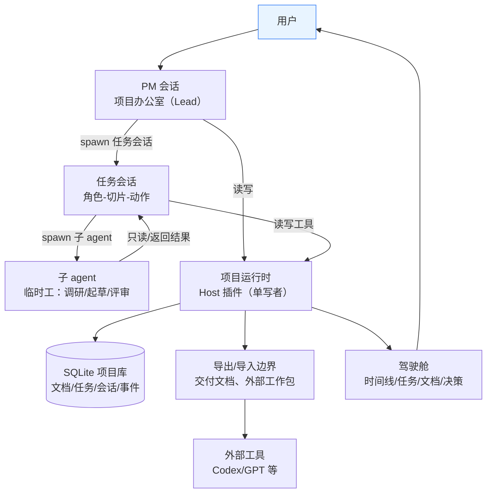

# DSH 软件项目工作台 · 目标架构 v1（施工图）

> 2026-11-11 · 目标态架构，**不是 MVP、不分期**。用户只提需求，PM 交付；架构、目录、业务预演、
> 数据流、视图都确定后一次性实现。
> 更新：Codex/GPT 已确认全部收敛 DSH 内（GPT=provider，Codex=subagent_codex，已实测可用）；
> 平台能力 PoC 已跑（SQLite/插件安装/Web bundle/自定义路由/任务会话调 Codex），见
> [research/poc-platform-capabilities.zh.md](research/poc-platform-capabilities.zh.md)；
> UI 目标改为「工作区→项目→PM（唯一对话）+ team（只读）+ 树状驾驶舱（3D 有条件）」，
> 详见 [工作台 UI 架构 v1](workbench-ui-architecture-v1.zh.md)。
> 前置研究：分层分片、DB 记忆、多工具、日程/门禁等见 docs/research/ 与主提案；本文只定义目标态。

---

## 0. 定位与原则

**工作台 = 工作区里的「项目」运行时。** 它不是一个 CLI、不是一个通用 memory 服务、不是另一个 App。

| 原则 | 含义 |
|---|---|
| 用户只对 PM | 用户只和项目办公室（PM 会话）说话；新会话也由 PM 拉起并交代任务；用户不直接指挥子会话 |
| PM 是唯一的对外接口 | PM 理解需求、拆活、拉会话、收结果、对用户汇报；子会话只对 PM 负责 |
| 会话有层级 | PM 会话 → 任务会话（角色-切片-动作）→ 子 agent（临时工）；任务会话决定活儿怎么干、拉几个子 agent |
| DB 是项目的大脑 | 项目文档、任务、会话、决策、证据、时间线全部在 DB；人和 AI 都不"读文件找项目信息"，需要什么从 DB 拿 |
| 文件只有三类 | ① 代码/测试/脚本（真正的仓库内容）；② 导出的交付文档（只导出、不回读）；③ 外部工具工作包/回执（受控导入） |
| 目标导向 | 本文是完整目标态：所有组件、所有数据流、所有视图一起定义，然后一次性实现；不拆期、不做最小原型 |
| 人只看驾驶舱 | DB 不给人看；人看驾驶舱（时间线/任务/文档/决策）；AI 看注入的 2k 上下文 + 按需查询 |

---

## 1. 总体架构



**六个组件**

| 组件 | 职责 | 不做什么 |
|---|---|---|
| PM 会话（项目办公室） | 唯一用户接口；理解需求、拆任务、拉会话、收结果、请求拍板、对用户汇报 | 不亲自写 PRD/代码；不绕过用户批准不可逆动作 |
| 任务会话 | 承接一个切片（工作项/模块）的一个角色任务；决定怎么做、拉子 agent、产出文档/证据/交接 | 不跨切片写；不直接向用户提问（问题回 PM） |
| 子 agent | 临时调研/起草/评审/测试执行；结果交回任务会话 | 不写项目记忆；不长期存在 |
| 项目运行时（Host 插件） | 单写者；DB 事务；文档版本；时间线；上下文编译；权限/门禁；导出导入 | 不是聊天入口；不替 agent 做决策 |
| SQLite 项目库 | 项目唯一事实源：文档、任务、会话、决策、证据、事件 | 不给人类直接看（人看驾驶舱） |
| 驾驶舱（Client UI） | 人看「AI 干了什么、到哪了、要不要拍板」；文档/时间线/任务/会话视图 | 不提供手工编辑项目数据（纠错走决策卡/PM） |

---

## 2. 工作区目录（目标态）

```text
<workspace>/
├─ .project/                       # 项目运行时（插件管理；DB 不入 git）
│  ├─ project.db                   # SQLite 唯一事实源（WAL）
│  ├─ project.json                 # 项目配置：名称/根/阶段模板/导出映射（可入 git）
│  ├─ exports/                     # 导出缓存（可重建，不入 git）
│  │  ├─ docs/                     # 审核通过的文档快照
│  │  └─ timeline.md               # 人读时间线快照
│  ├─ inbox/                       # 外部工具产物/回执（受控导入）
│  └─ packages/                    # 导出给外部工具的工作包（按需创建）
├─ docs/                           # 交付文档（由 .project 导出；只读，回读禁止）
│  ├─ product/PRD-xxxx.md
│  ├─ architecture/ADR-xxxx.md
│  └─ ...
├─ src/ tests/ scripts/ ...        # 代码（真正的仓库内容）
└─ README.md
```

规则：
- **.project/project.db 不入 git**；project.json 与导出的 docs 入 git。
- 交付文档的编辑入口是插件工具（DB），不是直接改 docs/ 文件；docs/ 只由导出器写入，带「generated」标记。
- 外部工具工作包/回执走 inbox，由 PM 触发导入（作为新文档版本 + 时间线事件），不做双向同步。
- 代码/测试/脚本仍由 agent 用文件工具直接改；DB 记录路径、hash、提交、归属与时间线。

---

## 3. 概念模型

| 概念 | 定义 | 粒度 |
|---|---|---|
| 项目 Project | 一个工作区对应一个项目；有阶段、周期、成员（人+会话）、配置 | 工作区 |
| 阶段 Stage | 产品→UX→架构→实现→测试→发布→复盘（可裁剪） | 项目级 |
| 切片 Slice | 可写对象：工作项 WorkItem 或模块 Module；一所有权、一生命周期 | 文档/责任边界 |
| 任务 Task | PM 分给任务会话的一个可验收单元（属于切片） | 执行单元 |
| 会话 Session | 一次执行上下文：PM 会话 / 任务会话 / 子 agent；绑定角色、切片、模型 | 执行上下文 |
| 文档 Doc | DB 中的项目文档（PRD/ADR/设计/规格/报告），有版本链 | 文档 |
| 决策 Decision | 需要人拍板的问题 + 选项/推荐/结果/理由；可选不可逆标记 | 决策 |
| 证据 Evidence | 可复核的产出：测试输出、命令结果、截图、diff、交付物 | 证据 |
| 事件 Event | append-only 时间线：一切写操作、会话起止、门禁、导入导出、导出 | 时间线 |
| 产物 Artifact | 代码/文件/外部产物引用：路径+hash+大小 | 参考物 |

---

## 4. 数据模型（DB，架构级）

```sql
projects(id, name, root, stage_template, config_json, created_at)
stages(id, project_id, key, name, status, gate, started_at, ended_at)
slices(id, project_id, type, key, title, parent_id, status, owner_role, owner_session, current_handoff, created_at, updated_at)
tasks(id, project_id, slice_id, title, status, assignee_session, acceptance_json, created_at, updated_at)
sessions(id, project_id, name, kind, role, slice_id, parent_session_id, provider, model, status, started_at, ended_at, handoff_id)
documents(id, project_id, slice_id, type, logical_key, title, status, current_version, owner_session, stage, created_at, updated_at)
doc_versions(id, document_id, version, content, content_hash, author_session, event_id, frozen, created_at)
doc_sections(id, document_id, version, heading, content, content_hash)   -- 派生、可重建；检索按章节片段
decisions(id, project_id, slice_id, title, question, options_json, recommended, status, irreversible, deadline, decided_by, rationale, created_at, decided_at)
evidence(id, project_id, slice_id, task_id, kind, uri, content_hash, command, result_summary, created_by, verified_by, created_at)
artifacts(id, project_id, slice_id, kind, path, content_hash, bytes, metadata_json, created_at)
events(id, project_id, seq, at, kind, actor_session, role, slice_id, subject_type, subject_id, payload_json)
approvals(id, project_id, stage, gate, status, evidence_ids_json, snapshot_json, approved_by, approved_at)
links(src_type, src_id, dst_type, dst_id, rel, created_at)
leases(slice_id, session_id, expires_at, reason)
exports(id, project_id, kind, path, content_hash, version, exported_at, status)
```

约束：
- documents.current_version 与 doc_versions 只增不改；冻结后不允许新版本覆盖（返工=新版本+新决策）。
- events.seq 无空洞，append-only；一切写操作在同事务里写事件。
- 单写者：只有项目运行时能写；会话通过插件工具写；无直接 DB 访问。
- 全文检索：documents 内容进 FTS5 trigram（两字词 LIKE 兜底）；结果返回片段，不返回全文。
- 驾驶舱只读：所有视图来自 DB 查询/投影；人纠错走决策卡或 PM。

---

## 5. 文档与记忆：DB 唯一源，不拆文件、不同步

**直接回答：不需要把文档拆成「文件 + DB 同步」。** 插件的本意是项目运行时，所有项目文档由 agent 通过插件工具写 DB：
写文档 = 新版本记录 + 时间线事件；读文档 = 插件工具查询/注入；人 = 驾驶舱看渲染视图；git = 导出快照。

> 关于「拆开文档」：**存储上不拆，读取上按需拆**。整篇文档按版本存在 DB（doc_versions.content）；
> 检索时返回的是章节/片段（doc_sections 从版本派生、可重建）与摘要，而不是整篇；所以 agent 永远不需要
> 「读文档文件再找信息」，而是从 DB 拿最小片段。`拆` 是检索层的事，不是存储/同步层的事。

| 对象 | 存在哪 | 谁写 | 谁读 | 文件角色 |
|---|---|---|---|---|
| 项目文档（PRD/ADR/设计/规格/报告） | DB（doc_versions） | 任务会话经工具 | PM/任务会话经工具；人经驾驶舱；导出 | 导出快照，只读 |
| 任务/会话/决策/证据/时间线 | DB | 项目运行时（由工具触发） | 驾驶舱、PM、任务会话 | 不落文件 |
| 代码/测试/脚本 | 工作区文件 | agent 文件工具 | agent/CI | 文件是本体；DB 记路径+hash+事件 |
| 外部工具产物 | inbox → 导入 DB（新版本） | PM 触发导入 | 同文档 | 工作包/回执，受控 |

**上下文装载（2k 预算）**

| 层 | 内容 | 来源 | 预算 |
|---|---|---|---|
| L0 核心 | 项目名/阶段/周期/当前切片/门禁/待决策数 | DB 查询 | 400 tokens（每步，仅变化部分刷新） |
| L1 角色卡 | 该角色读写边界/开工收工清单 | 配置 + DB | 300 |
| L2 当前切片 | 任务 + 交接 + 相关摘要 | DB 查询 | 900 |
| 余量 | 用户输入/工具结果 | — | 400 |

- 每步只刷 L0（≤150 tokens 的变化部分）；L1/L2 会话启动/切切片时注入。
- 需要更细：project_recall / project_search / doc_get，单次 ≤500 tokens、返回片段+出处+时间。
- 禁止：把文档全文塞上下文；把 DB 当聊天记录库；让 agent 直接读 docs/ 文件找项目信息。

**Codex / GPT / Claude 怎么进来（已确认：全部收敛为 DSH 内，不需要 CLI）**：

| 工具 | DSH 内形态 | 用法 | 限制 |
|---|---|---|---|
| **GPT 模型** | LLM provider（本机 profile 已注册 grsai / OpenAI-Responses，如 gpt-6.1-sol） | PM 拉起任务会话时指定 provider/model；或子 agent 用该 provider | 是"模型"不是"Codex 代理"；没有 Codex 的工具体验 |
| **真实 Codex** | 原生 Codex 子智能体（subagent-codex bundle，官方 app-server 协议，每次全新线程、无人值守、跑在父工作区） | PM/任务会话调用 subagent_codex 工具：给任务+资料，回收最终答案文本；文档类任务由父会话把答案导入 DB 成新版本；代码类任务按 permissionMode 允许其改工作区，父会话用 git diff 验收 | 一次性、不能追问、只返回最终答案；中间工具活动/stderr/工作区 diff 不进父会话；需配置 permissionMode（默认 never）；模型沿用 Codex 原生配置 |
| **Claude Code / ACP** | 同类原生 subagent provider（subagent-claude-code / subagent-acp） | 同上，按 provider 选择 | 同上（一次性/无追问） |
| **外部人工/其他工具** | 兜底：工作包导出 + inbox 导入 | PM 导出资料包 → 外部产出 → inbox → PM 审核导入新版本 | 仅在 DSH 内确实做不了时使用；不是主路径 |

> 已经实测：本机 DSH 的 subagent_codex 可用（返回真实 Codex 结果）。所以"Codex+GPT 写文档"不需要 CLI，也不需要把 Codex 桌面版接进来：
> **GPT 走 provider 会话，Codex 走 subagent_codex 委派，产物统一回到 DB 文档版本 + 时间线。**

**导出**：门禁批准时自动导出对应文档到 docs/（只写不读）；发布时打快照；导出记录进 exports 表与时间线。

---

## 6. 会话体系

### 6.1 会话类型与命名

| 类型 | 谁创建 | 命名 | 职责 |
|---|---|---|---|
| PM 会话 | 用户/工作台初始化 | 项目办公室（固定 1 个/项目） | 唯一用户接口；拆任务、拉会话、收结果、请求决策、汇报 |
| 任务会话 | PM | 角色-切片-动作（产品-支付PRD / 码农-会话保持实现） | 承接一个切片的一个角色任务；可拉子 agent |
| 子 agent | 任务会话 | 临时命名（子agent-调研/起草/评审） | 临时工；结果回任务会话；不写项目记忆 |

规则：
- 用户只和 PM 说话；任务会话/子 agent 不直接向用户提问（问题回 PM，由 PM 汇总成决策卡）。
- 同一（切片, 角色）同时只有一个 active 任务会话；再开由 PM 决定并记事件。
- 任务会话的名称是给人看的，也用于时间线过滤；工具/provider/model 存 sessions 表。
- 任务会话可拉子 agent（需 DSH maxDepth≥2 配置）；子 agent 结果只回任务会话。

### 6.2 模型/工具路由

- 每个任务会话有 provider/model（DSH 的 spawn/子 agent 支持），PM 按任务类型分派：
  - 长文档/PRD/对外说明：优先级 ① 真实 Codex（subagent_codex，一次性委派，返回草稿文本）→ ② GPT provider 会话（如 gpt-6.1-sol）→ ③ 其他强文本模型；
  - 代码/仓库操作：优先 DSH 内码农会话；需要 Codex 工具体验时委派 subagent_codex（允许改工作区时用 git diff 验收）；
  - 校验/注入/驾驶舱：DSH + DeepSeek；
  - 具体 provider/model 由项目配置声明，PM 按任务类型选，不硬编码。
- 外部 Codex/Qoder/WorkBuddy 不直接改 DB；走 §5 的受控导入边界（或用户在 DSH 内配置相应 provider）。
- PM 不硬编码模型名单：provider/model 在项目配置里声明，PM 按任务选择。

### 6.3 生命周期

```text
用户提需求
 → PM 记录 intent 事件，判断阶段，拆切片/任务
 → PM spawn 任务会话（带角色卡 + 切片简报 + 任务验收）
 → 任务会话执行（可拉子 agent），写文档/证据/交接
 → 任务会话结束（handoff）→ PM 收结果（校验）
 → PM 需要拍板 → 决策卡 → 用户答复 → 决策事件
 → 门禁通过 → 阶段推进 → 导出/快照 → 对用户汇报
```

---

## 7. 业务预演（理论跑通：支付退款）

> 目标：证明从一句话需求到发布，数据流、会话流、UI 都成立。只预演，不实现。

| 步 | 谁 | 动作 | 数据写入 | UI/人看到 | 失败处理 |
|---|---|---|---|---|---|
| 1 | 用户→PM | 「支付要能退款」 | event:intent；草拟切片 支付-退款 | PM 会话里出现需求卡 | 需求不清→PM 提问 |
| 2 | PM | 判断 S1 产品阶段；建 WorkItem 与任务；spawn 产品会话 | slices/tasks/sessions/events | 驾驶舱任务板出现任务；PM 汇报「已派产品」 | 已有同切片活跃会话→拒绝重复创建 |
| 3 | 产品会话 | 读 2k 简报；调研（子 agent）；写 PRD 新文档版本 | documents/doc_versions/events | 文档视图出现 PRD v1 | 缺信息→回 PM 问题 |
| 4 | 产品会话 | 交 handoff；PM 校验；生成 G1 决策卡 | tasks 状态；decisions；events | 决策收件箱出现「PRD 认不认」 | 用户不答→超时规则 |
| 5 | 用户 | 批准 PRD | decisions 落定；stage→UX；文档冻结；导出 docs/product/PRD | 时间线出现「用户批准 PRD」；阶段徽章变化 | 驳回→新版本+事件 |
| 6 | PM | spawn UX 会话、架构会话（并行） | sessions/tasks/events | 会话总览显示角色/模型/切片 | 资源冲突→排队 |
| 7 | UX/架构会话 | 写 UX 文档/ADR/契约；拉子 agent 做评审 | docs/evidence/events | 文档版本 diff；证据列表 | 评审失败→返工版本 |
| 8 | PM | 架构门禁 → 用户批准 → 进入实现 | approvals；stage→实现；冻结 ADR/契约 | 门禁卡片；时间线 | 证据缺失→拒绝提交 |
| 9 | PM | 拆实现任务；spawn 码农会话（可多个切片） | tasks/sessions；写作用域 lease | 任务板；会话列表 | 同切片冲突→lease 拒绝 |
| 10 | 码农会话 | 改代码文件；跑测试；写实现文档/证据；子 agent 帮忙 | artifacts/evidence；code 文件；events | 时间线「改了哪些文件」；文档 | 测试失败→证据记录+返工 |
| 11 | PM | 收实现交接；spawn 测试会话 | tasks/sessions/events | 待验收任务 | 交接不完整→退回 |
| 12 | 测试会话 | 独立验证；写验收证据；结论 | evidence；events | 验收卡；证据链 | 失败→缺陷任务回实现 |
| 13 | 用户 | 验收门禁 | approvals；stage→发布 | 时间线「用户验收」 | 拒收→返工 |
| 14 | PM | 发布；导出快照；复盘任务 | exports；events；复盘文档 | 项目总览更新；时间线完整 | 回滚→版本+事件 |

**贯穿检查**：每一步都能回答「谁、在哪个切片、做了什么、依据什么、结果如何」；人只看驾驶舱；AI 只读 2k + 按需查 DB。

---

## 8. 数据流与不变量

### 8.1 写路径

| 写入者 | 路径 | 产物 | 约束 |
|---|---|---|---|
| PM | 插件工具（切片/任务/会话/决策/门禁） | slices/tasks/sessions/decisions/approvals/events | 必须挂 project/slice/actor |
| 任务会话 | 插件工具（文档/证据/交接/状态） | documents/doc_versions/evidence/tasks/events | 受 lease/写作用域/阶段策略约束 |
| 子 agent | 只回任务会话，不直接写 | 产物文本/建议 | 不写 DB |
| 项目运行时 | 事件驱动/定时 | events/exports | append-only；导出只写文件 |
| 用户 | 决策卡/纠错 | decisions/events | 只通过 UI/PM；不可逆需明确确认 |

### 8.2 读路径

- AI：上下文编译（2k）+ project_recall/search/doc_get/timeline（≤500/次）。
- UI：只读查询/投影（sessions/timeline/docs/decisions/tasks），不做多源聚合逻辑。
- 导出：按文档冻结/门禁/发布，把 DB 渲染为 docs/ 快照。

### 8.3 不变量（实现验收的硬条件）

1. 每笔写都有 events 且 seq 无空洞；时间线可从事件重放。
2. 文档只增版本；冻结后不可改；返工=新版本。
3. 单写者：无任何组件绕过插件直接写 DB。
4. 每个任务/会话必须能回答「谁、哪个切片、干什么、结果」。
5. 人只看驾驶舱；AI 不依赖 docs/ 文件获取项目信息。
6. 不变量：代码文件是代码的本体；项目文档的正文在 DB；外部产物只经 inbox 导入。
7. 2k 注入预算硬限制；超出即裁剪/按需查询。
8. 用户只与 PM 交互；任务会话不直接向用户提问。
9. 导出单向：DB→文件；文件不回读（外部导入是显式新版本）。
10. 门禁/不可逆动作必须人批准；agent 不能代批。

---

## 9. 视图与 UI（驾驶舱）

> 完整 UI 架构见 [workbench-ui-architecture-v1.zh.md](workbench-ui-architecture-v1.zh.md)。
> 目标形态：**工作区 → 项目面板 → PM（唯一对话）/ team（只读）/ 树状驾驶舱（3D 可选）**；
> 不改 DSH 外壳，通过 main 面板 + sidebar.panellist + session header utilities + composer dock + agentTeam 投影实现；
> 核心会话列表不可替换，原始会话作为兜底保留（只读靠产品层保证，平台无 session 只读机制）。

| 视图 | 内容 | 数据源 |
|---|---|---|
| 总览 | 阶段/周期、进度、活跃会话、待决策数、最近时间线 | DB 查询 |
| 时间线 | 谁（角色/会话）→ 在哪个切片 → 做了什么 → 关联文档/决策/证据 → 时间；可过滤 | events |
| 任务板 | 切片/任务状态、owner、阻塞、验收 | slices/tasks |
| 文档 | 文档列表/类型/状态/版本；版本 diff；冻结/导出状态；搜索 | documents/doc_versions |
| 决策收件箱 | 待拍板：问题/选项/推荐/不返工后果；答复 | decisions |
| 会话 | PM/任务/子 agent：名称、角色、切片、provider/model、状态、开始/结束 | sessions |
| 证据墙 | 按切片/门禁列证据，可回溯 | evidence |
| 设置 | 阶段模板、provider/model 路由、导出映射、2k 预算 | config/DB |

会话内：项目徽章（阶段/切片/待决策）；PM 聊天卡（需求卡、决策卡、收工回执）；文档预览卡（渲染视图，不打开文件）。

---

## 10. 与 DSH 的映射

| 需求 | DSH 机制 | 约束/假设 |
|---|---|---|
| 用户只与 PM 交互 | Lead 会话 + 项目 presets | PM 是唯一项目办公室会话；用户可打开其他会话但 PM 是入口 |
| PM 拉任务会话 | spawn_teammate（Lead 专属）；teammate 独立会话 | 团队上限/任务板上限；命名与切片元数据由插件或 PM 工具维护 |
| 任务会话拉子 agent | subagent / subagent_codex / subagent_claude_code 工具；Host 配置 maxDepth | 默认 maxDepth=1，需配置 ≥2；Codex/Claude 为一次性外部激活，结果回任务会话 |
| GPT/Claude 模型会话 | llm provider（grsai、pi-ai/Anthropic）+ spawnTeammate(provider) | 需在 profile 配好 provider；模型选择在项目配置声明 |
| 真实 Codex 写文档/代码 | subagent-codex bundle（app-server） | 一次性、无追问、只回最终答案；permissionMode 控制 workspace 写权限 |
| provider/model 路由 | spawnTeammate 的 provider；llm 提供者注册 | 需要先配置对应 provider；外部 Codex 走导入边界 |
| 每步注入 2k | systemPrompt.section（每步、不进历史）+ context（变化才追加） | 无压缩前钩子；关键约束放 section |
| 按需查询 | 插件工具（project_search/doc_get/recall/timeline） | 返回片段+出处；≤500 tokens |
| 驾驶舱 | Client Panel + slots + projection + actionCards | 不轮询；不做第二套团队 UI |
| 决策/门禁 | actionCards + userQuestions + Remote | 人身份批准；不可逆二次确认 |
| DB | 插件内 node:sqlite（WAL） | 单写者；DB 不入 git；导出快照入 git |
| 定时 | schedule 包 | 日报/周报/周期整理 |
| 隔离 | worktrees（码农切片） | 写作用域 + lease |

**必须验证的两个假设（实现前核对）**：① Host 可配置 provider 并用 spawnTeammate 指定；② maxDepth 可调到 ≥2 且任务会话拿到 subagent 工具。若②不可调，任务会话自己执行、PM 负责拆细（不改变架构，只改变分工深度）。

---

## 11. 一次性实现的验收清单（"做完"的标准）

- [ ] 数据流预演 §7 的 14 步可完整回放；任一时刻驾驶舱能回答三问（在做什么/依据/下一步）。
- [ ] 时间线：过滤/追溯任意事件到会话、切片、文档版本、决策、证据。
- [ ] 文档：新建/新版本/冻结/导出/导入外部产物全流程；旧版本可查不可改。
- [ ] 上下文：2k 装载符合预算；超出降级；注入内容带来源与状态。
- [ ] 会话：PM 拉任务会话；任务会话拉子 agent；命名/角色/切片/模型可查；用户不直接进子会话对话。
- [ ] 决策：PM 汇总问题；用户答复；不可逆动作必须人批。
- [ ] 导出：门禁/发布导出 docs/ 快照；文件不回读；导入外部产物形成新版本。
- [ ] 恢复：DB 备份/重建；导出可重生成；进程重启会话可恢复。
- [ ] 权限：写作用域/阶段策略/单写者/用户边界全部有负向测试。

---

## 12. 待确认（影响实现，非分期）

1. ~~外部 Codex/GPT 的接入边界~~ **已确认：全部收敛为 DSH 内**（GPT=provider 会话，Codex=subagent_codex；工作包导入仅作兜底）。
2. ~~导出时机~~ **已确认**：门禁批准时导出 + 发布快照；文档冻结不必每次导出。
3. ~~项目目录名~~ **已确认**：.project/；DB 不入 git，project.json + 导出 docs 入 git。
4. **provider 清单**：哪些模型/provider 要在 DSH 配好（DeepSeek/OpenAI/其他）。
5. ~~PM 会话数量~~ **已确认**：一个项目一个 PM；换人接手新建 PM 会话并继承 handoff。
6. ~~任务会话可见性~~ **已确认**：用户可只读查看（项目面板内），不能直接对话；原始会话可兜底打开但提示回 PM。
7. **maxDepth**：确认可配置为 2；否则子 agent 由 PM 直接拉，任务会话不拉。
8. **文档冻结粒度**：门禁级冻结 vs 文档级冻结（建议门禁级）。

> UI 相关待定：3D 是否纳入目标态（取决于 client bundle/性能评估）；项目面板单面板切项目 vs 每项目一面板；
> 侧栏原始会话列表无法替换，是否接受其作为兜底入口。

---

> 本文是施工图，不是实现。通过后按此一次性实现；实现期间不改架构，只修 bug。
>
> **状态（2026-11-11）：施工图 v1 冻结，用于实现。** Team 只读视图暂缓（见 UI 文档）；
> 实现启动提示词：[kickoff-implementation-prompt.zh.md](kickoff-implementation-prompt.zh.md)。
